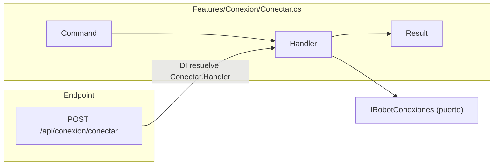

---
proyecto:
  - Ocelotl.Hermes
  - Ocelotl.Iris
  - Itzamna.Dionisio
  - ReporteriaAzure
proyectos:
  - "[[Ocelotl.Hermes]]"
  - "[[Ocelotl.Iris]]"
  - "[[Itzamna.Dionisio]]"
  - "[[ReporteriaAzure]]"
tipo: arquitectura
nivel: intermedio
estado: completo
tags:
  - conocimiento
  - arquitectura
  - vertical-slices
progreso: pendiente
area: Arquitectura y patrones
---
# Vertical Slice Architecture

> Organizar el código por caso de uso (una "rebanada" de punta a punta) en lugar de por capa técnica.

## Qué es y qué problema resuelve
En una arquitectura por capas, un cambio pequeño ("agregar el campo X al dispensado") toca un controlador, un servicio, un repositorio y varios DTO repartidos en carpetas distintas. Vertical Slice (popularizada por Jimmy Bogard) agrupa **todo lo de un caso de uso en un solo lugar**: su entrada, su salida y su lógica. Se minimiza el acoplamiento *entre* slices y se acepta algo de duplicación entre ellos.

## Cómo funciona por dentro
- Cada caso de uso es una unidad: **Command** (escribe) o **Query** (lee), un **Result** y un **Handler**.
- Los slices no se llaman entre sí; lo compartido se reduce a lo mínimo (validaciones comunes, puertos hacia fuera).
- Un mecanismo une la petición con su handler: MediatR, un despachador propio o, como en Hermes, la propia [[Inyección de dependencias]].



## Cuándo usarla y cuándo no
Úsala cuando la aplicación crece por funcionalidades independientes y los cambios suelen ser "verticales". Evítala (o combínala) si hay un modelo de dominio rico con reglas compartidas por muchos casos de uso: ahí conviene un dominio central fuerte.

### Ventajas
- Un caso de uso se entiende abriendo **un archivo**.
- Agregar una funcionalidad no rompe otras.
- Cada slice puede elegir su forma (uno usa SQL directo, otro un repositorio) sin imponerla a todos.
- Pruebas por caso de uso, con fakes de los puertos.

### Desventajas
- Duplicación entre slices si no se vigila.
- Sin convención clara, cada slice "inventa" su estilo.
- Lo transversal (validación, errores, autorización) necesita otro mecanismo (filtros, middleware).

## Alternativas
| Alternativa | En qué se diferencia |
|---|---|
| Capas por tipo técnico (Controllers/Services/Repositories) | Un caso de uso se reparte en varias carpetas. |
| Slices con MediatR | Igual organización, pero un mediador despacha `IRequest` → `IRequestHandler` y permite *behaviors* (pipeline). Hermes lo evita. |
| [[Clean Architecture]] pura | Organiza por capa; en Hermes se usa *por fuera* (proyectos) y los slices *por dentro* de Application. |
| Feature folders en front | El equivalente en UI: una carpeta por pantalla (lo que hace Iris). |

## Cómo se usó en Ocelotl
**[[Ocelotl.Hermes]]** — `Application/Features/<Area>/<CasoDeUso>.cs`, sin MediatR. Áreas: `Conexion`, `Stock`, `Dispensado`, `Egresos`, `Ingreso`, `Sesion`, `Trazabilidad`. Ejemplo de Query real, `Ocelotl.Hermes/src/Ocelotl.Hermes.Application/Features/Conexion/ObtenerEstado.cs`:

```csharp
public static class ObtenerEstado
{
    public sealed record Query(string IpAddress);

    public sealed record Result(string RobotId, bool Conectado, string Estado, DateTimeOffset? ConectadoDesde);

    public sealed class Handler(IRobotConexiones robots)
    {
        public Result Handle(Query query)
        {
            var ip = Validar.DireccionIp(query.IpAddress);
            var conexion = robots.ObtenerConexion(ip);
```

El endpoint pide el handler directamente (`Ocelotl.Hermes/src/Ocelotl.Hermes.Api/Controllers/ConexionController.cs`):

```csharp
[HttpPost("conectar")]
public Task<Conectar.Result> ConectarRobot(
    [FromBody] Conectar.Command cmd, [FromServices] Conectar.Handler h, CancellationToken ct) =>
    h.Handle(cmd, ct);
```

**Registro automático** por convención: toda clase anidada llamada `Handler` (`Ocelotl.Hermes/src/Ocelotl.Hermes.Application/DependencyInjection.cs`):

```csharp
internal static IEnumerable<Type> Handlers(Assembly? ensamblado = null) =>
    (ensamblado ?? typeof(DependencyInjection).Assembly).GetTypes()
        .Where(t => t is { Name: "Handler", IsClass: true, IsAbstract: false, IsNested: true });
```

Se registran como *scoped*; si además implementan `IReaccionEvento` se exponen también por esa interfaz (ver [[Eventos de dominio y reacciones]]). La prueba `Registra_todos_los_handlers_de_los_slices` en `tests/Ocelotl.Hermes.Application.Tests/SlicesTests.cs` vigila la convención.

Lo transversal no está en los slices: validación con `Application/Common/Validar.cs`, errores a [[ProblemDetails]] en `Api/Errores/ManejadorErrores.cs` y sesión con el atributo `[RequiereSesion]` en cada controller.

**[[Ocelotl.Iris]]** — el equivalente en el front es `src/features/<pantalla>/` (`login`, `inicio`, `ingresos`, `dispensar`, `configuracion`, `reportes`, `soporte`), cada una autocontenida: "una pantalla nunca importa el service de otra" (README de Iris). Su forma interna es el [[Molde Service-View-Handlers-Events]].

Funcionalidades: todas, p. ej. [[Conexión de robots]], [[Dispensar]], [[Ingresos]], [[Historial de salidas]].


## Cómo se usó en Itzamna
**Respuesta corta: [[Itzamna.Dionisio]] no es vertical slice en sentido estricto.** Es [[Clean Architecture]] por proyectos con **carpetas por funcionalidad + CQRS** dentro de Application. Toma ideas de los slices (un handler por caso de uso, validador junto al comando), pero la rebanada no va "de punta a punta".

Cómo está organizado `Itzamna.Dionisio/src/Itzamna.Dionisio.Application/Features/`:

| Carpeta | Archivos | Contenido |
|---|---|---|
| `Me/` | `EnsureCreator.cs` | crear creador + portfolio en el primer acceso |
| `Portfolios/` | `GetStudioPortfolio.cs`, `UpdateModules.cs` | borrador y módulos 1:1 (perfil, hero, about, contacto, SEO…) |
| `Collections/` | `Socials.cs`, `Metrics.cs`, `Categories.cs`, `Content.cs`, `Services.cs`, `Collaborations.cs`, `Recommendations.cs` | guardar / borrar / reordenar por colección |
| `Media/` | `MediaFeatures.cs` | subir, listar, editar, usos, borrar |
| `Publishing/` | `PublishingFeatures.cs` | preview, publicar, versiones, restaurar, despublicar |
| `Public/` | `GetPublicPortfolio.cs` | lectura anónima |
| `Templates/` | `ListTemplates.cs` | catálogo |

Cada archivo agrupa **varios** casos de uso del módulo, cada uno con su `record` (`IRequest<T>`), su validador opcional y su handler `sealed` ([[CQRS y mediador]]). Ejemplo: `Socials.cs` tiene `SaveSocialProfileCommand` + `SaveSocialProfileValidator` + `SaveSocialProfileHandler`, `DeleteSocialProfileCommand` + handler y `ReorderSocialProfilesCommand` + handler.

Lo que **se parece** a vertical slice:
- Un handler por caso de uso; el controller solo hace `Sender.Send(...)`.
- Validación del comando en el mismo archivo.
- Agregar una colección nueva (como `Recommendations`) se hizo agregando un archivo en `Collections/` sin tocar los demás handlers.

Lo que **no** es vertical slice:
- **Los DTOs no son del slice**: viven en el proyecto compartido `Itzamna.Dionisio.Contracts` (`StudioDtos.cs`, `PublicPortfolioDto.cs`) y se reutilizan entre casos de uso.
- **El endpoint vive en otra capa**: `API/Controllers/` agrupa por recurso (`CollectionsController` sirve las siete colecciones).
- **Mucho código compartido entre handlers**: `PortfolioData.LoadAsync` (carga todo el borrador; lo usan preview, publicar, listar medios sin uso y borrar medios), `StudioMapping`, `TenantExtensions`, `ReorderAsync`/`NextOrderAsync`, `TouchPortfolioAsync`, `PortfolioSnapshotBuilder`.
- **Reglas transversales en la infraestructura**, no en el slice: filtros de tenant y borrado lógico, auditoría ([[Multi-tenancy]], [[Borrado lógico y auditoría]]).
- Un archivo por **módulo**, no por caso de uso (Hermes: un archivo por caso de uso).

Comparado con [[Ocelotl.Hermes]]: Hermes sí es vertical slice dentro de Application (un archivo por caso de uso, `Command/Result` propios anidados, sin mediador). Dionisio está más cerca de "Clean Architecture + CQRS con feature folders".

> [!note] Pendiente de confirmar
> El repo no se autodefine como vertical slice: `.ai/01_ARCHITECTURE.md` dice "Features por módulo". La clasificación de arriba es una lectura del código, no una decisión documentada.


## Cómo se usó en ReporteriaAzure
[[ReporteriaAzure]] tiene un solo slice: `Application/Features/Tableros/ConsultarTablero.cs`, una clase estática con `Query`, `Item`, `Handler` y `Mapeo` en el mismo archivo. No usa mediador: el controller recibe el `Handler` directo.

`AddApplication()` registra por reflexión toda clase anidada que se llame `Handler`, así que un slice nuevo no necesita tocar el registro:

```csharp
// ReporteriaAzure/Application/DependencyInjection.cs
var handlers = typeof(DependencyInjection).Assembly.GetTypes()
    .Where(t => t is { Name: "Handler", IsClass: true, IsAbstract: false, IsNested: true });

foreach (var handler in handlers)
    services.AddScoped(handler);
```

Antes estaba repartido por capa técnica (`ConsultaInfo/Services`, `Interfaces`, `Models/Azure`, `Models/Request`, `Models/Response`).

## Errores comunes y buenas prácticas
- **Slices que se llaman entre sí.** Si dos necesitan lo mismo, se extrae a un puerto o a `Common`, o se duplica conscientemente (en Iris, cada pantalla redeclara su `EndPoint`).
- **Lógica en el endpoint.** En Hermes cada endpoint es una línea que delega.
- **Romper la convención de nombres**: si una clase no se llama `Handler`, no se registra. La prueba de registro lo detecta.
- Mantener Command/Result como `record` inmutables y propios del slice (no reutilizar DTO de otro slice).

## Qué estudiar después
- [[Clean Architecture]] y [[Arquitectura hexagonal]]
- [[ASP.NET Core Controllers]] (parámetros resueltos por DI en los endpoints)
- [[Inyección de dependencias]] (registro por reflexión, lifetimes)
- CQRS (separar Command y Query)
- [[Molde Service-View-Handlers-Events]]

## Documentación oficial
- https://www.jimmybogard.com/vertical-slice-architecture/

## Autoevaluación

Contesta primero en voz alta o en papel; luego despliega la respuesta.

> [!question]- ¿Qué agrupa un *slice* y qué se acepta a cambio?
> Todo lo de un caso de uso (entrada, handler, salida, validación) en un lugar. Se acepta algo de duplicación entre slices a cambio de bajo acoplamiento entre ellos.

> [!question]- ¿Cuándo preferirías un dominio central fuerte sobre slices independientes?
> Cuando muchas operaciones comparten reglas de negocio ricas (invariantes de un agregado). Ahí las reglas viven en el dominio y los slices solo orquestan.

> [!question]- Un slice necesita lógica que ya está en otro slice. ¿Qué haces?
> No llamar al otro handler. Extrae lo común a un servicio de dominio, a una entidad o a un puerto compartido; o tolera la duplicación si es pequeña y puede divergir.

> [!question]- ¿Cómo resuelves lo transversal (validación, logging, transacciones) en VSA?
> Con *pipeline behaviors* del mediador, filtros o middleware: un solo punto que envuelve a todos los handlers ([[CQRS y mediador]]).

