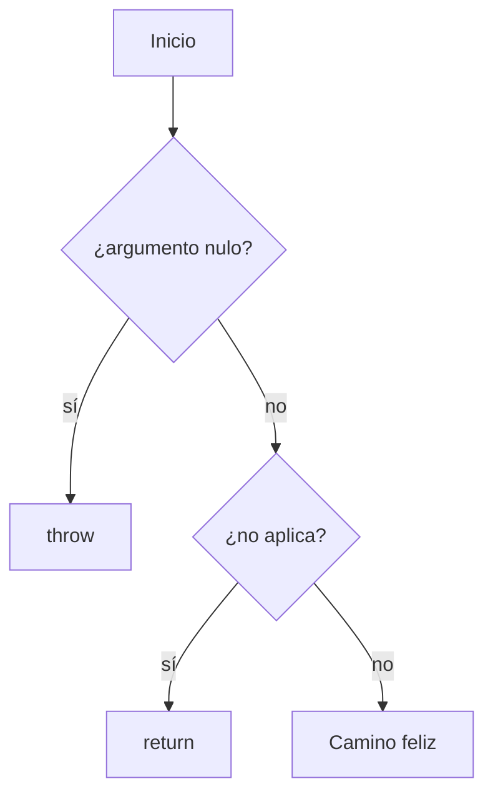

# Guard clauses

Parte de: [[09-Arquitectura-Patrones/02 Patrones de diseño/_Índice Patrones de diseño|Patrones de diseño]]

> [!info] Cómo avanzar
> `progreso`: **pendiente** → **viendo** (estudiando) → **visto** (contestaste la autoevaluación sin abrir las respuestas) → **dominado** (hiciste el laboratorio o lo aplicaste de verdad).

## Contenido

### Qué es
Una *guard clause* (cláusula de guarda) es una comprobación **al inicio de un método** que termina la ejecución temprano (`return`, `throw` o `continue`) cuando una precondición no se cumple. En lugar de envolver el camino feliz en varios `if` anidados, "despejas" los casos inválidos primero y el código principal queda al final, sin indentación. Sirve para leer un método de arriba abajo como una lista de condiciones seguida de lo que realmente hace.

### Cómo funciona
1. Identifica cada condición que impide continuar (argumento nulo, colección vacía, estado que no aplica).
2. **Invierte** la condición y sal del método si se cumple.
3. Repite para cada condición, una por línea.
4. Lo que queda al final es el camino feliz.



Hay dos tipos de salida, y elegir bien importa:
- **`throw`** cuando la condición es un **error de programación**: alguien llamó al método con un argumento que nunca debió pasar (nulo, índice negativo). Es un contrato roto.
- **`return`** (o un resultado) cuando la condición es un **caso válido** que simplemente no requiere trabajo (pedido ya pagado, lista vacía).

### Helpers de .NET
.NET moderno trae métodos estáticos para guardas de argumentos, que además ponen el nombre del parámetro automáticamente gracias a `CallerArgumentExpression`:

```csharp
public sealed class CobroService(IPasarelaPagos pasarela)
{
    public async Task<Recibo> CobrarAsync(Pedido pedido, string referencia, decimal monto, int intentos)
    {
        ArgumentNullException.ThrowIfNull(pedido);                  // .NET 6+
        ArgumentException.ThrowIfNullOrWhiteSpace(referencia);      // .NET 8+
        ArgumentOutOfRangeException.ThrowIfNegativeOrZero(monto);   // .NET 8+
        ArgumentOutOfRangeException.ThrowIfGreaterThan(intentos, 5);

        if (pedido.Pagado) return Recibo.YaPagado(pedido.Id);       // caso válido: salir

        return await pasarela.CobrarAsync(pedido.Id, referencia, monto);
    }
}
```

Otros: `ArgumentException.ThrowIfNullOrEmpty`, `ArgumentOutOfRangeException.ThrowIfNegative`, `ThrowIfZero`, `ThrowIfLessThan`, `ObjectDisposedException.ThrowIf`. Son más cortos que escribir el `if` y el `throw new ArgumentNullException(nameof(x))` a mano.

### Ejemplo
Antes, con "pirámide" de `if`:

```csharp
public void Procesar(Solicitud? s)
{
    if (s != null)
    {
        if (s.Activa)
        {
            if (s.Archivos.Count > 0)
            {
                foreach (var a in s.Archivos) Guardar(a);
            }
        }
    }
}
```

Después, con guardas:

```csharp
public void Procesar(Solicitud? s)
{
    ArgumentNullException.ThrowIfNull(s);
    if (!s.Activa) return;
    if (s.Archivos.Count == 0) return;

    foreach (var a in s.Archivos) Guardar(a);
}
```

Mismo comportamiento (salvo que ahora un nulo es un error explícito, que es lo correcto si nunca debía llegar nulo), menos indentación y cada regla en una línea.

### Guard clause o validación de negocio
No confundas las guardas con la validación de lo que escribe el usuario:

| | Guard clause | Validación de entrada / negocio |
|---|---|---|
| Qué detecta | Errores de programación, contratos rotos | Datos inválidos que el usuario puede corregir |
| Cómo responde | Excepción (`ArgumentException`), termina en 500 si escapa | Mensajes amigables, 400/422 con [[ProblemDetails]] y `codigo` |
| Dónde | Dentro de métodos, constructores, value objects | En el borde: [[FluentValidation]] del command, o un [[Result pattern vs excepciones|Result]] del dominio |

En un slice típico del usuario: el validador de FluentValidation revisa el `Command` (RFC con formato, importe mayor a cero) y devuelve un 400 con detalles; dentro del handler y del dominio, las guardas protegen contra nulos que "no deberían pasar nunca". Si un usuario puede provocar la condición, no es una guarda con excepción, es validación.

### Cuándo usarlo y cuándo no
- **Úsalo** en cualquier método con precondiciones o con casos que no requieren trabajo; es casi siempre una mejora.
- **No lo uses** para reemplazar la validación de entrada del usuario con excepciones, ni para esconder lógica compleja: si tienes 10 guardas, quizá el método hace demasiado.

### Errores comunes
1. **Usar excepciones de guarda para errores del usuario:** terminan como 500 o en un `catch` genérico. Valida en el borde.
2. **Guardas con efectos secundarios** (escribir logs, modificar estado) que hacen difícil saber qué pasa al salir.
3. **Mezclar guardas en medio del método:** ponlas todas al inicio; si una condición solo aplica a la mitad, extrae un método.
4. **Duplicar las mismas guardas en cada capa:** valida una vez en el borde y protege los invariantes en el dominio; no repitas en cada método intermedio.
5. **Olvidar habilitar `nullable`:** con `<Nullable>enable</Nullable>` el compilador ya te avisa de muchos nulos; la guarda cubre lo que llega de afuera.

### Para profundizar
- [Replace Nested Conditional with Guard Clauses (Refactoring.Guru)](https://refactoring.guru/refactoring/techniques/simplifying-conditional-expressions/replace-nested-conditional-with-guard-clauses)
- [ArgumentNullException.ThrowIfNull (Microsoft Learn)](https://learn.microsoft.com/en-us/dotnet/api/system.argumentnullexception.throwifnull)
- [ArgumentOutOfRangeException.ThrowIfNegative (Microsoft Learn)](https://learn.microsoft.com/en-us/dotnet/api/system.argumentoutofrangeexception.throwifnegative)

## Ejercicios

Resuélvelos en papel o en la herramienta; la solución está plegada.

> [!question]- Refactoriza con guard clauses:
```csharp
if (pedido != null) {
  if (pedido.Lineas.Count > 0) {
    if (!pedido.Pagado) { Cobrar(pedido); }
  }
}
```
> ```csharp
> ArgumentNullException.ThrowIfNull(pedido);
> if (pedido.Lineas.Count == 0) return;
> if (pedido.Pagado) return;
> Cobrar(pedido);
> ```
> Cada condición de salida queda en una línea y el camino feliz queda al final sin indentación.

## Autoevaluación

Contesta primero en voz alta o en papel; luego despliega la respuesta.

> [!question]- ¿Qué es una guard clause?
> Una comprobación al inicio del método que sale temprano (`return` o `throw`) si una precondición no se cumple, evitando `if` anidados.

> [!question]- Helpers de .NET para guardas de argumentos.
> `ArgumentNullException.ThrowIfNull(x)`, `ArgumentException.ThrowIfNullOrEmpty(s)`, `ArgumentOutOfRangeException.ThrowIfNegative(n)` (disponibles en .NET moderno).

> [!question]- ¿Guard clause o validación de negocio?
> Guardas: errores de programación en argumentos (excepción). Validación de entrada del usuario: [[Result pattern vs excepciones|Result]] o validadores (FluentValidation) con mensajes amigables.

