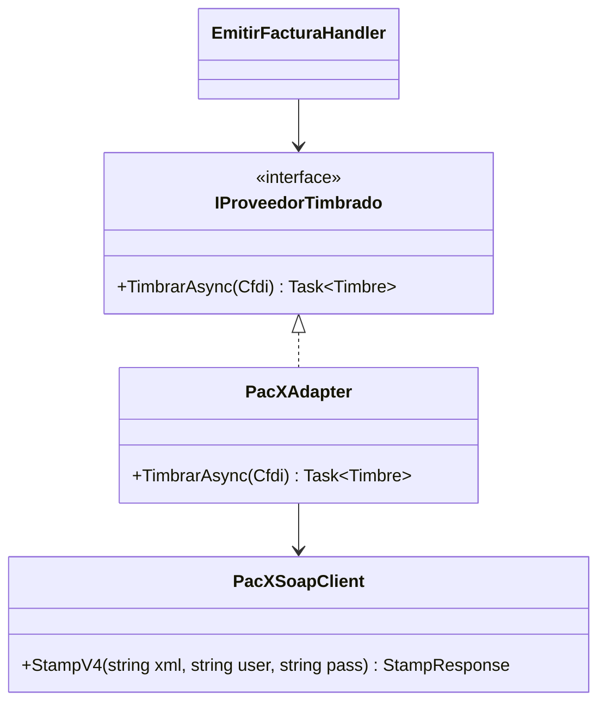

# Patrón Adapter

Parte de: [[09-Arquitectura-Patrones/02 Patrones de diseño/_Índice Patrones de diseño|Patrones de diseño]]

> [!info] Cómo avanzar
> `progreso`: **pendiente** → **viendo** (estudiando) → **visto** (contestaste la autoevaluación sin abrir las respuestas) → **dominado** (hiciste el laboratorio o lo aplicaste de verdad).

## Contenido

### Qué es
*Adapter* (adaptador) es un patrón estructural del libro GoF que **convierte la interfaz de una clase en otra interfaz que el cliente espera**. Es el adaptador de corriente de un viaje: el aparato y el contacto no cambian, el adaptador los hace compatibles. En código sirve para usar una librería, un SDK o un sistema legado **sin que su forma se filtre** a tu código: tu código habla con tu interfaz, y el adaptador traduce hacia la API ajena.

### Cómo funciona
Participantes:
- **Target:** la interfaz que tu código quiere usar (`IEnvioCorreo`).
- **Adaptee:** la clase existente con otra interfaz (el SDK de un proveedor).
- **Adapter:** implementa `Target` y por dentro llama al `Adaptee`, traduciendo tipos, nombres, errores y unidades.
- **Client:** tu caso de uso, que solo conoce `Target`.



### Ejemplo
Facturación electrónica: el proveedor de timbrado (PAC) ofrece un cliente SOAP con su propio modelo y códigos de error. Tu slice no debería saberlo.

```csharp
// Puerto: lo define tu aplicación, con tu lenguaje
public interface IProveedorTimbrado
{
    Task<ResultadoTimbrado> TimbrarAsync(string xmlCfdi, CancellationToken ct);
}

public sealed record ResultadoTimbrado(bool Exito, string? Uuid, string? Codigo, string? Mensaje);

// Adaptador: traduce hacia el SDK del proveedor (clase generada, con otra forma)
public sealed class PacXAdapter(PacXSoapClient cliente, IOptions<PacXOpciones> op) : IProveedorTimbrado
{
    public async Task<ResultadoTimbrado> TimbrarAsync(string xmlCfdi, CancellationToken ct)
    {
        var resp = await cliente.StampV4Async(
            Convert.ToBase64String(Encoding.UTF8.GetBytes(xmlCfdi)),
            op.Value.Usuario, op.Value.Password);

        return resp.Status switch
        {
            "OK" => new(true, resp.Uuid, null, null),
            "307" => new(false, null, "CFDI_YA_TIMBRADO", "El comprobante ya estaba timbrado."),
            _ => new(false, null, "PAC_ERROR", resp.Message)
        };
    }
}

// Registro: cambiar de PAC = cambiar esta línea y escribir otro adaptador
builder.Services.AddScoped<IProveedorTimbrado, PacXAdapter>();
```

Fíjate en lo que traduce: el formato (Base64), las credenciales (que vienen de configuración, fuera del repo), y sobre todo los **errores** del proveedor a tus códigos (`CFDI_YA_TIMBRADO`), que luego terminan en el `codigo` de [[ProblemDetails]].

### Adapter vs Decorator
Ambos envuelven un objeto, pero con intención opuesta:
- **Adapter cambia la interfaz** y conserva el comportamiento: entra `IProveedorTimbrado`, sale una llamada a `StampV4`.
- **[[Patrón Decorator|Decorator]] conserva la interfaz** y agrega comportamiento: entra `IProveedorTimbrado`, sale otra llamada a `IProveedorTimbrado` con logging, caché o reintentos alrededor.

Si tu clase implementa la misma interfaz que recibe, es decorator; si implementa una y usa otra distinta, es adapter.

### Dónde aparece en arquitectura hexagonal
En [[Arquitectura hexagonal]], los **adaptadores son literalmente este patrón**: los puertos son interfaces que define la aplicación, y los adaptadores secundarios (de salida) los implementan contra SQL, Blob, colas o APIs externas. Los adaptadores primarios (de entrada), como un controller, traducen HTTP a un comando. La regla del usuario, "hexagonal solo en bordes", significa justamente esto: usa un puerto + adaptador donde hay una integración externa que puede cambiar o que quieres aislar en pruebas (PAC, correo, almacenamiento), no para cada consulta a tu propia base, que ya vive en archivos `.sql` con su interfaz por consulta.

Un adaptador a escala de modelo completo, que protege tu dominio de un sistema entero, se convierte en una [[Anti-corruption layer]].

### Cuándo usarlo y cuándo no
- **Úsalo** con SDKs de terceros, sistemas legados, APIs que podrías cambiar, o para poder sustituir una dependencia en pruebas.
- **No lo uses** para envolver tu propio código "por si acaso" o para APIs estables de .NET (no adaptes `ILogger`).

### Errores comunes
1. **Adaptador que filtra tipos ajenos:** devolver `StampResponse` del SDK en la interfaz anula el propósito.
2. **Lógica de negocio dentro del adaptador:** solo traduce; las reglas viven en el slice o dominio.
3. **Interfaz copiada del proveedor:** si tu puerto tiene los mismos métodos y nombres que el SDK, no aislaste nada. Diseña el puerto con lo que tu caso de uso necesita.
4. **No traducir errores:** dejar que escapen excepciones del SDK hasta el controller.

### Para profundizar
- [Adapter (Refactoring.Guru)](https://refactoring.guru/design-patterns/adapter)
- [Patrón Anti-corruption Layer (Azure Architecture Center)](https://learn.microsoft.com/en-us/azure/architecture/patterns/anti-corruption-layer)

## Autoevaluación

Contesta primero en voz alta o en papel; luego despliega la respuesta.

> [!question]- ¿Qué hace Adapter?
> Traduce la interfaz de una clase existente (a menudo de terceros) a la interfaz que tu código espera.

> [!question]- Adapter vs [[Patrón Decorator]].
> Adapter cambia la interfaz (traduce); Decorator mantiene la misma interfaz y agrega comportamiento.

> [!question]- ¿Dónde aparece en [[Arquitectura hexagonal]]?
> Los adaptadores secundarios implementan tus puertos traduciendo a la API del proveedor (SDK, HTTP, SQL).

