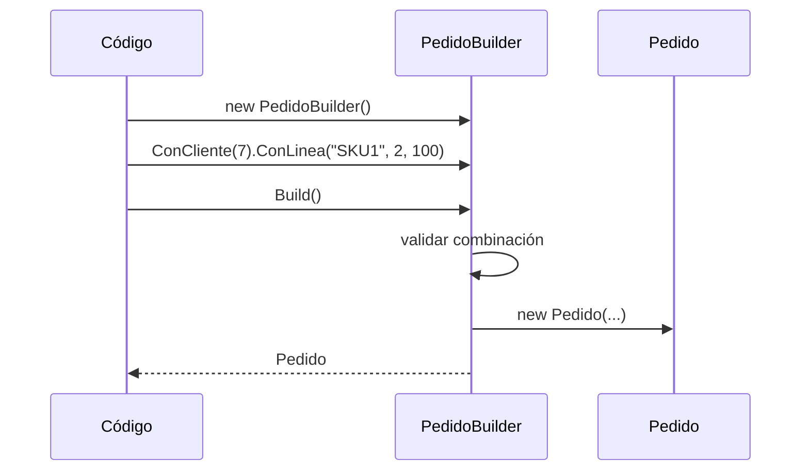

# Patrón Builder

Parte de: [[09-Arquitectura-Patrones/02 Patrones de diseño/_Índice Patrones de diseño|Patrones de diseño]]

> [!info] Cómo avanzar
> `progreso`: **pendiente** → **viendo** (estudiando) → **visto** (contestaste la autoevaluación sin abrir las respuestas) → **dominado** (hiciste el laboratorio o lo aplicaste de verdad).

## Contenido

### Qué es
*Builder* (constructor) es un patrón creacional que **separa la construcción de un objeto complejo de su representación final**, permitiendo armarlo paso a paso con una API legible y obtener el resultado con una llamada final (`Build()`). Sirve cuando un objeto tiene muchos parámetros opcionales, combinaciones válidas e inválidas, o un proceso de armado en varias etapas, y un constructor con diez parámetros sería ilegible ("¿el cuarto `true` era *activo* o *pagado*?").

### Cómo funciona
1. El builder guarda la configuración en campos internos con **valores por defecto razonables**.
2. Métodos con nombre (`ConCliente`, `ConLinea`, `Pagado`) modifican esa configuración y devuelven el propio builder (*fluent interface*) para encadenar.
3. `Build()` **valida** que la combinación sea coherente y crea el objeto final, idealmente inmutable.



### Ejemplos de Builder en .NET
Ya lo usas todos los días:
- **`WebApplication.CreateBuilder(args)`**: configuras servicios, configuración y logging, y `builder.Build()` crea la `WebApplication`.
- **`StringBuilder`**: armas un texto en pasos y `ToString()` produce el resultado.
- **`SqlConnectionStringBuilder`**: armas la cadena de conexión con propiedades tipadas en lugar de concatenar texto.
- **`UriBuilder`**, **`HostApplicationBuilder`**, **`ResiliencePipelineBuilder`** de Polly, **`ConfigurationBuilder`**.

```csharp
var csb = new SqlConnectionStringBuilder
{
    DataSource = "sql-dionisio.database.windows.net",
    InitialCatalog = "Dionisio",
    Authentication = SqlAuthenticationMethod.ActiveDirectoryDefault, // sin contraseñas en el repo
    Encrypt = SqlConnectionEncryptOption.Mandatory,
    ApplicationName = "Dionisio.Api"
};
string cadena = csb.ConnectionString;
```

### Ejemplo: Test Data Builder
Donde más brilla Builder en tu día a día es en **pruebas**. Cada prueba necesita un `Pedido` válido con *una* característica distinta; sin builder, cada prueba repite 15 líneas de armado y, cuando el constructor cambia, se rompen 40 pruebas.

```csharp
public sealed class PedidoBuilder
{
    private int _id = 1;
    private int _clienteId = 100;
    private readonly List<(string Sku, int Cant, decimal Precio)> _lineas = [("SKU-BASE", 1, 50m)];
    private bool _cerrado;

    public PedidoBuilder ConId(int id) { _id = id; return this; }
    public PedidoBuilder ConCliente(int clienteId) { _clienteId = clienteId; return this; }
    public PedidoBuilder SinLineas() { _lineas.Clear(); return this; }
    public PedidoBuilder ConLinea(string sku, int cant, decimal precio)
    { _lineas.Add((sku, cant, precio)); return this; }
    public PedidoBuilder Cerrado() { _cerrado = true; return this; }

    public Pedido Build()
    {
        var p = new Pedido(_id, _clienteId);
        foreach (var l in _lineas) p.AgregarLinea(l.Sku, l.Cant, new Dinero(l.Precio, "MXN"));
        if (_cerrado) p.Cerrar();
        return p;
    }
}

public sealed class CerrarPedidoTests
{
    [Fact]
    public void No_permite_agregar_lineas_a_un_pedido_cerrado()
    {
        var pedido = new PedidoBuilder().Cerrado().Build();

        var accion = () => pedido.AgregarLinea("SKU-2", 1, new Dinero(10, "MXN"));

        Assert.Throws<InvalidOperationException>(accion);
    }
}
```

La prueba dice exactamente lo que importa ("un pedido cerrado") y oculta lo irrelevante. Si mañana `Pedido` exige un campo nuevo, solo cambias el builder.

Además, el builder se convierte en documentación viva del dominio: sus métodos (`Cerrado()`, `SinLineas()`, `ConCliente(...)`) nombran los estados que importan al negocio, y quien lee la prueba entiende el escenario sin conocer los detalles de construcción. Puedes tener un builder por agregado importante (`PedidoBuilder`, `CuentaBuilder`) en un proyecto compartido de pruebas, y combinarlo con una librería como Bogus si necesitas datos variados para pruebas de integración contra SQL Server.

### Cuándo usarlo y cuándo no
- **Úsalo** con objetos de muchos parámetros opcionales, armado por etapas, configuración de infraestructura, y **datos de prueba**.
- **No lo uses** para objetos simples: en C# moderno, un `record` con propiedades `init` y **inicializadores de objeto** o **parámetros con nombre** resuelven la legibilidad sin una clase extra. `new Dinero(monto: 150, moneda: "MXN")` ya es claro.
- Para variaciones en pruebas sobre un record, la expresión `with` (`pedidoBase with { Cerrado = true }`) es un builder gratuito.

### Errores comunes
1. **Builder sin validación en `Build()`:** permite construir objetos inválidos y el error aparece lejos.
2. **Builder mutable reutilizado** entre pruebas: una prueba cambia el estado y otra hereda el cambio. Crea uno nuevo por prueba.
3. **Builder para todo:** una clase extra por cada DTO de tres campos es ceremonia.
4. **Valores por defecto inválidos** en el test builder: el objeto por defecto debe ser siempre válido, y cada prueba cambia solo lo que le interesa.

### Para profundizar
- [Builder (Refactoring.Guru)](https://refactoring.guru/design-patterns/builder)
- [Generic Host y builders en .NET (Microsoft Learn)](https://learn.microsoft.com/en-us/dotnet/core/extensions/workers)

Relacionado: [[Patrón Factory]], [[xUnit]].

## Autoevaluación

Contesta primero en voz alta o en papel; luego despliega la respuesta.

> [!question]- ¿Para qué sirve Builder?
> Construir paso a paso un objeto complejo o con muchas opciones, con una API legible, dejando el objeto final válido e (idealmente) inmutable.

> [!question]- Ejemplos de Builder en .NET.
> `WebApplication.CreateBuilder()`, `StringBuilder`, `ConfigurationBuilder`, `UriBuilder`, `ResiliencePipelineBuilder` de Polly.

> [!question]- ¿Cuándo usar Builder en pruebas?
> *Test data builders*: `new PedidoBuilder().ConCliente(x).ConLineas(3).Build()` con valores por defecto válidos; cada prueba solo especifica lo que le importa.

