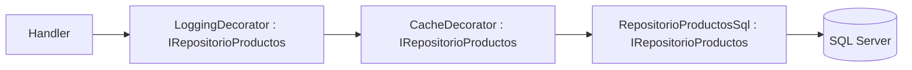

# Patrón Decorator

Parte de: [[09-Arquitectura-Patrones/02 Patrones de diseño/_Índice Patrones de diseño|Patrones de diseño]]

> [!info] Cómo avanzar
> `progreso`: **pendiente** → **viendo** (estudiando) → **visto** (contestaste la autoevaluación sin abrir las respuestas) → **dominado** (hiciste el laboratorio o lo aplicaste de verdad).

## Contenido

### Qué es
*Decorator* (decorador) es un patrón estructural que **agrega comportamiento a un objeto envolviéndolo en otro que implementa la misma interfaz**. El decorador recibe la implementación real, hace algo antes o después (registrar, medir, cachear, reintentar, autorizar) y delega la llamada. Como la interfaz es la misma, el cliente no nota la diferencia y puedes **apilar** decoradores. Sirve para respetar el principio abierto/cerrado: extiendes sin modificar la clase original.

### Cómo funciona


1. Defines una interfaz (`IRepositorioProductos`).
2. La implementación real hace el trabajo.
3. Cada decorador implementa la misma interfaz, recibe un `IRepositorioProductos` interno y añade una responsabilidad.
4. La composición (normalmente en la [[Inyección de dependencias]]) decide el orden.

### Ejemplo: caché sobre un repositorio
```csharp
public interface IRepositorioProductos
{
    Task<ProductoDto?> ObtenerAsync(int id, CancellationToken ct);
    Task ActualizarPrecioAsync(int id, decimal precio, CancellationToken ct);
}

// Implementación real con Dapper y SQL en archivo
public sealed class RepositorioProductosSql(IDbConnection db, ISqlArchivos sql) : IRepositorioProductos
{
    public Task<ProductoDto?> ObtenerAsync(int id, CancellationToken ct) =>
        db.QuerySingleOrDefaultAsync<ProductoDto>(new CommandDefinition(
            sql.Leer("Productos/Obtener.sql"), new { id }, cancellationToken: ct));

    public Task ActualizarPrecioAsync(int id, decimal precio, CancellationToken ct) =>
        db.ExecuteAsync(new CommandDefinition(
            sql.Leer("Productos/ActualizarPrecio.sql"), new { id, precio }, cancellationToken: ct));
}

// Decorador: misma interfaz, agrega caché (cache-aside) e invalidación
public sealed class RepositorioProductosConCache(
    IRepositorioProductos interno, HybridCache cache) : IRepositorioProductos
{
    private static string Llave(int id) => $"producto:{id}";

    public async Task<ProductoDto?> ObtenerAsync(int id, CancellationToken ct) =>
        await cache.GetOrCreateAsync(Llave(id),
            async token => await interno.ObtenerAsync(id, token),
            new HybridCacheEntryOptions { Expiration = TimeSpan.FromMinutes(10) },
            cancellationToken: ct);

    public async Task ActualizarPrecioAsync(int id, decimal precio, CancellationToken ct)
    {
        await interno.ActualizarPrecioAsync(id, precio, ct);
        await cache.RemoveAsync(Llave(id), ct); // invalidar después de escribir
    }
}
```

Registro sin librerías (el contenedor de .NET no tiene "decorate" nativo):

```csharp
builder.Services.AddHybridCache();
builder.Services.AddScoped<RepositorioProductosSql>();
builder.Services.AddScoped<IRepositorioProductos>(sp =>
    new RepositorioProductosConCache(
        sp.GetRequiredService<RepositorioProductosSql>(),
        sp.GetRequiredService<HybridCache>()));
```

La librería Scrutor ofrece `services.Decorate<IRepositorioProductos, RepositorioProductosConCache>()` si prefieres menos código. El handler sigue pidiendo `IRepositorioProductos` y no sabe que hay caché. Ver [[Cache-aside y estrategias de caché]].

### Decorators que ya usas sin llamarlos así
- **`DelegatingHandler`** en `HttpClient`: cada handler envuelve al siguiente; `AddStandardResilienceHandler()` agrega uno con reintentos y circuit breaker.
- **Middleware de ASP.NET Core:** cada componente envuelve al resto del pipeline (`await next(context)`), agregando autenticación, logging, manejo de errores.
- **Streams:** `GZipStream`, `BufferedStream` y `CryptoStream` envuelven otro `Stream` y agregan compresión, búfer o cifrado.
- **Filtros de acción** en controllers (`IAsyncActionFilter`), que ejecutan lógica antes y después de la acción.
- **Pipeline behaviors** de librerías tipo MediatR (validación, transacción alrededor del handler).

### Cuándo usarlo y cuándo no
- **Úsalo** para preocupaciones transversales sobre una interfaz concreta: caché, métricas, reintentos, auditoría, autorización fina.
- **No lo uses** si la "decoración" es lógica de negocio que debería estar en el caso de uso, o si la interfaz tiene 20 métodos (tendrás que reenviar los 20). Para algo que aplica a *todas* las peticiones HTTP, un middleware o filtro es más directo.
- Con vertical slices sin mediador, el decorador por interfaz es la forma natural de agregar comportamiento a un puerto concreto sin tocar el handler.

### Errores comunes
1. **Orden equivocado:** logging dentro de la caché no registra los aciertos; reintento fuera del circuit breaker se comporta distinto que dentro. Decide el orden a propósito.
2. **Registrar la implementación real como `IRepositorioProductos`** además del decorador: alguien recibe la versión sin caché.
3. **Decoradores con estado compartido** no seguro para hilos.
4. **Caché sin invalidación** en el método de escritura.
5. **Ciclo de vida incompatible:** un decorador singleton que envuelve algo scoped (ver [[Patrón Singleton]]).

### Para profundizar
- [Decorator (Refactoring.Guru)](https://refactoring.guru/design-patterns/decorator)
- [Middleware de ASP.NET Core (Microsoft Learn)](https://learn.microsoft.com/en-us/aspnet/core/fundamentals/middleware/)
- [HybridCache en ASP.NET Core (Microsoft Learn)](https://learn.microsoft.com/en-us/aspnet/core/performance/caching/hybrid)

## Autoevaluación

Contesta primero en voz alta o en papel; luego despliega la respuesta.

> [!question]- ¿Qué es Decorator?
> Envolver un objeto con otro que implementa la misma interfaz para agregar comportamiento (caché, logging, reintentos) sin modificar el original.

> [!question]- Ejemplo: agrega caché a `IRepositorioProductos`.
> ```csharp
> public sealed class RepoProductosConCache(IRepositorioProductos inner, IMemoryCache cache) : IRepositorioProductos {
>     public Task<Producto?> ObtenerAsync(int id) =>
>         cache.GetOrCreateAsync($"prod:{id}", _ => inner.ObtenerAsync(id));
> }
> ```

> [!question]- Decorators que ya usas sin llamarlos así.
> Middleware de ASP.NET Core, `DelegatingHandler` de `HttpClient`, *pipeline behaviors* del mediador, `BufferedStream`.

