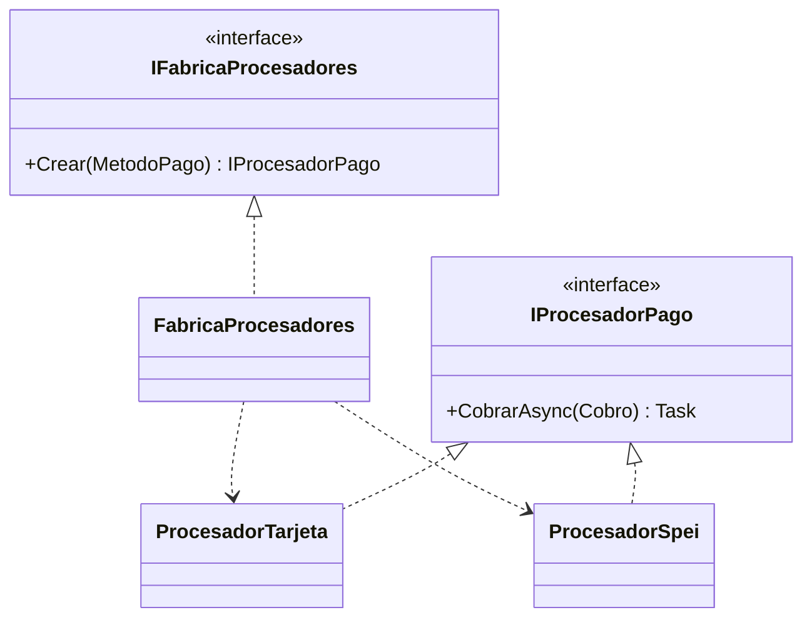

# Patrón Factory

Parte de: [[09-Arquitectura-Patrones/02 Patrones de diseño/_Índice Patrones de diseño|Patrones de diseño]]

> [!info] Cómo avanzar
> `progreso`: **pendiente** → **viendo** (estudiando) → **visto** (contestaste la autoevaluación sin abrir las respuestas) → **dominado** (hiciste el laboratorio o lo aplicaste de verdad).

## Contenido

### Qué es
Una fábrica (*factory*) es un objeto o método cuyo trabajo es **crear otros objetos**, ocultando al cliente qué clase concreta se instancia y cómo se arma. Resuelve tres problemas: decidir **qué implementación** crear según datos que solo se conocen en tiempo de ejecución (el tipo de pago que eligió el usuario), **encapsular un armado complicado** (dependencias, configuración) y **controlar el ciclo de vida** de lo creado (reutilizar conexiones, como hace `IHttpClientFactory`). El cliente pide "dame un procesador para tarjeta" y no hace `new ProcesadorTarjeta(...)`.

### Cómo funciona
El término cubre varias formas:
- **Simple factory / método estático:** una función que decide y crea (`Dinero.Desde("150.00 MXN")`). No es un patrón GoF, pero es lo más común.
- **Factory Method (GoF):** una clase base declara un método abstracto de creación y **las subclases deciden qué crear**. La herencia elige el producto.
- **Abstract Factory (GoF):** una interfaz que crea **familias de objetos relacionados** que deben usarse juntos (por ejemplo, `IProveedorNube` que crea su `IAlmacen`, su `ICola` y su `ISecretos` coherentes entre sí). La composición elige la familia.



### En .NET con DI, ¿cuándo sigues necesitando una fábrica?
La [[Inyección de dependencias]] ya es una gran fábrica: le dices `AddScoped<IServicio, Servicio>()` y ella crea todo. Aun así necesitas una fábrica cuando:
1. **La implementación depende de un dato en tiempo de ejecución** (método de pago, tenant, tipo de archivo).
2. **Necesitas crear varias instancias bajo demanda** o con un ciclo de vida distinto al de quien la usa (un singleton que necesita un servicio scoped por operación: `IServiceScopeFactory`).
3. **Se requiere un parámetro que no está en el contenedor** (un id, una ruta) además de dependencias inyectadas (`ActivatorUtilities.CreateInstance`).
4. **El objeto es costoso o tiene recursos compartidos**, como `IHttpClientFactory`, que reutiliza los handlers para no agotar sockets, o `ILoggerFactory`.

### Ejemplo
Desde .NET 8, los **keyed services** resuelven el caso 1 sin escribir una fábrica a mano:

```csharp
public enum MetodoPago { Tarjeta, Spei, Efectivo }

public interface IProcesadorPago { Task<ResultadoCobro> CobrarAsync(Cobro cobro, CancellationToken ct); }

builder.Services.AddKeyedScoped<IProcesadorPago, ProcesadorTarjeta>(MetodoPago.Tarjeta);
builder.Services.AddKeyedScoped<IProcesadorPago, ProcesadorSpei>(MetodoPago.Spei);
builder.Services.AddKeyedScoped<IProcesadorPago, ProcesadorEfectivo>(MetodoPago.Efectivo);

// Fábrica delgada: traduce el dato del negocio a la implementación
public sealed class FabricaProcesadores(IServiceProvider sp)
{
    public IProcesadorPago Crear(MetodoPago metodo) =>
        sp.GetKeyedService<IProcesadorPago>(metodo)
        ?? throw new NotSupportedException($"Método de pago no soportado: {metodo}");
}

builder.Services.AddScoped<FabricaProcesadores>();

// En el slice
public sealed class CobrarPedidoHandler(FabricaProcesadores fabrica)
{
    public Task<ResultadoCobro> Handle(CobrarPedido.Command cmd, CancellationToken ct) =>
        fabrica.Crear(cmd.Metodo).CobrarAsync(new Cobro(cmd.PedidoId, cmd.Monto), ct);
}
```

Si la clave es fija en tiempo de compilación, puedes inyectar directo con `[FromKeyedServices(MetodoPago.Spei)] IProcesadorPago spei`. Esta combinación fábrica + implementaciones intercambiables es la base del [[Patrón Strategy]].

Ejemplo de **Factory Method** clásico en .NET: `DbProviderFactory` (`SqlClientFactory.Instance.CreateConnection()`) y, en tu propio código, una clase base `GeneradorReporte` con `protected abstract IFormatoSalida CrearFormato()` que `GeneradorExcel` implementa. Hoy suele preferirse inyectar la dependencia en lugar de heredar.

### Cuándo usarlo y cuándo no
- **Úsalo** en los casos 1–4 de arriba y cuando crear el objeto requiere lógica que no quieres repetir.
- **No lo uses** si la DI ya lo resuelve: una fábrica que solo hace `return new Servicio()` es indirección vacía.

### Errores comunes
1. **Fábrica como *service locator* disfrazado:** pasar `IServiceProvider` a todos lados y pedir cualquier cosa oculta las dependencias reales. Limita la fábrica a una familia concreta.
2. **`switch` que crece** con cada tipo nuevo y en varios lugares: centraliza la decisión en un solo punto (o en el registro con keyed services).
3. **Crear con `new` objetos que tienen dependencias** saltándose la DI, y luego no poder probarlos.
4. **Ignorar el ciclo de vida:** una fábrica singleton que guarda instancias scoped crea dependencias cautivas.
5. **Crear `HttpClient` con `new` en cada llamada** en lugar de usar `IHttpClientFactory`.

### Para profundizar
- [Factory Method (Refactoring.Guru)](https://refactoring.guru/design-patterns/factory-method)
- [Abstract Factory (Refactoring.Guru)](https://refactoring.guru/design-patterns/abstract-factory)
- [Inyección de dependencias en .NET, incluye keyed services (Microsoft Learn)](https://learn.microsoft.com/en-us/dotnet/core/extensions/dependency-injection)
- [IHttpClientFactory (Microsoft Learn)](https://learn.microsoft.com/en-us/aspnet/core/fundamentals/http-requests)

## Autoevaluación

Contesta primero en voz alta o en papel; luego despliega la respuesta.

> [!question]- ¿Qué resuelve una fábrica?
> Centraliza la creación de objetos cuando decidir *qué* clase concreta crear o *cómo* armarla es lógica no trivial, para que el consumidor dependa solo de la abstracción.

> [!question]- Diferencia entre *Factory Method* y *Abstract Factory*.
> Factory Method: un método (a menudo sobrescribible) que crea un producto. Abstract Factory: una interfaz que crea familias de productos relacionados (p. ej. `IUiFactory` que crea botón y menú del mismo tema).

> [!question]- En .NET con DI, ¿cuándo sigues necesitando una fábrica?
> Cuando el objeto depende de datos de tiempo de ejecución (el tenant, el tipo elegido por el usuario) o hay que crear varias instancias bajo demanda: `IHttpClientFactory`, `Func<T>` o una fábrica propia que use `IServiceProvider`.

> [!question]- Error común con fábricas.
> Fábricas para objetos que DI ya resuelve, o fábricas que esconden un *service locator* (`provider.GetService(...)` por todos lados).

## Práctica

- [[Lab 1 - Refactor de un switch a Strategy]]

