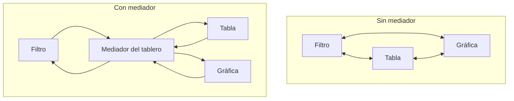

# Patrón Mediator

Parte de: [[09-Arquitectura-Patrones/02 Patrones de diseño/_Índice Patrones de diseño|Patrones de diseño]]

> [!info] Cómo avanzar
> `progreso`: **pendiente** → **viendo** (estudiando) → **visto** (contestaste la autoevaluación sin abrir las respuestas) → **dominado** (hiciste el laboratorio o lo aplicaste de verdad).

## Contenido

### Qué es
*Mediator* (mediador) es un patrón de comportamiento del libro GoF que **centraliza la comunicación entre varios objetos** para que no se referencien directamente. En lugar de que cada componente conozca a todos los demás (una red de N×N dependencias), todos hablan con el mediador, y él decide a quién avisar. El ejemplo clásico es la torre de control: los aviones no se coordinan entre sí, todos hablan con la torre. Sirve para reducir el acoplamiento cuando muchos objetos interactúan de formas complejas.

### Cómo funciona


Participantes GoF:
- **Mediator:** interfaz con la operación de notificar (`Notificar(emisor, evento)`).
- **ConcreteMediator:** conoce a los colegas y contiene la lógica de coordinación.
- **Colleagues:** componentes que solo conocen al mediador.

### Ejemplo GoF en C#
Un tablero de reporte donde cambiar el filtro debe refrescar tabla y gráfica, y seleccionar una fila debe resaltar la gráfica:

```csharp
public interface IMediadorTablero { void Notificar(object emisor, string evento); }

public sealed class MediadorTablero : IMediadorTablero
{
    public required FiltroFechas Filtro { get; init; }
    public required TablaVentas Tabla { get; init; }
    public required GraficaVentas Grafica { get; init; }

    public void Notificar(object emisor, string evento)
    {
        switch (evento)
        {
            case "FiltroCambiado":
                Tabla.Recargar(Filtro.Rango);
                Grafica.Recargar(Filtro.Rango);
                break;
            case "FilaSeleccionada" when emisor is TablaVentas t:
                Grafica.Resaltar(t.Seleccion);
                break;
        }
    }
}
```

Cada componente solo hace `mediador.Notificar(this, "FiltroCambiado")`. Si mañana agregas un exportador, solo cambia el mediador.

### Relación con librerías tipo MediatR
En .NET, "mediador" suele significar **MediatR** o similares: envías un objeto `IRequest` (comando o consulta) con `mediator.Send(request)` y la librería encuentra **un handler** registrado para ese tipo; también publica notificaciones a varios handlers y permite *pipeline behaviors* (validación, logging, transacción) alrededor de cada handler.

Eso **se parece poco al GoF**: no coordina colegas que interactúan entre sí, sino que **despacha un mensaje en proceso a su handler**. Es más cercano a un *command bus* o *in-process dispatcher*. Lo que sí comparte es el desacoplamiento: el controller no conoce al handler.

Datos a considerar al elegirlo:
- MediatR pasó a tener **licencia comercial en 2025** (con una edición gratuita para ciertos casos); revisa los términos antes de adoptarlo en un proyecto nuevo.
- En las reglas del usuario (y en Ocelotl.Hermes), los vertical slices **no usan MediatR**: la [[Inyección de dependencias]] resuelve directamente `CrearPedido.Handler`, y lo transversal se hace con filtros, middleware o [[Patrón Decorator|decoradores]]. Es más explícito: "ir a la definición" desde el controller te lleva al handler.

```csharp
// Sin librería: el controller recibe su handler directamente
[HttpPost]
public async Task<IActionResult> Crear(CrearPedido.Command cmd,
    [FromServices] CrearPedido.Handler handler, CancellationToken ct)
{
    var r = await handler.Handle(cmd, ct);
    return r.Exito ? Created($"/api/pedidos/{r.Valor}", null) : r.ToProblem();
}
```

Ver también [[CQRS y mediador]].

### Riesgo del mediador
- **"Objeto dios":** el mediador GoF concentra toda la lógica de coordinación y crece sin límite hasta ser la clase más difícil de cambiar del sistema.
- **Indirección que oculta el flujo:** con un despachador genérico, `Send(new X())` no dice quién lo atiende; navegar el código y entender qué pasa exige buscar por tipo, y los behaviors ejecutan lógica "invisible".
- **Handlers que se llaman entre sí** a través del mediador, recreando el acoplamiento que querías evitar, ahora escondido.
- **Rendimiento y depuración:** reflexión, más capas en la pila de llamadas, errores de registro que aparecen en ejecución.

### Cuándo usarlo y cuándo no
- **GoF Mediator:** en UI o flujos con varios componentes que se coordinan (formularios con dependencias entre campos, tableros). En React, un estado elevado al padre o un contexto juega este papel.
- **Despachador tipo MediatR:** cuando quieres un pipeline uniforme de behaviors en muchos handlers y el equipo acepta la indirección. Si no, la DI directa es suficiente.

### Errores comunes
1. Usar un mediador para **dos componentes**: una referencia directa es más clara.
2. Meter **reglas de negocio** en el mediador en lugar de en los colegas o handlers.
3. Llamar `Send` desde un handler a otro handler para "reutilizar".
4. Adoptar una librería **sin revisar su licencia**.

### Para profundizar
- [Mediator (Refactoring.Guru)](https://refactoring.guru/design-patterns/mediator)
- [Anuncio de ediciones comerciales de AutoMapper y MediatR (Jimmy Bogard)](https://www.jimmybogard.com/automapper-and-mediatr-commercial-editions-launch-today/)

## Autoevaluación

Contesta primero en voz alta o en papel; luego despliega la respuesta.

> [!question]- ¿Qué hace el patrón Mediator?
> Un objeto central coordina la comunicación entre otros, que ya no se conocen entre sí; reduce dependencias de muchos-a-muchos a muchos-a-uno.

> [!question]- Relación entre el patrón GoF y librerías tipo MediatR.
> Las librerías aplican la idea a mensajes de aplicación: el emisor envía un request y el mediador encuentra su handler. Ver [[CQRS y mediador]].

> [!question]- Riesgo del mediador.
> Que se vuelva un "objeto dios" o que oculte el flujo: cuesta seguir quién maneja qué. Mantén un handler por mensaje y nombres claros.

