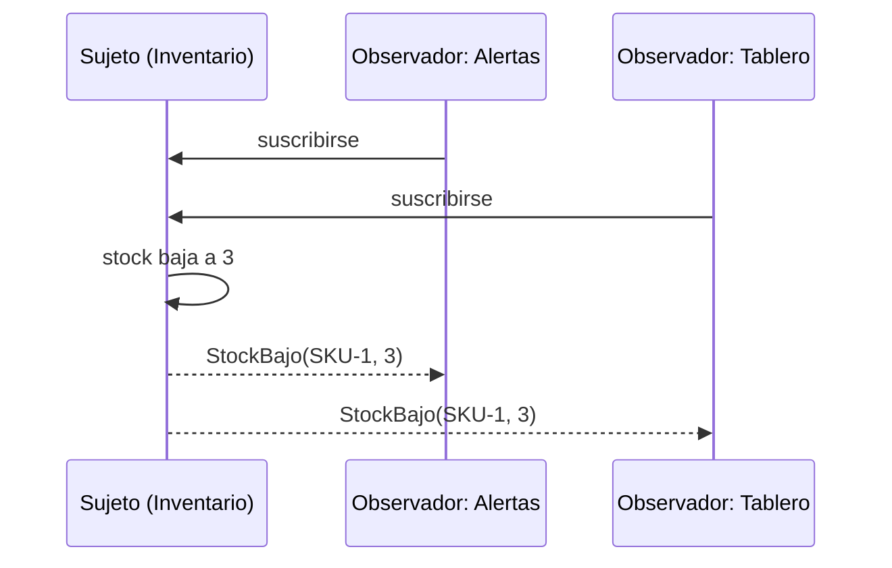

# Patrón Observer

Parte de: [[09-Arquitectura-Patrones/02 Patrones de diseño/_Índice Patrones de diseño|Patrones de diseño]]

> [!info] Cómo avanzar
> `progreso`: **pendiente** → **viendo** (estudiando) → **visto** (contestaste la autoevaluación sin abrir las respuestas) → **dominado** (hiciste el laboratorio o lo aplicaste de verdad).

## Contenido

### Qué es
*Observer* (observador) es un patrón de comportamiento en el que un objeto, el **sujeto**, mantiene una lista de **observadores** y les **avisa automáticamente** cuando su estado cambia. Los observadores se suscriben y se desuscriben por su cuenta; el sujeto no conoce sus clases concretas, solo sabe que implementan cierta interfaz o firma. Sirve para que un cambio dispare reacciones en otras partes sin acoplarlas: es la versión en proceso de la idea de publicar/suscribir.

### Cómo funciona
1. El sujeto expone una forma de suscribirse (`Subscribe`, `+=`).
2. Cada observador se registra.
3. Cuando ocurre algo, el sujeto recorre la lista y llama a cada observador, normalmente con datos del cambio.
4. Al terminar su vida, el observador se desuscribe.



### Dónde aparece en C#
Observer está integrado en el lenguaje y en .NET:
- **Eventos de C#** (`event EventHandler<T>`): la forma más directa. `+=` suscribe, `-=` desuscribe.
- **`IObservable<T>` / `IObserver<T>`**: la interfaz formal del patrón en .NET, base de Reactive Extensions (Rx.NET).
- **`INotifyPropertyChanged`**: en WPF/MAUI la vista observa al modelo.
- **`IOptionsMonitor<T>.OnChange`** y **`IChangeToken`**: te avisan cuando cambia la configuración ([[Options pattern]]).
- **`CancellationToken.Register`**: callbacks cuando se cancela una operación.
- **`DiagnosticListener` / `ActivitySource`**: la instrumentación de .NET publica eventos que observan las herramientas de telemetría.
- En el front, `addEventListener` del DOM y las suscripciones de React son el mismo patrón.

### Ejemplo
```csharp
public sealed record StockBajoEventArgs(string Sku, int Existencia);

public sealed class Inventario
{
    private readonly Dictionary<string, int> _existencias = new();
    public event EventHandler<StockBajoEventArgs>? StockBajo;

    public void Descontar(string sku, int piezas, int minimo = 5)
    {
        _existencias[sku] = _existencias.GetValueOrDefault(sku) - piezas;
        if (_existencias[sku] <= minimo)
            StockBajo?.Invoke(this, new StockBajoEventArgs(sku, _existencias[sku])); // ?. evita null
    }
}

public sealed class AlertasCompras : IDisposable
{
    private readonly Inventario _inv;
    public AlertasCompras(Inventario inv) { _inv = inv; _inv.StockBajo += AlRecibir; }
    private void AlRecibir(object? s, StockBajoEventArgs e) =>
        Console.WriteLine($"Pedir {e.Sku}: quedan {e.Existencia}");
    public void Dispose() => _inv.StockBajo -= AlRecibir; // desuscribirse
}
```

En una API web, para reaccionar a hechos del negocio prefiere [[Eventos de dominio y reacciones|eventos de dominio]] despachados explícitamente en el slice, o mensajería con outbox si la reacción sale del proceso. Los eventos de C# son ideales para componentes de larga vida en el mismo proceso (servicios en segundo plano, UI, librerías).

### Error común con eventos de C#
El más importante: **fugas de memoria por no desuscribirse.** El sujeto guarda una referencia al delegado, y el delegado a su objeto. Si un sujeto de larga vida (un singleton, un servicio estático) tiene suscrito a un objeto de corta vida (un formulario, un objeto por petición), ese objeto **nunca se libera** y además sigue recibiendo avisos. Solución: desuscribir en `Dispose`, o usar suscripciones que devuelvan `IDisposable` (como `IObservable<T>.Subscribe` o `IOptionsMonitor.OnChange`).

Otros errores:
- **Invocar sin comprobar null:** si nadie se suscribió, el evento es `null`. Usa `?.Invoke`.
- **Una excepción en un observador corta a los siguientes:** los delegados se invocan en orden y una excepción detiene el resto. Si deben ser independientes, invoca cada uno con `GetInvocationList()` y captura por separado.
- **Handlers `async void`:** las excepciones no se pueden capturar y pueden tirar el proceso; el sujeto tampoco espera a que terminen.
- **Suponer orden o hilo:** los observadores se ejecutan en el hilo del sujeto, en orden de suscripción, y bloquean al sujeto mientras corren.

### Cuándo usarlo y cuándo no
- **Úsalo** cuando varios componentes en el mismo proceso reaccionan a cambios de otro y no quieres que este los conozca.
- **No lo uses** para flujos de negocio que deben ser confiables y auditables entre procesos (ahí: mensajería y outbox), ni cuando un orden estricto de pasos importa (llama directamente).

### Para profundizar
- [Observer (Refactoring.Guru)](https://refactoring.guru/design-patterns/observer)
- [Eventos en .NET (Microsoft Learn)](https://learn.microsoft.com/en-us/dotnet/standard/events/)
- [Interfaz IObservable de T (Microsoft Learn)](https://learn.microsoft.com/en-us/dotnet/api/system.iobservable-1)

## Autoevaluación

Contesta primero en voz alta o en papel; luego despliega la respuesta.

> [!question]- ¿Qué es Observer?
> Un sujeto mantiene una lista de observadores y los notifica cuando cambia, sin conocer sus tipos concretos.

> [!question]- ¿Dónde aparece en C#?
> `event`/delegados, `IObservable<T>`/`IObserver<T>`, `INotifyPropertyChanged`, Rx. A escala de sistema, la versión distribuida es publicar/suscribir.

> [!question]- Error común con eventos de C#.
> No desuscribirse (`-=`): el sujeto mantiene viva la referencia y hay fugas de memoria; además, una excepción en un manejador corta a los siguientes.

