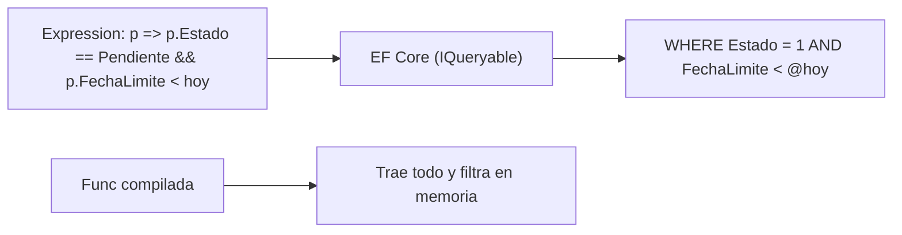

# Patrón Specification

Parte de: [[09-Arquitectura-Patrones/02 Patrones de diseño/_Índice Patrones de diseño|Patrones de diseño]]

> [!info] Cómo avanzar
> `progreso`: **pendiente** → **viendo** (estudiando) → **visto** (contestaste la autoevaluación sin abrir las respuestas) → **dominado** (hiciste el laboratorio o lo aplicaste de verdad).

## Contenido

### Qué es
*Specification* (especificación) es un patrón, descrito por Eric Evans y Martin Fowler, que **encapsula una regla de selección o de negocio en un objeto con nombre** que responde "¿este objeto cumple?". En lugar de repetir `p.Estado == Pendiente && p.FechaLimite < hoy` en cinco lugares, creas `PedidoVencido` y la usas para filtrar, validar o decidir. Las especificaciones se pueden **combinar** (`And`, `Or`, `Not`) y, en .NET, si se expresan como árboles de expresión, **se traducen a SQL**.

### Cómo funciona
Tiene tres usos:
1. **Validación:** ¿este pedido cumple la regla? (`spec.EsSatisfechaPor(pedido)`).
2. **Selección:** dame los pedidos que la cumplen (`WHERE`).
3. **Construcción por pedido:** crear objetos que la cumplan (menos común).

La clave técnica en .NET está en el tipo:
- `Func<Pedido, bool>` es **código compilado**: solo se puede ejecutar en memoria. Si lo pasas a `Where` sobre un `DbSet`, EF Core lo trata como `IEnumerable` y **trae todas las filas** para filtrar en C#.
- `Expression<Func<Pedido, bool>>` es un **árbol de expresión**: datos que describen el código. EF Core lo recorre y lo **traduce a SQL**, de modo que el filtro corre en SQL Server.



### Ejemplo
```csharp
public abstract class Especificacion<T>
{
    public abstract Expression<Func<T, bool>> Criterio { get; }

    private Func<T, bool>? _compilado;
    public bool EsSatisfechaPor(T entidad) => (_compilado ??= Criterio.Compile())(entidad);
}

public sealed class PedidoVencido(DateTime hoy) : Especificacion<Pedido>
{
    public override Expression<Func<Pedido, bool>> Criterio =>
        p => p.Estado == EstadoPedido.Pendiente && p.FechaLimite < hoy;
}

// Uso con EF Core: el filtro se traduce a SQL, no se trae todo a memoria
var spec = new PedidoVencido(DateTime.Today);
var vencidos = await db.Pedidos
    .Where(spec.Criterio)        // IQueryable<Pedido>.Where(Expression<...>)
    .OrderBy(p => p.FechaLimite)
    .Take(100)
    .ToListAsync(ct);

// Uso en memoria: la misma regla para validar un objeto
if (spec.EsSatisfechaPor(pedido)) { /* enviar recordatorio */ }
```

Detalles importantes:
- `hoy` llega como parámetro (no `DateTime.Today` dentro de la expresión): queda como parámetro SQL y la regla es fácil de probar con una fecha fija.
- La expresión solo puede usar cosas que EF sabe traducir: propiedades mapeadas, comparaciones, algunos métodos (`Contains`, `StartsWith`). Si llamas un método tuyo dentro, EF lanzará error de traducción.
- Para combinar (`And`) dos expresiones hay que reescribir el parámetro con un `ExpressionVisitor`, o usar la librería Ardalis.Specification, que además encapsula `Include`, orden y paginación.

### Specification con Dapper y las reglas del usuario
En los proyectos del usuario el acceso a datos es **Dapper con SQL en archivos `.sql` y una interfaz por consulta**. Ahí Specification pierde su mayor ventaja: Dapper no traduce expresiones, así que la regla terminaría duplicada (en C# y en el `.sql`). La alternativa natural es que **la consulta sea la especificación**: `IPedidosVencidos` con su `PedidosVencidos.sql`, cuyo nombre expresa la regla y cuyo `WHERE` es la única fuente de verdad. Si además necesitas validar en memoria, un método del dominio (`pedido.EstaVencido(hoy)`) basta, con una prueba que mantenga ambas en sintonía.

### Cuándo usarlo y cuándo es exceso
**Vale la pena** cuando:
- La misma regla de negocio se usa en varios lugares (filtros, validación, reportes) y cambia con el tiempo.
- Usas EF Core y quieres reglas reutilizables que se traduzcan a SQL.
- Necesitas combinar criterios dinámicamente (filtros de búsqueda armados por el usuario).

**Es exceso** cuando:
- La condición se usa en **un solo lugar**: un `Where` en línea es más claro.
- Construyes un "repositorio genérico + especificaciones" para todo el sistema: terminas con una mini-ORM encima de EF y consultas difíciles de optimizar.
- Usas Dapper con SQL en archivos (ver arriba).
- La especificación solo envuelve `p => p.Id == id`.

### Errores comunes
1. **Usar `Func` en lugar de `Expression`** con EF Core: trae toda la tabla a memoria sin avisar.
2. **Llamar métodos no traducibles** dentro de la expresión y descubrirlo en producción.
3. **Fechas dentro de la expresión** (`DateTime.Now`): pruebas no deterministas y planes de consulta que no se reutilizan.
4. **Especificaciones con lógica de presentación** (paginación, proyección a DTO) mezclada con la regla de negocio.
5. **Combinar expresiones con `Expression.AndAlso` sin reemplazar el parámetro:** EF falla porque hay dos parámetros distintos.

### Para profundizar
- [Specifications (Eric Evans y Martin Fowler, PDF)](https://martinfowler.com/apsupp/spec.pdf)
- [Cómo funcionan las consultas en EF Core (Microsoft Learn)](https://learn.microsoft.com/en-us/ef/core/querying/how-query-works)
- [Ardalis.Specification](https://specification.ardalis.com/)

## Ejercicios

Resuélvelos en papel o en la herramienta; la solución está plegada.

> [!question]- Escribe una especificación `PedidoVencido` (estado Pendiente y fecha límite menor a hoy) usable en EF Core.
> ```csharp
> public sealed class PedidoVencido(DateTime hoy) {
>     public Expression<Func<Pedido, bool>> Criterio =>
>         p => p.Estado == EstadoPedido.Pendiente && p.FechaLimite < hoy;
> }
> // uso
> var vencidos = await db.Pedidos.Where(new PedidoVencido(reloj.Hoy).Criterio).ToListAsync(ct);
> ```
> Se recibe `hoy` desde fuera (reloj inyectado) para poder probarla.

## Autoevaluación

Contesta primero en voz alta o en papel; luego despliega la respuesta.

> [!question]- ¿Qué es una especificación?
> Un objeto que encapsula una regla de selección o validación (`ClienteMoroso`), reutilizable y combinable con `And`, `Or`, `Not`.

> [!question]- ¿Cómo se usa con EF Core sin traer todo a memoria?
> La especificación expone un `Expression<Func<T,bool>>` que se pasa a `Where`, así EF lo traduce a SQL. Si usas `Func<T,bool>` se evalúa en memoria.

> [!question]- ¿Cuándo es exceso?
> Si la regla se usa en un solo lugar: un `Where` directo en el handler es más claro.

