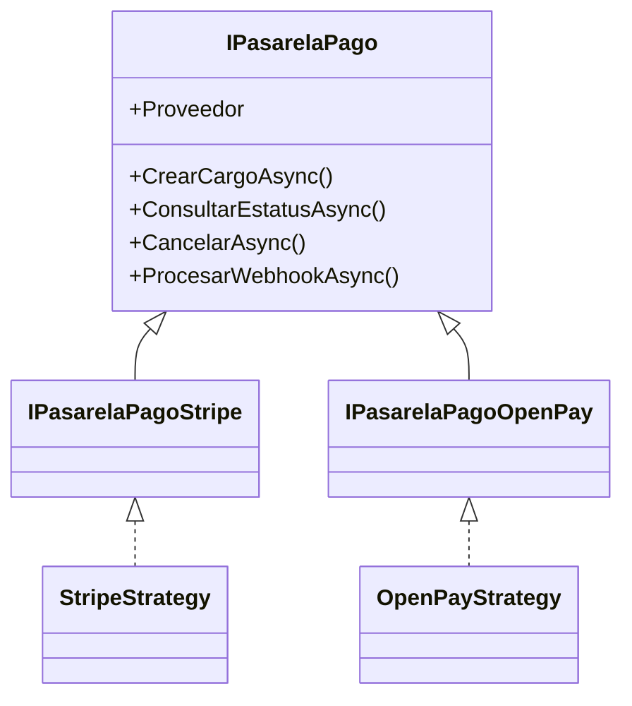

---
proyecto:
  - Pochteca.Nomisma
proyectos:
  - "[[Pochteca.Nomisma]]"
tipo: patron
nivel: basico
estado: completo
tags:
  - conocimiento
  - backend
  - patrones
  - diseno
progreso: pendiente
area: Arquitectura y patrones
contenido: completo
---
# Patrón Strategy

> Varias implementaciones de una misma interfaz, intercambiables. En [[Pochteca.Nomisma]] cada pasarela de pago (Stripe, OpenPay) es una estrategia de `IPasarelaPago`.

## Qué es y qué problema resuelve
Sin el patrón, el código se llena de `if (proveedor == "stripe") ... else if (proveedor == "openpay")`. Con Strategy, cada variante vive en su clase detrás de un contrato común, y quien la usa no sabe cuál es.

## Cómo funciona por dentro
- **Contrato**: una interfaz con las operaciones comunes (`CrearCargoAsync`, `ConsultarEstatusAsync`, `CancelarAsync`…).
- **Estrategias**: una clase por variante.
- **Selección**: por configuración, por un registro (`IEnumerable<IPasarelaPago>` + `Proveedor`), por *keyed services* o, como aquí, por **interfaces marcadoras**.



## Cuándo usarla y cuándo no
### Ventajas
- Agregar un proveedor = una clase nueva, sin tocar los que ya existen.
- Cada estrategia se prueba por separado (o se reemplaza por un falso).
### Desventajas
- Si los proveedores no se parecen, el contrato común queda forzado (OpenPay no puede cancelar y su `CancelarAsync` siempre regresa `false`).

## Alternativas
| Alternativa | En qué se diferencia |
|---|---|
| `switch` por proveedor | Simple con 2 casos; crece mal |
| Keyed services (.NET 8+) | `[FromKeyedServices("stripe")]`; la llave es un texto |
| Adapter | Parecido, pero enfocado en traducir una interfaz ajena a la tuya ([[Arquitectura hexagonal]]) |

## Cómo se usó en Pochteca.Nomisma
- `IPasarelaPagoStripe` e `IPasarelaPagoOpenPay` **no agregan miembros**: solo heredan de `IPasarelaPago` para que el tipo del parámetro del handler decida cuál se inyecta. No hay `if` por proveedor en Application.
- También se registran como `IPasarelaPago`, así que `IEnumerable<IPasarelaPago>` trae las dos (lo usaba un "cargo automático" con respaldo que ya no existe).

```csharp
// Pochteca.Nomisma.Infrastructure/DependencyInjection.cs
services.AddHttpClient<OpenPayStrategy>();
services.AddScoped<IPasarelaPagoOpenPay>(provider => provider.GetRequiredService<OpenPayStrategy>());
services.AddScoped<IPasarelaPagoStripe, StripeStrategy>();
```

```csharp
// Application/Features/OpenPay/CrearCargo/CrearCargoHandler.cs
public CrearCargoHandler(IPasarelaPagoOpenPay pasarela, ICargoRepository repositorio)
```

> [!tip] Reutilizable
> Interfaz base + interfaces marcadoras por variante: el contenedor resuelve la correcta sin textos mágicos.

## Errores comunes y buenas prácticas
- Meter en el contrato algo que solo una variante soporta.
- Elegir la estrategia con un texto que manda el cliente sin validarlo.

## Qué estudiar después
- [[Inyección de dependencias]], [[Arquitectura hexagonal]], [[Clean Architecture]].

## Documentación oficial
- https://refactoring.guru/design-patterns/strategy
- https://learn.microsoft.com/dotnet/core/extensions/dependency-injection#keyed-services

## Ejercicios

Resuélvelos en papel o en la herramienta; la solución está plegada.

> [!question]- Tienes `decimal CalcularEnvio(string tipo, decimal peso)` con `switch` de "estandar" (50 + 10/kg), "express" (120 + 15/kg) y "recoger" (0). Escribe el contrato y una estrategia.
> ```csharp
> public interface ICalculoEnvio { string Tipo { get; } decimal Calcular(decimal pesoKg); }
> public sealed class EnvioExpress : ICalculoEnvio {
>     public string Tipo => "express";
>     public decimal Calcular(decimal pesoKg) => 120m + 15m * pesoKg;
> }
> // Selección
> public sealed class CalculadoraEnvio(IEnumerable<ICalculoEnvio> estrategias) {
>     public decimal Calcular(string tipo, decimal peso) =>
>         (estrategias.SingleOrDefault(e => e.Tipo == tipo)
>          ?? throw new ArgumentException($"Tipo no soportado: {tipo}")).Calcular(peso);
> }
> ```
> Express con 2 kg = 120 + 30 = **150**.

> [!question]- ¿Cómo registrarías las tres estrategias en DI para que `IEnumerable<ICalculoEnvio>` las traiga?
> ```csharp
> services.AddSingleton<ICalculoEnvio, EnvioEstandar>();
> services.AddSingleton<ICalculoEnvio, EnvioExpress>();
> services.AddSingleton<ICalculoEnvio, EnvioRecoger>();
> services.AddSingleton<CalculadoraEnvio>();
> ```
> Registrar varias implementaciones de la misma interfaz hace que DI las inyecte todas como colección.

## Autoevaluación

Contesta primero en voz alta o en papel; luego despliega la respuesta.

> [!question]- ¿Qué problema resuelve Strategy?
> Elimina condicionales que eligen un algoritmo (`if proveedor == ...`): cada variante va en su clase detrás de una interfaz común y se elige en tiempo de ejecución.

> [!question]- ¿Cómo eliges la estrategia en .NET sin un `switch` central?
> `IEnumerable<IEstrategia>` y filtrar por una propiedad (`Proveedor`), *keyed services* (`[FromKeyedServices("stripe")]`), interfaces marcadoras o un diccionario en una fábrica.

> [!question]- Diferencia entre Strategy y [[Patrón Template Method]].
> Strategy usa composición: se inyecta el algoritmo completo. Template Method usa herencia: la clase base fija los pasos y las subclases sobrescriben algunos.

> [!question]- Error común: contrato forzado. ¿Qué lo delata?
> Métodos que alguna estrategia implementa con `throw new NotSupportedException()` o `return false` siempre. Divide la interfaz por capacidad.

## Práctica

- [[Lab 1 - Refactor de un switch a Strategy]]

