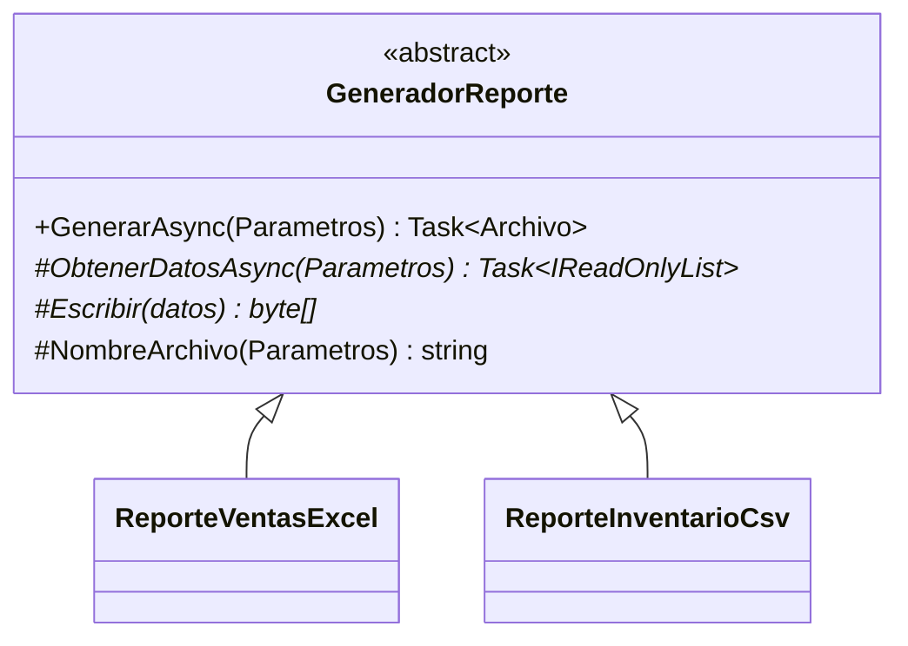

# Patrón Template Method

Parte de: [[09-Arquitectura-Patrones/02 Patrones de diseño/_Índice Patrones de diseño|Patrones de diseño]]

> [!info] Cómo avanzar
> `progreso`: **pendiente** → **viendo** (estudiando) → **visto** (contestaste la autoevaluación sin abrir las respuestas) → **dominado** (hiciste el laboratorio o lo aplicaste de verdad).

## Contenido

### Qué es
*Template Method* (método plantilla) es un patrón de comportamiento en el que **una clase base define el esqueleto de un algoritmo** en un método (la plantilla) y **deja que las subclases implementen ciertos pasos** sin cambiar el orden general. La base dice "primero valido, luego leo datos, luego genero, luego guardo"; cada subclase decide cómo se hace "generar". Sirve para reutilizar un flujo fijo con pasos variables y garantizar que nadie se salte un paso obligatorio.

### Cómo funciona
1. La clase base es `abstract` y tiene un método público, normalmente **no virtual**, con el flujo.
2. Los pasos variables son métodos `protected abstract` (obligatorios) o `protected virtual` con implementación por defecto (*hooks* opcionales).
3. Las subclases sobrescriben solo los pasos.
4. El cliente llama al método plantilla; el control fluye de la base hacia la subclase ("principio de Hollywood": no nos llames, nosotros te llamamos).



### Ejemplo en .NET
El caso más conocido del propio framework es **`BackgroundService`**: la clase base implementa `StartAsync` y `StopAsync` (arranque, manejo de cancelación, espera al detenerse) y tú solo implementas el paso abstracto `ExecuteAsync`.

```csharp
public sealed class LimpiezaArchivos(ILogger<LimpiezaArchivos> log) : BackgroundService
{
    protected override async Task ExecuteAsync(CancellationToken ct) // el paso que te toca
    {
        using var timer = new PeriodicTimer(TimeSpan.FromHours(1));
        while (await timer.WaitForNextTickAsync(ct))
            log.LogInformation("Limpiando archivos temporales");
    }
}
```

Otros ejemplos del framework: `JsonConverter<T>` (`Read`/`Write`), `ValidationAttribute.IsValid`, `Stream` (implementas `Read`/`Write` y la base da `CopyTo`, `ReadAsync` por defecto), `DelegatingHandler.SendAsync`.

En tu código, Wee.Reporteria es un caso natural:

```csharp
public abstract class GeneradorReporte<TFila>
{
    // Plantilla: el flujo no se puede alterar
    public async Task<ArchivoReporte> GenerarAsync(ParametrosReporte p, CancellationToken ct)
    {
        Validar(p);
        var filas = await ObtenerDatosAsync(p, ct);
        var contenido = Escribir(filas);
        return new ArchivoReporte(NombreArchivo(p), contenido);
    }

    protected virtual void Validar(ParametrosReporte p)            // hook con defecto
    {
        if (p.Hasta < p.Desde) throw new ArgumentException("Rango de fechas inválido.");
    }
    protected abstract Task<IReadOnlyList<TFila>> ObtenerDatosAsync(ParametrosReporte p, CancellationToken ct);
    protected abstract byte[] Escribir(IReadOnlyList<TFila> filas);
    protected virtual string NombreArchivo(ParametrosReporte p) => $"{GetType().Name}_{p.Desde:yyyyMMdd}.xlsx";
}
```

### Por qué muchos prefieren Strategy o composición
Template Method usa **herencia**, y la herencia acopla fuerte:
- La subclase depende de detalles de la base (qué llama primero, qué estado deja). Cambiar la base puede romper subclases (*fragile base class*).
- Solo puedes heredar de **una** clase: si quieres "datos de SQL + salida en Excel" y "datos de API + salida en Excel", la jerarquía se multiplica (`ReporteSqlExcel`, `ReporteApiExcel`, `ReporteSqlCsv`...).
- Las pruebas exigen crear subclases solo para probar.

Con **composición** separas los pasos variables en interfaces y los combinas libremente:

```csharp
public sealed class GeneradorReporte<TFila>(IFuenteDatos<TFila> fuente, IFormatoSalida formato)
{
    public async Task<ArchivoReporte> GenerarAsync(ParametrosReporte p, CancellationToken ct)
    {
        var filas = await fuente.ObtenerAsync(p, ct);
        return new ArchivoReporte(formato.Nombre(p), formato.Escribir(filas));
    }
}
```

Ahora fuente y formato son estrategias independientes ([[Patrón Strategy]]), inyectables y probables por separado. La regla general: *prefiere composición sobre herencia*.

### Cuándo usarlo y cuándo no
- **Úsalo** cuando el flujo es realmente fijo, hay pocas variantes, y quieres que el framework controle el ciclo (como `BackgroundService`). También en clases base de pruebas con *setup* común.
- **Prefiere Strategy** si los pasos varían de forma independiente o hay muchas combinaciones.

### Errores comunes
1. **Método plantilla `virtual`:** las subclases lo sobrescriben y se saltan pasos. Déjalo no virtual.
2. **Demasiados hooks:** diez métodos virtuales hacen imposible saber qué pasa.
3. **Jerarquías profundas** (base → intermedia → concreta) con lógica en todas.
4. **Llamar métodos virtuales desde el constructor** de la base: la subclase aún no está inicializada.

### Para profundizar
- [Template Method (Refactoring.Guru)](https://refactoring.guru/design-patterns/template-method)
- [Worker services y BackgroundService (Microsoft Learn)](https://learn.microsoft.com/en-us/dotnet/core/extensions/workers)

## Autoevaluación

Contesta primero en voz alta o en papel; luego despliega la respuesta.

> [!question]- ¿Qué es Template Method?
> Una clase base define el esqueleto de un algoritmo en un método no sobrescribible y deja pasos `abstract` o `virtual` para las subclases.

> [!question]- Ejemplo en .NET.
> `BackgroundService`: la base gestiona inicio/parada y tú implementas `ExecuteAsync`. También `DelegatingHandler.SendAsync`.

> [!question]- ¿Por qué muchos prefieren Strategy o composición?
> La herencia acopla fuerte a la base y solo permite una; con composición puedes combinar y probar pasos por separado.

