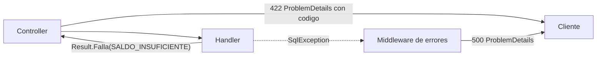

# Result pattern vs excepciones

Parte de: [[09-Arquitectura-Patrones/02 Patrones de diseño/_Índice Patrones de diseño|Patrones de diseño]]

> [!info] Cómo avanzar
> `progreso`: **pendiente** → **viendo** (estudiando) → **visto** (contestaste la autoevaluación sin abrir las respuestas) → **dominado** (hiciste el laboratorio o lo aplicaste de verdad).

## Contenido

### Qué es
El *Result pattern* consiste en que un método **devuelva un objeto que indica explícitamente si tuvo éxito o falló** (con el valor o con el error) en lugar de lanzar una excepción cuando algo esperado sale mal. La firma `Result<Recibo> Retirar(decimal monto)` le dice al que llama: "esto puede fallar y tienes que manejarlo". Las excepciones, en cambio, son para situaciones **excepcionales**: cosas que no deberían pasar o que el código no puede resolver en ese punto.

### Cómo funciona
#### Cuándo excepción y cuándo Result
| Situación | Mecanismo | Por qué |
|---|---|---|
| Saldo insuficiente, RFC ya registrado, pedido ya cerrado | **Result** | Es un resultado de negocio esperado; el usuario puede corregirlo |
| Datos de entrada con formato inválido | **Validación** ([[FluentValidation]]) | Se detecta en el borde, antes del caso de uso |
| Argumento nulo que nunca debió llegar | **Excepción** ([[Guard clauses]]) | Error de programación |
| SQL Server caído, timeout, disco lleno | **Excepción** | Fallo de infraestructura; no lo resuelve el caso de uso |
| Concurrencia optimista (otro editó la fila) | Depende: Result si el usuario debe reintentar, excepción si es raro | |



#### Rendimiento
Lanzar una excepción es **mucho más caro** que devolver un valor: el runtime captura la pila de llamadas, busca el `catch` recorriendo marcos y desenrolla. Una excepción cuesta del orden de microsegundos frente a nanosegundos de un `return`, es decir, varios órdenes de magnitud más. En el flujo normal (validar miles de solicitudes, un saldo insuficiente común) eso se nota en CPU y latencia bajo carga, además de llenar los logs y la telemetría de "errores" que no lo son. Por eso Microsoft recomienda no usar excepciones para el control de flujo normal.

### Ejemplo
Un `Result<T>` mínimo y suficiente:

```csharp
public sealed record Error(string Codigo, string Mensaje);

public readonly record struct Result<T>
{
    public T? Valor { get; }
    public Error? Error { get; }
    public bool Exito => Error is null;

    private Result(T? valor, Error? error) => (Valor, Error) = (valor, error);
    public static Result<T> Ok(T valor) => new(valor, null);
    public static Result<T> Falla(string codigo, string mensaje) => new(default, new Error(codigo, mensaje));
}

public sealed record Movimiento(Guid Id, decimal Monto, decimal SaldoNuevo);

public sealed class Cuenta(decimal saldoInicial)
{
    public decimal Saldo { get; private set; } = saldoInicial;

    public Result<Movimiento> Retirar(decimal monto)
    {
        ArgumentOutOfRangeException.ThrowIfNegativeOrZero(monto); // guarda: error de programación
        if (monto > Saldo)
            return Result<Movimiento>.Falla("SALDO_INSUFICIENTE",
                $"El saldo disponible ({Saldo:C}) no alcanza para retirar {monto:C}.");

        Saldo -= monto;
        return Result<Movimiento>.Ok(new Movimiento(Guid.NewGuid(), monto, Saldo));
    }
}
```

Mapeo a HTTP en el controller, con [[ProblemDetails]] y la extensión `codigo` que usa el usuario:

```csharp
[HttpPost("{id:int}/retiros")]
public async Task<IActionResult> Retirar(int id, RetirarRequest req, [FromServices] RetirarHandler h)
{
    Result<Movimiento> r = await h.Handle(id, req.Monto);
    if (r.Exito) return Ok(r.Valor);

    var problema = new ProblemDetails
    {
        Status = StatusCodes.Status422UnprocessableEntity,
        Title = "No se pudo realizar el retiro",
        Detail = r.Error!.Mensaje
    };
    problema.Extensions["codigo"] = r.Error.Codigo;
    return UnprocessableEntity(problema);
}
```

Las excepciones de infraestructura no se capturan aquí: las atrapa el manejador global (`AddProblemDetails` + `UseExceptionHandler`) y devuelven 500 sin detalles internos.

### Cuándo usarlo y cuándo no
- **Result** para fallas de negocio previsibles que el llamador debe manejar, especialmente en handlers de slices.
- **Excepciones** para errores de programación e infraestructura, y en código de librería donde el llamador no puede hacer nada razonable.
- No conviertas toda excepción en Result: envolver cada `SqlException` en un Result obliga a revisar errores en cada línea sin poder hacer nada útil.

### Errores comunes con Result
1. **Ignorar el resultado:** llamar `Retirar(100)` y no revisar `Exito`. Un Result que nadie revisa es peor que una excepción, porque falla en silencio. Revisa con analizadores o haz que la firma obligue a usar el valor.
2. **Acceder a `Valor` sin comprobar éxito**, obteniendo `null` o `default`.
3. **Errores como texto libre:** sin `codigo` estable, el front no puede reaccionar. Usa códigos constantes (`SALDO_INSUFICIENTE`).
4. **Mezclar estilos sin regla:** unos handlers lanzan, otros devuelven Result para lo mismo. Documenta la convención en las reglas del proyecto.
5. **Result para todo**, incluyendo fallos de infraestructura, que termina en cadenas de `if (!r.Exito) return r;` por todo el código.

### Para profundizar
- [Buenas prácticas para excepciones (Microsoft Learn)](https://learn.microsoft.com/en-us/dotnet/standard/exceptions/best-practices-for-exceptions)
- [Manejo de errores en APIs de ASP.NET Core (Microsoft Learn)](https://learn.microsoft.com/en-us/aspnet/core/web-api/handle-errors)
- [RFC 9457: Problem Details for HTTP APIs](https://www.rfc-editor.org/rfc/rfc9457)

## Ejercicios

Resuélvelos en papel o en la herramienta; la solución está plegada.

> [!question]- Escribe un `Result<T>` mínimo y úsalo en `Retirar(decimal monto)` que falla si el saldo no alcanza; mapea a HTTP en el endpoint.
> ```csharp
> public sealed record Error(string Codigo, string Mensaje);
> public sealed class Result<T> {
>     public T? Valor { get; }
>     public Error? Error { get; }
>     public bool Exito => Error is null;
>     private Result(T? v, Error? e) { Valor = v; Error = e; }
>     public static Result<T> Ok(T v) => new(v, null);
>     public static Result<T> Falla(Error e) => new(default, e);
> }
>
> public Result<decimal> Retirar(decimal monto) =>
>     monto > Saldo
>         ? Result<decimal>.Falla(new("saldo.insuficiente", "Saldo insuficiente"))
>         : Result<decimal>.Ok(Saldo -= monto);
>
> // Endpoint
> var r = cuenta.Retirar(monto);
> return r.Exito ? Results.Ok(r.Valor)
>                : Results.Problem(r.Error!.Mensaje, statusCode: 422);
> ```

## Autoevaluación

Contesta primero en voz alta o en papel; luego despliega la respuesta.

> [!question]- ¿Qué es el Result pattern?
> Devolver un objeto que representa éxito o fallo (`Result<T>` con valor o error) en lugar de lanzar excepción para fallos esperados del negocio.

> [!question]- ¿Cuándo excepción y cuándo Result?
> Excepción: situaciones inesperadas o de programación (base caída, `null` imposible). Result: fallos esperados que el llamador debe manejar (saldo insuficiente, validación, "no encontrado").

> [!question]- ¿Qué pasa con el rendimiento si usas excepciones para el flujo normal?
> Lanzar y capturar es caro (captura de pila) y oculta el flujo; en rutas calientes se nota. Además el compilador no obliga a manejarlas.

> [!question]- Error común con Result.
> Ignorar el resultado (`_ = Pagar()`), o envolver *todo* en Result incluidos errores de infraestructura, lo que llena el código de chequeos sin valor.

