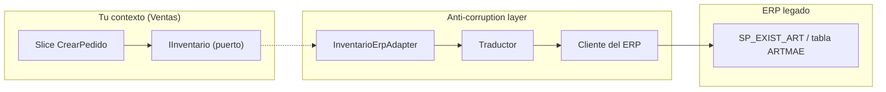

# Anti-corruption layer

Parte de: [[09-Arquitectura-Patrones/03 Patrones de nube y sistemas distribuidos/_Índice Patrones de nube y sistemas distribuidos|Patrones de nube y sistemas distribuidos]]

> [!info] Cómo avanzar
> `progreso`: **pendiente** → **viendo** (estudiando) → **visto** (contestaste la autoevaluación sin abrir las respuestas) → **dominado** (hiciste el laboratorio o lo aplicaste de verdad).

## Contenido

### Qué es
Una *anti-corruption layer* (ACL, capa anticorrupción) es una **frontera de traducción entre tu sistema y otro sistema con un modelo distinto** (un legado, un ERP, un proveedor externo), de modo que los conceptos, nombres, formatos y reglas del otro lado **no se filtren** en tu modelo. Viene del diseño estratégico de DDD: es uno de los patrones del mapa de [[Bounded contexts]]. Sirve para que puedas integrarte con un sistema "feo" sin que tu código empiece a hablar su idioma, y para poder reemplazarlo después tocando solo la capa.

### Cómo funciona
La ACL se sitúa en el borde de tu contexto y contiene:
1. **Fachadas o clientes** que hablan con el sistema externo (HTTP, SOAP, archivos, tablas).
2. **Traductores** que convierten su modelo al tuyo y viceversa: nombres, códigos, unidades, estados, fechas.
3. **Adaptadores** que implementan las interfaces (puertos) que tu aplicación define.
4. Opcionalmente, **reglas de reconciliación**: qué hacer cuando el otro sistema devuelve datos incompletos o contradictorios.



Puede vivir como unas clases dentro de tu servicio o, si la traducción es pesada o la usan varios sistemas, como un **servicio aparte**.

### Ejemplo concreto
La empresa tiene un ERP antiguo cuyo inventario se consulta con un procedimiento `SP_EXIST_ART` que devuelve columnas como `CVE_ART`, `EXIST`, `ST` (`'A'` activo, `'B'` baja, `'S'` suspendido) y cantidades en "cajas" de 12. Tu dominio de Ventas habla de `Sku`, `PiezasDisponibles` y `Disponible`.

```csharp
// Puerto: lo define Ventas, con su lenguaje
public interface IInventario
{
    Task<Disponibilidad> ConsultarAsync(string sku, CancellationToken ct);
}
public sealed record Disponibilidad(string Sku, int PiezasDisponibles, bool Vendible);

// ACL: lo único que conoce el modelo del ERP
internal sealed record FilaErp(string CVE_ART, decimal EXIST, string ST, int PZAS_CAJA);

internal sealed class InventarioErpAdapter(IDbConnection erp) : IInventario
{
    public async Task<Disponibilidad> ConsultarAsync(string sku, CancellationToken ct)
    {
        var fila = await erp.QuerySingleOrDefaultAsync<FilaErp>(new CommandDefinition(
            "EXEC dbo.SP_EXIST_ART @CveArt", new { CveArt = sku.ToUpperInvariant() },
            commandType: CommandType.Text, cancellationToken: ct));

        return fila is null
            ? new Disponibilidad(sku, 0, Vendible: false)
            : Traducir(fila);
    }

    private static Disponibilidad Traducir(FilaErp f) => new(
        Sku: f.CVE_ART.Trim(),
        PiezasDisponibles: (int)Math.Floor(f.EXIST * f.PZAS_CAJA), // cajas a piezas
        Vendible: f.ST == "A");                                    // 'B' y 'S' no se venden
}
```

Ningún slice de Ventas sabe qué es `ST = 'S'` ni que el ERP cuenta en cajas. Cuando el ERP se reemplace por un servicio nuevo, escribes otro adaptador para `IInventario` y Ventas no cambia. Esto es exactamente "hexagonal solo en bordes": el puerto aparece donde hay un sistema externo con otro modelo.

### ACL vs Adapter
- El **[[Patrón Adapter]]** es un patrón **de código**: hace compatible una interfaz con otra (firma, tipos). Es táctico y local a una clase.
- La **ACL** es un patrón **de arquitectura/estrategia**: protege **un modelo de dominio completo** frente a otro. Normalmente **se construye con** varios adaptadores, fachadas y traductores, e incluye decisiones semánticas (qué significa "suspendido" para Ventas, cómo convertir unidades, qué hacer con datos faltantes).

Dicho de otro modo: todo ACL usa adaptadores, pero un adaptador que solo cambia firmas no es una ACL si deja pasar el modelo ajeno.

### Cuándo usarlo y cuándo no
- **Úsalo** al integrarte con sistemas legados, ERPs, APIs de terceros con modelos muy distintos, o durante una migración con [[Strangler fig]] (el sistema nuevo habla con el viejo a través de una ACL).
- **No hace falta** si el sistema externo ya tiene un modelo limpio que coincide con el tuyo y estable (patrón conformista consciente), o si la integración es trivial (un solo campo).

### Errores comunes
1. **Dejar pasar tipos externos** (`FilaErp`) fuera de la ACL "solo por esta vez".
2. **ACL que crece hasta ser otro sistema**, con lógica de negocio propia que nadie sabe dónde vive. La ACL traduce; las reglas de negocio están en tu dominio.
3. **No traducir errores ni estados**: el código de error del ERP termina en el `ProblemDetails` del cliente.
4. **Olvidar la latencia y fallas** del sistema externo: la ACL es buen lugar para timeouts, reintentos y caché.
5. **Traducción bidireccional incompleta**: lees bien pero escribes con el modelo ajeno.

### Para profundizar
- [Patrón Anti-corruption Layer (Azure Architecture Center)](https://learn.microsoft.com/en-us/azure/architecture/patterns/anti-corruption-layer)
- [Bounded Context (Martin Fowler)](https://martinfowler.com/bliki/BoundedContext.html)
- [DDD Reference (Eric Evans)](https://www.domainlanguage.com/ddd/reference/)

## Autoevaluación

Contesta primero en voz alta o en papel; luego despliega la respuesta.

> [!question]- ¿Qué es una anti-corruption layer (ACL)?
> Una capa de traducción entre tu modelo y un sistema externo o legado para que los conceptos y defectos del otro no contaminen tu dominio.

> [!question]- Ejemplo concreto.
> Un ERP devuelve `STATUS_CD = "03"`; la ACL lo traduce a `EstadoPedido.Enviado`. Tu dominio nunca ve códigos del ERP.

> [!question]- ACL vs [[Patrón Adapter]].
> Adapter traduce interfaces a nivel de clase; la ACL es una frontera entre modelos (puede tener varios adapters, fachadas y traductores).

