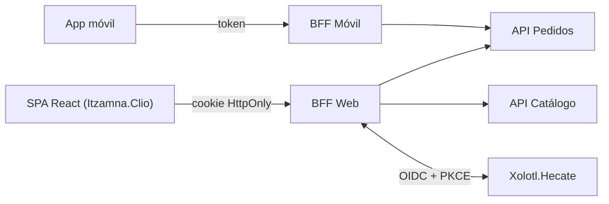

# Backend for Frontend (BFF)

Parte de: [[09-Arquitectura-Patrones/03 Patrones de nube y sistemas distribuidos/_Índice Patrones de nube y sistemas distribuidos|Patrones de nube y sistemas distribuidos]]

> [!info] Cómo avanzar
> `progreso`: **pendiente** → **viendo** (estudiando) → **visto** (contestaste la autoevaluación sin abrir las respuestas) → **dominado** (hiciste el laboratorio o lo aplicaste de verdad).

## Contenido

### Qué es
*Backend for Frontend* (BFF) es un patrón en el que **cada tipo de cliente tiene su propio backend dedicado**: uno para la SPA web, otro para la app móvil, otro para socios. Cada BFF expone exactamente lo que su interfaz necesita (formas de datos, agregaciones, paginación) y se comunica con los servicios internos. Sirve para evitar una API genérica que intenta complacer a todos y termina demasiado gruesa para el móvil y demasiado conversadora para la web. En SPAs tiene además una variante muy importante de **seguridad**: el BFF maneja la autenticación para que el navegador nunca toque los tokens.

### Cómo funciona


1. **Agregación y forma:** el BFF combina datos de varias APIs en una sola respuesta para una pantalla (reduce llamadas desde el cliente) y recorta campos que esa interfaz no usa.
2. **Dueño:** idealmente lo mantiene el mismo equipo que el frontend, porque evoluciona al ritmo de la UI.
3. **Seguridad (patrón BFF para SPAs):**
   - El BFF actúa como **cliente confidencial** de OAuth/OIDC: hace el flujo de autorización con PKCE y el intercambio de código **en el servidor**, usando su secreto.
   - Guarda los tokens (access y refresh) **del lado del servidor** y le da al navegador solo una **cookie de sesión `HttpOnly`, `Secure` y `SameSite`**.
   - Cuando la SPA llama `/api/...`, el BFF agrega el access token y reenvía a la API (proxy).

### Ventaja de seguridad en SPAs
Si la SPA guarda el access token en `localStorage` o en memoria, cualquier XSS (un script inyectado, una dependencia npm comprometida) puede **leerlo y usarlo desde otro lugar** hasta que expire, y un refresh token robado da acceso aún más largo. Con BFF:
- **No hay tokens en JavaScript**: la cookie `HttpOnly` no es legible desde scripts, así que un XSS no puede exfiltrar credenciales (aún podría hacer peticiones mientras la página está abierta, por eso el XSS sigue siendo grave).
- El refresh token nunca sale del servidor.
- El BFF puede ser cliente confidencial (con secreto), lo que una SPA pública no puede.
- Debes protegerte de CSRF: `SameSite=Strict` o `Lax` más un encabezado personalizado obligatorio (por ejemplo `X-CSRF: 1`) en las llamadas a la API.

La guía actual de la IETF para aplicaciones OAuth basadas en navegador describe el BFF como la opción más segura para este caso.

### Ejemplo
Un BFF en ASP.NET Core para Itzamna.Clio, con cookie + OIDC contra Xolotl.Hecate y YARP como proxy:

```csharp
builder.Services.AddAuthentication(o =>
    {
        o.DefaultScheme = CookieAuthenticationDefaults.AuthenticationScheme;
        o.DefaultChallengeScheme = OpenIdConnectDefaults.AuthenticationScheme;
    })
    .AddCookie(o =>
    {
        o.Cookie.HttpOnly = true;
        o.Cookie.SecurePolicy = CookieSecurePolicy.Always;
        o.Cookie.SameSite = SameSiteMode.Strict;
    })
    .AddOpenIdConnect(o =>
    {
        o.Authority = builder.Configuration["Hecate:Authority"];
        o.ClientId = "clio-bff";
        o.ClientSecret = builder.Configuration["Hecate:ClientSecret"]; // desde Key Vault, no del repo
        o.ResponseType = "code";
        o.UsePkce = true;
        o.SaveTokens = true;  // tokens en la sesión del servidor
        o.Scope.Add("api.pedidos");
    });

builder.Services.AddReverseProxy()
    .LoadFromConfig(builder.Configuration.GetSection("ReverseProxy"));
```

Un transform de YARP toma el access token de la sesión (`HttpContext.GetTokenAsync("access_token")`) y agrega el encabezado `Authorization` antes de reenviar. Existen librerías que resuelven todo esto (Duende BFF, con licencia comercial; revisa términos).

### Riesgo
- **Duplicación:** varios BFF repiten lógica de agregación o, peor, **reglas de negocio**. El BFF no debe decidir precios ni permisos de negocio; solo adapta y orquesta presentación.
- **Otro componente que operar:** despliegue, escalado y disponibilidad extra; si el BFF cae, cae la experiencia completa (punto único de falla).
- **Latencia** de un salto adicional.
- **Sesiones del lado del servidor:** necesitas almacenar sesiones de forma compartida (no en memoria) si escalas horizontalmente, y configurar Data Protection con llaves compartidas.
- **Crecer como monolito de presentación** si un solo BFF sirve a muchos clientes distintos.

### Cuándo usarlo y cuándo no
- **Úsalo** con SPAs que manejan datos sensibles (recomendado por seguridad), o cuando clientes distintos necesitan formas de datos muy diferentes.
- **No hace falta** si tienes un solo cliente simple y la API ya le queda bien, o una SPA servida por el mismo backend con cookie (ese backend ya es tu BFF).

### Para profundizar
- [Patrón Backends for Frontends (Azure Architecture Center)](https://learn.microsoft.com/en-us/azure/architecture/patterns/backends-for-frontends)
- [OAuth 2.0 for Browser-Based Applications (IETF)](https://datatracker.ietf.org/doc/draft-ietf-oauth-browser-based-apps/)
- [YARP en ASP.NET Core (Microsoft Learn)](https://learn.microsoft.com/en-us/aspnet/core/fundamentals/servers/yarp/yarp-overview)
- [Duende BFF Security Framework](https://docs.duendesoftware.com/bff/)

## Autoevaluación

Contesta primero en voz alta o en papel; luego despliega la respuesta.

> [!question]- ¿Qué es un BFF?
> Un backend dedicado a un tipo de cliente (web, móvil) que agrega y adapta llamadas a los servicios internos según lo que esa UI necesita.

> [!question]- ¿Qué ventaja de seguridad tiene en SPAs?
> El BFF puede hacer el flujo OAuth del lado servidor y guardar los tokens, dando a la SPA solo una cookie `HttpOnly`; los tokens no quedan expuestos en el navegador.

> [!question]- Riesgo.
> Duplicar lógica de negocio en cada BFF. Debe limitarse a agregación y adaptación de presentación.

