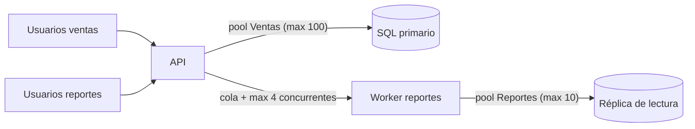

# Bulkhead y throttling

Parte de: [[09-Arquitectura-Patrones/03 Patrones de nube y sistemas distribuidos/_Índice Patrones de nube y sistemas distribuidos|Patrones de nube y sistemas distribuidos]]

> [!info] Cómo avanzar
> `progreso`: **pendiente** → **viendo** (estudiando) → **visto** (contestaste la autoevaluación sin abrir las respuestas) → **dominado** (hiciste el laboratorio o lo aplicaste de verdad).

## Contenido

### Qué es
Son dos patrones de resiliencia que **limitan el consumo de recursos** para que una parte del sistema no tumbe al resto:

- **Bulkhead (mamparo):** se inspira en los compartimentos estancos de un barco; si uno se inunda, los demás no. En software, **separas recursos (hilos, conexiones, instancias, colas) por tipo de trabajo o cliente**, de modo que si uno se agota, los otros siguen funcionando.
- **Throttling (estrangulamiento):** **limitas cuántas solicitudes aceptas** por cliente, operación o en total en un periodo, y rechazas o encolas el exceso para mantener el servicio dentro de su capacidad.

### Cómo funciona
#### Bulkhead
Formas de aislar:
1. **Límite de concurrencia por dependencia u operación:** como máximo 10 llamadas simultáneas al servicio de reportes; la llamada 11 espera en una cola corta o se rechaza.
2. **Pools separados:** un pool de conexiones a SQL para la API transaccional y otro para reportes (en SQL Server, cadenas de conexión distintas, por ejemplo con distinto `Application Name`, generan pools distintos con su propio `Max Pool Size`).
3. **Despliegues separados:** procesar reportes en otro proceso o instancia (un worker), no en la API.
4. **Datos separados:** reportes sobre una réplica de lectura.

En .NET, la estrategia de bulkhead de Polly v8 se implementa como **limitador de concurrencia** (`AddConcurrencyLimiter(permisos, cola)` del paquete `Polly.RateLimiting`), que lanza `RateLimiterRejectedException` al rechazar.

#### Throttling
El servidor aplica un algoritmo (ventana fija, ventana deslizante, token bucket, concurrencia) y, al exceder el límite, **responde `429 Too Many Requests`** con el encabezado **`Retry-After`** indicando cuándo reintentar. El cliente bien educado respeta ese tiempo. Ver [[Rate limiting]].



### Ejemplo: el reporte que tumba ventas
**Caso:** un reporte pesado de Wee.Reporteria corre en la misma API que ventas, abre consultas de minutos, agota el pool de conexiones y las peticiones de ventas esperan una conexión hasta el timeout. La API "se cae" aunque el servidor tenga CPU libre.

**Qué aplicas**, de lo más inmediato a lo más estructural:
1. **Throttling en el endpoint de reportes** para aceptar pocas solicitudes simultáneas.
2. **Bulkhead de conexiones:** cadena de conexión propia para reportes con `Max Pool Size` bajo, separada del pool de ventas.
3. **Sacar el trabajo de la petición:** el endpoint encola la solicitud (202 Accepted) y un worker la procesa con concurrencia limitada.
4. **Réplica de lectura** para las consultas de reporte, con `ApplicationIntent=ReadOnly`.

```csharp
builder.Services.AddRateLimiter(o =>
{
    o.RejectionStatusCode = StatusCodes.Status429TooManyRequests; // por defecto sería 503
    o.AddConcurrencyLimiter("reportes", l =>
    {
        l.PermitLimit = 4;   // máximo 4 reportes generándose a la vez
        l.QueueLimit = 10;   // 10 esperando; el resto recibe 429
    });
    o.OnRejected = (ctx, _) =>
    {
        ctx.HttpContext.Response.Headers.RetryAfter = "30";
        return ValueTask.CompletedTask;
    };
});

app.UseRateLimiter();
// En el controller: [EnableRateLimiting("reportes")] sobre la acción de generar

// Bulkhead de conexiones: dos cadenas, dos pools
// "Ventas":   "...;Application Name=Dionisio.Ventas;Max Pool Size=100"
// "Reportes": "...;Application Name=Dionisio.Reportes;Max Pool Size=10;ApplicationIntent=ReadOnly"
```

Para llamadas salientes, un `ResiliencePipeline` con `AddConcurrencyLimiter(10, 20)` alrededor del cliente de un servicio lento evita que todos los hilos queden esperándolo.

### Cuándo usarlo y cuándo no
- **Bulkhead:** cuando cargas de trabajo con perfiles muy distintos comparten recursos (transaccional vs analítica, clientes premium vs gratuitos, una dependencia lenta).
- **Throttling:** en toda API pública o multi-tenant, para proteger la capacidad y repartirla con justicia; también para respetar límites de dependencias (APIs de terceros con cuota).
- No sustituyen a escalar cuando la demanda legítima supera la capacidad: limitan el daño, no crean capacidad.

### Errores comunes
1. **Un solo pool para todo** y descubrirlo en el primer cierre de mes.
2. **Responder 503 o 500 al limitar** sin `Retry-After`: los clientes reintentan de inmediato y empeoran la carga. Usa 429 con `Retry-After`.
3. **Límites en memoria con varias instancias:** cada instancia cuenta por su lado; el límite real es N veces mayor. Para límites globales usa un almacén compartido o el gateway (Azure API Management).
4. **Colas sin límite:** esconden la sobrecarga hasta que la memoria se acaba. Ver [[Backpressure]].
5. **Particiones mal elegidas:** limitar por IP detrás de un proxy corporativo castiga a toda una empresa; limita por usuario o tenant.

### Para profundizar
- [Patrón Bulkhead (Azure Architecture Center)](https://learn.microsoft.com/en-us/azure/architecture/patterns/bulkhead)
- [Patrón Throttling (Azure Architecture Center)](https://learn.microsoft.com/en-us/azure/architecture/patterns/throttling)
- [Middleware de rate limiting en ASP.NET Core (Microsoft Learn)](https://learn.microsoft.com/en-us/aspnet/core/performance/rate-limit)
- [Rate limiter y concurrency limiter en Polly](https://pollydocs.org/strategies/rate-limiter.html)

## Autoevaluación

Contesta primero en voz alta o en papel; luego despliega la respuesta.

> [!question]- ¿Qué es un bulkhead?
> Aislar recursos (hilos, conexiones, colas) por dependencia o tipo de cliente, como compartimentos de un barco, para que un fallo o saturación no consuma todo.

> [!question]- ¿Qué es throttling y cómo responde el servidor?
> Limitar el consumo por cliente/tenant cuando se supera una cuota; se responde 429 con `Retry-After` o se degrada el servicio. Ver [[Rate limiting]].

> [!question]- Caso: un reporte pesado agota el pool de conexiones y la API de ventas se cae. ¿Qué aplicas?
> Bulkhead: un pool/cola separado y con límite de concurrencia para reportes (o un servicio aparte), de modo que ventas conserve sus recursos.

## Práctica

- [[Lab 2 - Resiliencia con reintentos y circuit breaker en .NET]]

