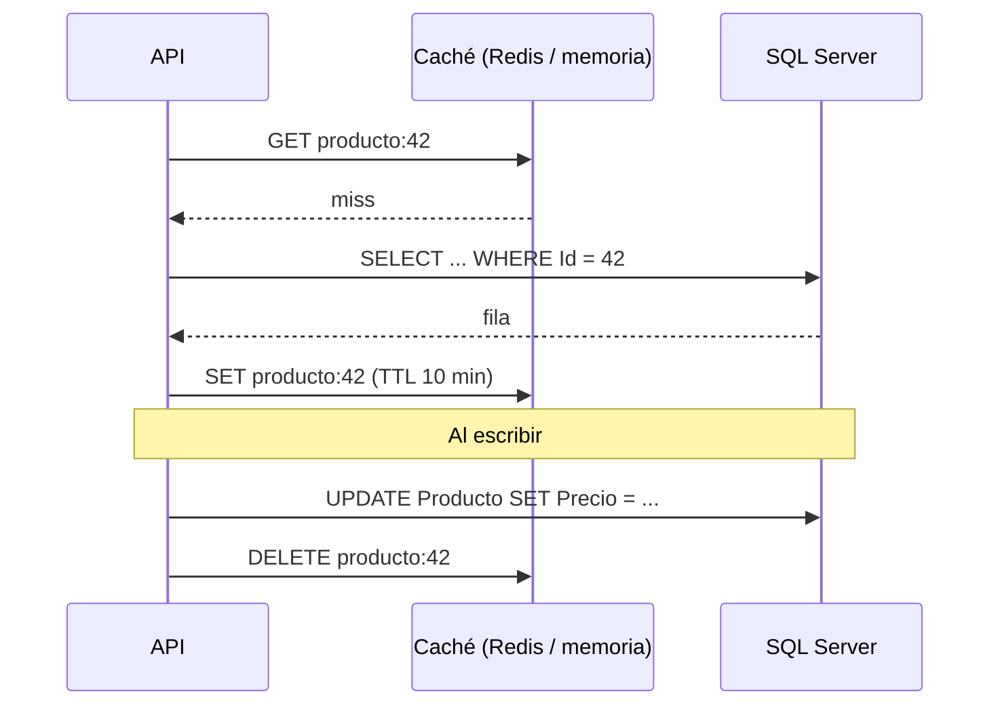

# Cache-aside y estrategias de caché

Parte de: [[09-Arquitectura-Patrones/03 Patrones de nube y sistemas distribuidos/_Índice Patrones de nube y sistemas distribuidos|Patrones de nube y sistemas distribuidos]]

> [!info] Cómo avanzar
> `progreso`: **pendiente** → **viendo** (estudiando) → **visto** (contestaste la autoevaluación sin abrir las respuestas) → **dominado** (hiciste el laboratorio o lo aplicaste de verdad).

## Contenido

### Qué es
*Cache-aside* (o *lazy loading*) es el patrón de caché más usado: **la aplicación consulta primero la caché; si el dato no está (miss), lo lee de la base, lo guarda en la caché y lo devuelve**. La caché no sabe nada de la base: la aplicación controla cuándo cargar y cuándo invalidar. Sirve para reducir latencia y carga sobre la base en datos que se leen mucho más de lo que se escriben (catálogos, configuración, perfiles).

### Cómo funciona


**Lectura:** caché → si falla, base → guardar en caché con TTL (tiempo de vida).
**Escritura:** actualizar la base → **invalidar** (borrar) la llave en la caché. La siguiente lectura la recarga.

#### Otras estrategias
| Estrategia | Escritura | Ventaja | Riesgo |
|---|---|---|---|
| **Cache-aside** | App escribe en BD e invalida | Simple, la caché solo tiene lo que se lee | Primer acceso lento; ventana de datos viejos |
| **Read-through** | La caché carga sola desde la BD en un miss | Código de app más simple | Requiere caché con proveedor de datos |
| **Write-through** | Se escribe en caché **y** en BD de forma síncrona en la misma operación | Caché siempre fresca para lo escrito | Escrituras más lentas; cachea datos que quizá nadie lee |
| **Write-behind (write-back)** | Se escribe en caché y la BD se actualiza **después**, de forma asíncrona y por lotes | Escrituras muy rápidas, absorbe picos | **Pérdida de datos** si la caché cae antes de persistir; consistencia eventual |

Write-through prioriza consistencia; write-behind prioriza velocidad de escritura a costa de durabilidad. Para datos de negocio en SQL Server, cache-aside con invalidación es la opción por defecto.

#### Estampida (cache stampede)
Cuando una llave muy consultada **expira**, cientos de peticiones simultáneas reciben miss y **todas** van a la base a recalcular lo mismo. La base se satura justo en el peor momento. Se evita con:
- **Una sola carga por llave** (*single-flight* o candado): la primera petición recalcula y las demás esperan ese resultado. `HybridCache` de .NET lo hace por defecto.
- **TTL con variación aleatoria (jitter)** para que no expiren muchas llaves a la vez.
- **Refresco anticipado:** recalcular en segundo plano antes de que expire.
- **Servir el valor viejo** mientras se recalcula (*stale-while-revalidate*).

#### Invalidar en vez de actualizar
Al escribir, ¿actualizas la caché con el valor nuevo o la borras? **Bórrala.** Si actualizas, dos escrituras concurrentes pueden llegar en distinto orden a la base y a la caché: la base termina con el valor B y la caché con A, y ese dato viejo vive hasta el TTL. Además, el valor que se cachea puede ser una proyección (con joins, cálculos) que el código de escritura no sabe construir. Borrar es idempotente y deja que la siguiente lectura cargue el estado real.

### Ejemplo
`HybridCache` (disponible de forma estable desde 2025 para .NET) combina caché en memoria (L1) y distribuida (L2, por ejemplo Redis) con protección contra estampida:

```csharp
builder.Services.AddHybridCache(o =>
{
    o.DefaultEntryOptions = new HybridCacheEntryOptions
    {
        Expiration = TimeSpan.FromMinutes(10),          // L2
        LocalCacheExpiration = TimeSpan.FromMinutes(2)  // L1
    };
});
// Opcional L2: builder.Services.AddStackExchangeRedisCache(o => o.Configuration = ...);

public sealed class ObtenerProductoHandler(HybridCache cache, IObtenerProducto consulta)
{
    public ValueTask<ProductoDto?> Handle(int id, CancellationToken ct) =>
        cache.GetOrCreateAsync($"producto:{id}",
            async token => await consulta.EjecutarAsync(id, token), // IObtenerProducto + .sql
            cancellationToken: ct);
}

public sealed class CambiarPrecioHandler(HybridCache cache, ICambiarPrecio comando)
{
    public async Task Handle(int id, decimal precio, CancellationToken ct)
    {
        await comando.EjecutarAsync(id, precio, ct);
        await cache.RemoveAsync($"producto:{id}", ct); // invalidar después de confirmar
    }
}
```

Fíjate que encaja con "una interfaz por consulta": la caché envuelve `IObtenerProducto` y puede ir como [[Patrón Decorator|decorador]]. Para respuestas HTTP completas existe además [[Output caching]].

### Cuándo usarlo y cuándo no
- **Úsalo** en lecturas frecuentes de datos que cambian poco y toleran unos segundos o minutos de atraso.
- **No lo uses** para datos que exigen consistencia fuerte (saldo, existencias al momento de cobrar), datos por usuario que casi no se repiten, o para tapar consultas mal indexadas (arregla primero el índice).

### Errores comunes
1. **Sin TTL:** datos viejos para siempre si una invalidación falla.
2. **Llaves sin tenant o usuario** en datos privados: un cliente ve datos de otro.
3. **Cachear `null` sin control** o, al revés, no cachearlo y que una llave inexistente golpee la base siempre.
4. **Invalidar antes de confirmar** la transacción: otra petición recarga el valor viejo.
5. **Caché local con varias instancias** sin invalidación distribuida: cada instancia ve algo distinto.

### Para profundizar
- [Patrón Cache-Aside (Azure Architecture Center)](https://learn.microsoft.com/en-us/azure/architecture/patterns/cache-aside)
- [HybridCache en ASP.NET Core (Microsoft Learn)](https://learn.microsoft.com/en-us/aspnet/core/performance/caching/hybrid)
- [Guía de caché (Azure Architecture Center)](https://learn.microsoft.com/en-us/azure/architecture/best-practices/caching)

## Autoevaluación

Contesta primero en voz alta o en papel; luego despliega la respuesta.

> [!question]- ¿Cómo funciona cache-aside?
> Lectura: buscar en caché; si no está (*miss*), leer de la base, guardar en caché con TTL y devolver. Escritura: actualizar la base e **invalidar** la entrada.

> [!question]- Compara write-through y write-behind.
> Write-through: se escribe en caché y base de forma síncrona (consistente, más latencia de escritura). Write-behind: se escribe en caché y la base se actualiza después (rápido; riesgo de perder datos).

> [!question]- ¿Qué es una estampida (*cache stampede*) y cómo se evita?
> Cuando expira una clave popular y miles de peticiones van a la base a la vez. Se mitiga con un lock por clave (solo uno recalcula), TTL con *jitter* o refresco anticipado.

> [!question]- ¿Por qué invalidar en vez de actualizar la caché al escribir?
> Con escrituras concurrentes, actualizar puede dejar el valor viejo ganando la carrera; borrar obliga a que la siguiente lectura traiga el dato actual.

