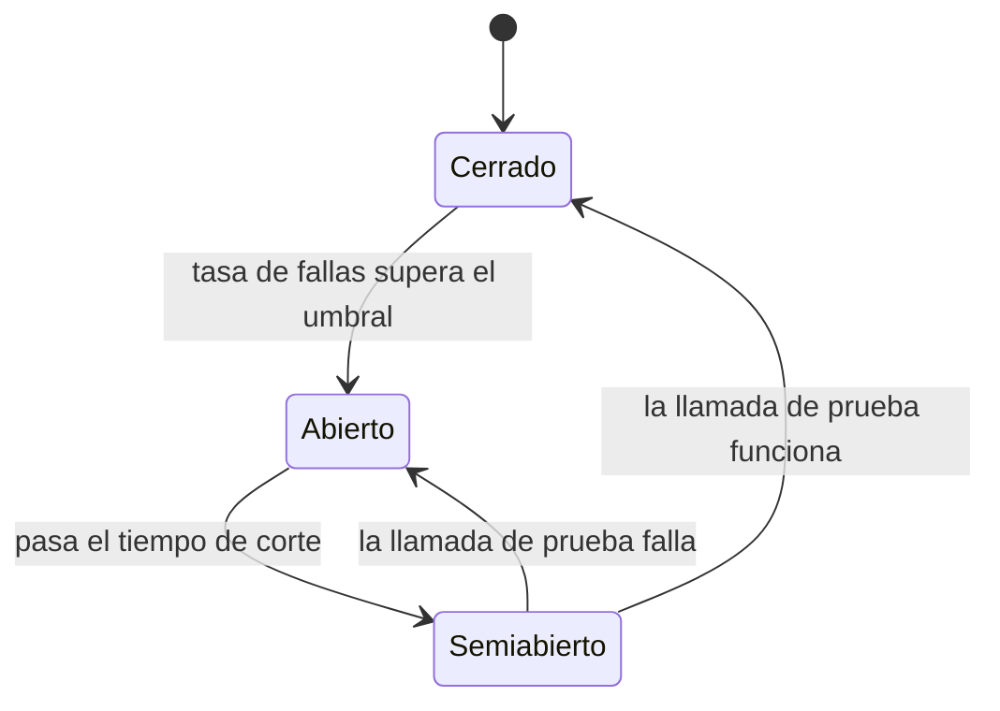

# Circuit breaker y reintentos

Parte de: [[09-Arquitectura-Patrones/03 Patrones de nube y sistemas distribuidos/_Índice Patrones de nube y sistemas distribuidos|Patrones de nube y sistemas distribuidos]]

> [!info] Cómo avanzar
> `progreso`: **pendiente** → **viendo** (estudiando) → **visto** (contestaste la autoevaluación sin abrir las respuestas) → **dominado** (hiciste el laboratorio o lo aplicaste de verdad).

## Contenido

### Qué es
Son dos patrones complementarios para tratar fallas de dependencias remotas (otra API, SQL, un proveedor):

- **Reintentos (retry):** repetir automáticamente una operación que falló por una causa **transitoria** (un timeout, un 503 momentáneo), esperando entre intentos.
- **Circuit breaker (cortacircuitos):** vigilar la tasa de fallas hacia una dependencia y, si supera un umbral, **dejar de llamarla durante un tiempo** y fallar de inmediato. Así no la saturas mientras se recupera ni dejas tus hilos esperando timeouts inútiles.

### Cómo funciona
#### Reintentos con backoff exponencial y jitter
Entre intentos esperas cada vez más: `espera = base × factor^(intento−1)`, con un **tope** por espera. Con base 200 ms, factor 2, 5 reintentos y tope de 2 s: 200, 400, 800, 1,600 y 2,000 ms (el quinto sería 3,200 pero se recorta), en total 5 segundos de espera. Además se agrega **jitter** (variación aleatoria) para que miles de clientes no reintenten sincronizados y golpeen al servidor en olas. Ver [[Reintentos con backoff]].

**Qué reintentar:** errores transitorios: timeouts, errores de red, `408`, `429` (respetando `Retry-After`), `500`, `502`, `503`, `504`, deadlocks de SQL Server (error 1205) y errores transitorios de Azure SQL.
**Qué no reintentar:** `400`, `401`, `403`, `404`, `409`, `422`: son errores del cliente o de negocio; fallarán igual en el siguiente intento.

#### Idempotencia
Reintentar un `POST /cobros` "a ciegas" es peligroso: si el primer intento **sí llegó** al servidor y cobró, pero la respuesta se perdió por un timeout, el reintento **cobra dos veces**. Solo reintenta operaciones idempotentes (GET, PUT, DELETE bien diseñados) o usa una **llave de idempotencia** (`Idempotency-Key`) que el servidor guarde para reconocer el duplicado y devolver la respuesta original. Ver [[Idempotencia]].

#### Estados del circuit breaker

- **Cerrado:** las llamadas pasan normalmente y se cuentan los fallos en una ventana.
- **Abierto:** toda llamada falla de inmediato (`BrokenCircuitException`) sin tocar la dependencia.
- **Semiabierto:** se deja pasar una llamada de prueba; según su resultado, cierra o vuelve a abrir.

#### Por qué se combinan y en qué orden
Los reintentos resuelven fallas **breves**; ante una caída **larga**, multiplican el tráfico contra un servicio ya caído. El breaker detecta la caída larga y corta. El orden típico, de afuera hacia adentro: **timeout total → reintentos → circuit breaker → timeout por intento**. Así cada intento tiene su propio límite de tiempo, el breaker cuenta cada intento, y cuando está abierto el reintento recibe un fallo rápido (y deja de insistir o espera).

### Ejemplo
En .NET, `Microsoft.Extensions.Http.Resilience` trae un manejador estándar listo para `HttpClient`:

```csharp
builder.Services.AddHttpClient<PacClient>(c => c.BaseAddress = new("https://pac.ejemplo.mx/"))
    .AddStandardResilienceHandler(o =>
    {
        o.Retry.MaxRetryAttempts = 3;
        o.Retry.BackoffType = DelayBackoffType.Exponential;
        o.Retry.UseJitter = true;
        o.Retry.DisableForUnsafeHttpMethods(); // no reintenta POST/PUT/DELETE/PATCH
        o.AttemptTimeout.Timeout = TimeSpan.FromSeconds(5);
        o.TotalRequestTimeout.Timeout = TimeSpan.FromSeconds(20);
        o.CircuitBreaker.FailureRatio = 0.5;
        o.CircuitBreaker.BreakDuration = TimeSpan.FromSeconds(30);
    });
```

El manejador estándar ya aplica, en este orden, limitador de tasa, timeout total (30 s por defecto), reintentos (3, exponencial con jitter), circuit breaker y timeout por intento (10 s por defecto); arriba solo ajustamos valores. Para código que no es HTTP (por ejemplo Dapper contra SQL), construyes un pipeline con Polly v8:

```csharp
var pipeline = new ResiliencePipelineBuilder()
    .AddRetry(new RetryStrategyOptions
    {
        ShouldHandle = new PredicateBuilder().Handle<SqlException>(e => e.Number is 1205 or -2),
        MaxRetryAttempts = 3,
        Delay = TimeSpan.FromMilliseconds(200),
        BackoffType = DelayBackoffType.Exponential,
        UseJitter = true
    })
    .AddTimeout(TimeSpan.FromSeconds(10))
    .Build();
```

El laboratorio de esta sección lo practica a fondo.

### Cuándo usarlo y cuándo no
- **Úsalo** en toda llamada a red: APIs, servicios de Azure (los SDK ya traen reintentos propios: no dupliques capas), bases remotas.
- **No reintentes** errores de negocio ni operaciones no idempotentes sin llave.
- **No uses breaker** en una dependencia que se llama una vez al día: no tiene muestras para decidir.

### Errores comunes
1. **Reintentos sin backoff ni jitter:** martillas al servicio y alargas la caída.
2. **Reintentos anidados:** el SDK reintenta 3, tu Polly 3 y el cliente HTTP 3: 27 intentos y minutos de espera.
3. **Sin timeout por intento:** un intento colgado consume todo el tiempo.
4. **Reintentar POST de cobro** sin idempotencia.
5. **Breaker compartido mal**: uno solo para todas las dependencias, y una que falla abre el circuito para todas.

### Para profundizar
- [Patrón Circuit Breaker (Azure Architecture Center)](https://learn.microsoft.com/en-us/azure/architecture/patterns/circuit-breaker)
- [Patrón Retry (Azure Architecture Center)](https://learn.microsoft.com/en-us/azure/architecture/patterns/retry)
- [Resiliencia HTTP en .NET (Microsoft Learn)](https://learn.microsoft.com/en-us/dotnet/core/resilience/http-resilience)

## Ejercicios

Resuélvelos en papel o en la herramienta; la solución está plegada.

> [!question]- Backoff exponencial: base 200 ms, factor 2, 5 reintentos, tope 2 s por espera. Lista las esperas y el total.
> 200, 400, 800, 1600, **2000** (tope) → total **5,000 ms**. Sin tope el quinto sería 3,200 y el total 6,200 ms.

## Autoevaluación

Contesta primero en voz alta o en papel; luego despliega la respuesta.

> [!question]- ¿Qué hace un circuit breaker y cuáles son sus estados?
> Corta llamadas a una dependencia que está fallando para no saturarla ni esperar en vano. **Cerrado** (pasa todo), **Abierto** (falla rápido), **Semiabierto** (deja pasar pruebas; si salen bien, cierra).

> [!question]- ¿Qué errores conviene reintentar y cuáles no?
> Reintentar transitorios: timeouts, 503, 429 (respetando `Retry-After`), errores de red. No reintentar: 400, 401, 403, 404, 422 — fallarán igual.

> [!question]- ¿Qué pasa si reintentas un `POST` de cobro sin más?
> Puedes cobrar dos veces si el primer intento sí llegó. Solo reintenta operaciones idempotentes o con *idempotency key* ([[Idempotencia]]).

> [!question]- ¿Por qué se combinan y en qué orden?
> Reintentos para fallos breves; el breaker evita que los reintentos martillen un servicio caído. Típicamente el reintento envuelve al breaker y cada intento tiene timeout propio.

## Práctica

- [[Lab 2 - Resiliencia con reintentos y circuit breaker en .NET]]

