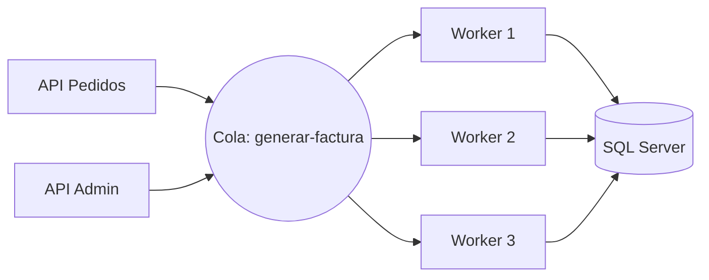

# Competing consumers

Parte de: [[09-Arquitectura-Patrones/03 Patrones de nube y sistemas distribuidos/_Índice Patrones de nube y sistemas distribuidos|Patrones de nube y sistemas distribuidos]]

> [!info] Cómo avanzar
> `progreso`: **pendiente** → **viendo** (estudiando) → **visto** (contestaste la autoevaluación sin abrir las respuestas) → **dominado** (hiciste el laboratorio o lo aplicaste de verdad).

## Contenido

### Qué es
*Competing consumers* (consumidores en competencia) es un patrón de mensajería en el que **varias instancias de un mismo consumidor leen de la misma cola**, y cada mensaje lo procesa **solo una** de ellas. Las instancias "compiten" por los mensajes. Sirve para **escalar el procesamiento horizontalmente** (más instancias, más throughput), para **absorber picos** (la cola guarda lo que no da tiempo de procesar) y para tener **disponibilidad** (si una instancia cae, las otras siguen).

### Cómo funciona


1. Los productores envían mensajes a una **cola** (no a un tema con suscripciones distintas: ahí cada suscripción recibe copia).
2. Cada consumidor pide mensajes. En Azure Service Bus, con **peek-lock**, el mensaje queda **bloqueado** para ese consumidor y oculto a los demás durante el *lock duration*.
3. Si el consumidor termina bien, **completa** el mensaje y se borra. Si falla o su proceso muere, el bloqueo expira y el mensaje **vuelve a la cola** para que otro lo tome.
4. Tras N entregas fallidas (*max delivery count*), el mensaje va a la **dead-letter queue** ([[Dead letter queues y mensajes venenosos]]).
5. Para escalar, agregas instancias (manual o con autoescalado según el largo de la cola, por ejemplo con KEDA en Azure Container Apps).

#### Orden de los mensajes
Con varios consumidores **se pierde el orden global**: el mensaje 2 puede terminar antes que el 1 porque lo tomó un worker más rápido, o porque el 1 falló y se reintentó. Si el orden importa **por entidad** (todos los eventos de un mismo pedido en orden), usa **particionamiento por llave**: en Service Bus, **sesiones** (`SessionId = PedidoId`), que garantizan que los mensajes de una sesión los procese un solo consumidor a la vez y en orden; en Kafka, la llave de partición. El paralelismo sigue existiendo entre sesiones distintas. Si necesitas orden global estricto, solo puede haber un consumidor, y pierdes el patrón.

#### Por qué los consumidores deben ser idempotentes
La entrega es **al menos una vez** (*at-least-once*): un mensaje puede procesarse **más de una vez** si el consumidor hizo el trabajo pero murió (o se le venció el lock) antes de completar el mensaje; otro consumidor lo recibirá de nuevo. Si procesar dos veces "generar factura" timbra dos CFDI, tienes un problema real. El consumidor debe ser **idempotente**: registrar el `MessageId` procesado en una tabla en la misma transacción que el efecto, y si ya existe, completar sin repetir. Ver [[Consumidores idempotentes]] y [[Entrega at-least-once]].

### Ejemplo
Worker con `ServiceBusProcessor`; puedes correr varias instancias del mismo contenedor:

```csharp
public sealed class GenerarFacturaWorker(ServiceBusClient bus, IServiceScopeFactory scopes,
    ILogger<GenerarFacturaWorker> log) : BackgroundService
{
    protected override async Task ExecuteAsync(CancellationToken ct)
    {
        var processor = bus.CreateProcessor("generar-factura", new ServiceBusProcessorOptions
        {
            MaxConcurrentCalls = 8,          // paralelismo dentro de esta instancia
            AutoCompleteMessages = false,
            PrefetchCount = 16
        });

        processor.ProcessMessageAsync += async args =>
        {
            using var scope = scopes.CreateScope();
            var handler = scope.ServiceProvider.GetRequiredService<GenerarFactura.Handler>();
            var cmd = args.Message.Body.ToObjectFromJson<GenerarFactura.Command>()!;

            // Idempotencia: el handler inserta MessageId en dbo.MensajesProcesados
            // en la misma transacción que la factura; si ya existe, no repite.
            await handler.Handle(cmd, args.Message.MessageId, args.CancellationToken);
            await args.CompleteMessageAsync(args.Message, args.CancellationToken);
        };
        processor.ProcessErrorAsync += args =>
        {
            log.LogError(args.Exception, "Error en {Origen}", args.ErrorSource);
            return Task.CompletedTask;
        };

        await processor.StartProcessingAsync(ct);
        await Task.Delay(Timeout.Infinite, ct).ContinueWith(_ => { });
        await processor.StopProcessingAsync();
    }
}
```

El `ServiceBusClient` se registra como singleton y se autentica con identidad administrada, sin cadena de conexión en el repo.

### Cuándo usarlo y cuándo no
- **Úsalo** para trabajo asíncrono e independiente por mensaje: generar facturas, procesar archivos subidos, enviar notificaciones, recalcular reportes.
- **No lo uses** cuando el orden global es requisito estricto, cuando el usuario necesita la respuesta en la misma petición, o cuando el cuello de botella está en la base y más consumidores solo la saturan (limita la concurrencia total).

### Errores comunes
1. **Consumidores no idempotentes:** duplicados en producción en la primera caída.
2. **Lock duration menor que el tiempo de procesamiento:** el mensaje reaparece mientras aún se procesa y otro worker lo duplica. Renueva el lock o ajusta la duración.
3. **Escalar sin límite** y agotar el pool de conexiones de SQL ([[Bulkhead y throttling]]).
4. **Mensajes venenosos** que fallan siempre y bloquean recursos: configura max delivery count y vigila la DLQ.
5. **Suponer orden** sin sesiones o particiones.

### Para profundizar
- [Patrón Competing Consumers (Azure Architecture Center)](https://learn.microsoft.com/en-us/azure/architecture/patterns/competing-consumers)
- [Sesiones de mensajes en Service Bus (Microsoft Learn)](https://learn.microsoft.com/en-us/azure/service-bus-messaging/message-sessions)
- [Competing Consumers (Enterprise Integration Patterns)](https://www.enterpriseintegrationpatterns.com/patterns/messaging/CompetingConsumers.html)

## Autoevaluación

Contesta primero en voz alta o en papel; luego despliega la respuesta.

> [!question]- ¿Qué es competing consumers?
> Varias instancias consumen de la misma cola; cada mensaje lo procesa solo una. Escala horizontalmente el procesamiento.

> [!question]- ¿Qué pasa con el orden de los mensajes?
> Se pierde el orden global. Si importa por entidad, usa particiones/sesiones por clave (`pedidoId`) para que una sola instancia procese esa clave en orden.

> [!question]- ¿Por qué los consumidores deben ser idempotentes?
> Con entrega *at-least-once*, si una instancia muere antes de confirmar, otra recibe el mismo mensaje. Ver [[Consumidores idempotentes]].

