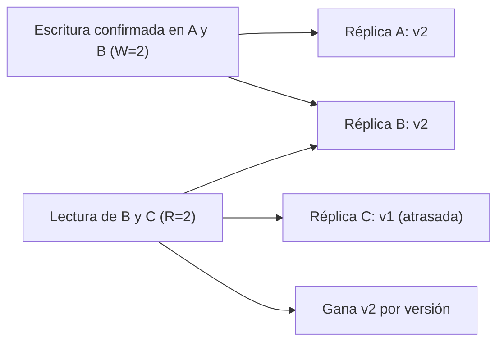

# Consistencia eventual y teorema CAP

Parte de: [[09-Arquitectura-Patrones/03 Patrones de nube y sistemas distribuidos/_Índice Patrones de nube y sistemas distribuidos|Patrones de nube y sistemas distribuidos]]

> [!info] Cómo avanzar
> `progreso`: **pendiente** → **viendo** (estudiando) → **visto** (contestaste la autoevaluación sin abrir las respuestas) → **dominado** (hiciste el laboratorio o lo aplicaste de verdad).

## Contenido

### Qué es
El **teorema CAP** (Eric Brewer, 2000; demostrado por Gilbert y Lynch en 2002) dice que un sistema de datos distribuido, ante una **partición de red** (P: los nodos no pueden comunicarse entre sí), debe elegir entre:
- **Consistencia (C):** toda lectura ve la escritura más reciente confirmada (o devuelve error).
- **Disponibilidad (A):** toda petición a un nodo que funciona recibe una respuesta (no error), aunque quizá no sea la más reciente.

Como las particiones en redes reales **ocurren**, la elección práctica es: cuando hay partición, **CP** (rechazas para no dar datos inconsistentes) o **AP** (respondes con lo que tienes y reconcilias después).

La **consistencia eventual** es la garantía típica de los sistemas AP: si dejan de llegar escrituras, **todas las réplicas convergerán al mismo valor con el tiempo**. No dice cuánto tiempo ni qué verás mientras tanto.

### Cómo funciona
#### Quórums (N, W, R)
En sistemas replicados tipo Dynamo/Cassandra:
- **N** = número de réplicas de cada dato.
- **W** = cuántas réplicas deben confirmar una escritura.
- **R** = cuántas réplicas se consultan en una lectura.

Si **W + R > N**, el conjunto de réplicas que leíste y el que confirmó la última escritura **se traslapan al menos en una**, y esa réplica tiene el valor más reciente (se elige por versión o timestamp). Con N = 3, W = 2, R = 2: 2 + 2 = 4 > 3, la lectura **siempre ve la última escritura confirmada** (en ausencia de mecanismos como *sloppy quorum*). Con W = 1, R = 1: 1 + 1 = 2, que no es mayor que 3; puedes leer de una réplica que aún no recibió la escritura, así que **no está garantizado**: es consistencia eventual, a cambio de menor latencia y mayor disponibilidad.

#### PACELC
CAP solo habla de lo que pasa **durante** una partición, que es poco tiempo. **PACELC** (Daniel Abadi) agrega el caso normal: **si hay Partición, eliges entre A y C; si no (Else), eliges entre Latencia y Consistencia.** Aun sin fallas, esperar a que varias réplicas confirmen cuesta milisegundos; leer de una sola réplica local es rápido pero puede estar atrasado. Ejemplos: Dynamo y Cassandra suelen ser PA/EL (disponibles y rápidos); un clúster con replicación síncrona es PC/EC. Azure Cosmos DB expone este dial con sus cinco niveles de consistencia.

### Ejemplo: carrito vs saldo
- **Carrito de compras:** si durante una partición dos réplicas aceptan cambios distintos ("agregó audífonos" en una, "agregó funda" en otra), es preferible **aceptar ambas y fusionar** (unión de artículos) a decirle al cliente "no puedes agregar ahora". Un artículo que reaparece después de borrarlo es una molestia menor. **AP + consistencia eventual.** Este fue el caso clásico de Amazon Dynamo.
- **Saldo bancario:** si dos réplicas autorizan retiros por separado, puedes dejar la cuenta en negativo o pagar dos veces. Es preferible **rechazar** la operación ("intenta más tarde") a dar un saldo inconsistente. **CP + consistencia fuerte**, típicamente con una base relacional y transacciones (SQL Server con su primario y, en Always On, réplicas síncronas para el failover).

En un sistema real conviven ambos: Pochteca.Nomisma puede guardar saldos con transacciones en Postgres (consistencia fuerte) mientras su tablero de estadísticas lee de una réplica o una caché (eventual).

En .NET, lo eventual aparece en cuanto agregas una réplica de lectura, una caché ([[Cache-aside y estrategias de caché]]) o eventos entre servicios ([[Arquitectura orientada a eventos]]). La pregunta de diseño no es "¿lo evito?", sino "¿qué atraso tolera este dato y cómo lo explico en la interfaz?".

### Cuándo usarlo y cuándo no
- **Acepta consistencia eventual** en catálogos, contadores, feeds, reportes, búsquedas y proyecciones de lectura.
- **Exige consistencia fuerte** en dinero, existencias al momento de vender lo último, identidad y permisos, y cualquier invariante que, roto, cueste dinero o cumplimiento.

### Errores comunes
1. **Creer que se elige "CA":** sin particiones no hay sistema distribuido; las particiones no se eligen.
2. **"Eventual" sin cota:** define cuánto atraso es aceptable (segundos, minutos) y mídelo.
3. **Mezclar lecturas de réplica en flujos de escritura**: validar saldo leyendo de una réplica atrasada.
4. **No diseñar la UX**: el usuario guarda y no ve su cambio; ver [[Modelos de consistencia (fuerte, eventual, read-your-writes)]].
5. **Pensar que CAP habla de rendimiento**: eso es PACELC.

### Para profundizar
- [CAP Twelve Years Later (Eric Brewer, InfoQ)](https://www.infoq.com/articles/cap-twelve-years-later-how-the-rules-have-changed/)
- [Niveles de consistencia en Azure Cosmos DB (Microsoft Learn)](https://learn.microsoft.com/en-us/azure/cosmos-db/consistency-levels)
- [Modelos de consistencia (Jepsen)](https://jepsen.io/consistency)

## Ejercicios

Resuélvelos en papel o en la herramienta; la solución está plegada.

> [!question]- Réplicas N = 3. Con W = 2 y R = 2, ¿la lectura siempre ve la última escritura confirmada? ¿Y con W = 1, R = 1?
> Regla de quórum: si **R + W > N** los conjuntos se traslapan. 2 + 2 = 4 > 3 → sí. 1 + 1 = 2 ≤ 3 → no; puede leerse una réplica que no recibió la escritura.

## Autoevaluación

Contesta primero en voz alta o en papel; luego despliega la respuesta.

> [!question]- Enuncia el teorema CAP.
> Ante una **partición** de red (P), un sistema distribuido debe elegir entre **consistencia** (todas las lecturas ven la última escritura o error) y **disponibilidad** (toda petición recibe respuesta). Sin partición se pueden tener ambas.

> [!question]- ¿Qué es consistencia eventual?
> Si no hay nuevas escrituras, todas las réplicas convergen al mismo valor con el tiempo; mientras tanto, una lectura puede devolver un valor viejo.

> [!question]- ¿Qué agrega PACELC?
> Si hay Partición: A vs C; **E**lse (sin partición): **L**atencia vs **C**onsistencia. Recuerda que el costo de la consistencia existe también en operación normal.

> [!question]- Caso: carrito de compras vs saldo bancario.
> Carrito: disponibilidad (AP) y fusionar después. Saldo/retiros: consistencia (CP); mejor rechazar que permitir un sobregiro.

