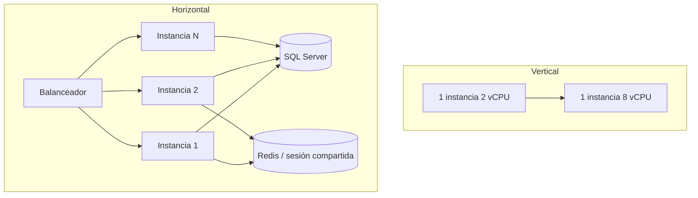

# Escalabilidad horizontal y vertical

Parte de: [[09-Arquitectura-Patrones/03 Patrones de nube y sistemas distribuidos/_Índice Patrones de nube y sistemas distribuidos|Patrones de nube y sistemas distribuidos]]

> [!info] Cómo avanzar
> `progreso`: **pendiente** → **viendo** (estudiando) → **visto** (contestaste la autoevaluación sin abrir las respuestas) → **dominado** (hiciste el laboratorio o lo aplicaste de verdad).

## Contenido

### Qué es
La escalabilidad es la capacidad de un sistema de **atender más carga agregando recursos** sin rediseñarse. Hay dos formas:
- **Vertical (scale up):** darle **más recursos a la misma máquina**: más CPU, RAM, disco más rápido, un plan de App Service o un tier de Azure SQL más grande. Es simple (no cambias código), pero tiene un **techo** (la máquina más grande que exista), suele requerir reinicio y sigue siendo un punto único de falla.
- **Horizontal (scale out):** **agregar más instancias** iguales detrás de un balanceador. No tiene techo práctico, da redundancia (si una cae, las otras atienden) y permite autoescalar según demanda, pero exige que la aplicación esté diseñada para correr en varias copias.

### Cómo funciona


En Azure: *scale up* cambia el plan del App Service o el tier de la base; *scale out* sube el número de instancias del plan (manual o con reglas de autoescalado por CPU, memoria o largo de cola). En Container Apps, las réplicas escalan con reglas KEDA.

#### Qué impide escalar horizontalmente una API
Todo lo que haga que **una instancia sea distinta de otra** (estado local):
- **Sesión en memoria** o datos de usuario en variables estáticas: el siguiente request llega a otra instancia que no los tiene. Solución: API sin estado con JWT, o sesión en almacén compartido (Redis, SQL).
- **Caché solo en memoria** con datos que se invalidan: cada instancia ve versiones distintas. Usa caché distribuida o `HybridCache` con L2.
- **Archivos en disco local** (subidas, reportes generados): guárdalos en [[Azure Blob Storage]].
- **Llaves de Data Protection locales**: las cookies cifradas en una instancia no se leen en otra. Persiste las llaves en Blob y protégelas con Key Vault.
- **Trabajos en segundo plano dentro de la API** (un `BackgroundService` que procesa el outbox): con N instancias corren N veces. Usa locks distribuidos, colas o un worker aparte.
- **Sticky sessions** como parche: funcionan hasta que una instancia cae o el balanceo queda desigual.

Esto es lo que pide el factor "procesos sin estado" de [[Las doce factores (12-factor)]].

#### El cuello de botella típico
Al escalar la API, **casi siempre el siguiente cuello es la base de datos**: más instancias abren más conexiones y lanzan más consultas contra el mismo SQL Server, que escala principalmente vertical. Síntomas: el p95 no mejora al agregar instancias, esperas de bloqueo, pool de conexiones agotado, CPU de la base al 100%. Remedios en orden: índices y consultas (revisar planes de los `.sql`), [[Cache-aside y estrategias de caché|caché]], [[Replicación y réplicas de lectura|réplicas de lectura]], mover trabajo pesado a colas, y solo al final [[Sharding y particionamiento|particionar]]. Otros cuellos: un servicio externo con cuota, un lock global, o el tamaño del pool de conexiones.

### Ejemplo: cuántas instancias
Cada instancia aguanta 250 req/s con p95 aceptable; el pico esperado es 1,800 req/s y quieres tolerar la caída de una instancia (N+1).
- Capacidad necesaria: 1,800 / 250 = 7.2, se redondea **hacia arriba** a 8 instancias.
- Para tolerar la caída de una: 8 + 1 = **9 instancias**. Con 9, si una cae, 8 × 250 = 2,000 req/s ≥ 1,800.

En la práctica agrega margen (no operes al 100% de lo medido) y verifica que la base soporte el tráfico de 9 instancias. Si el escenario es multi-zona, reparte para que la caída de una zona no deje menos de 8.

```csharp
// Preparar la API para varias instancias
builder.Services.AddDataProtection()
    .PersistKeysToAzureBlobStorage(new Uri(builder.Configuration["DataProtection:BlobUri"]!),
                                   new DefaultAzureCredential())
    .ProtectKeysWithAzureKeyVault(new Uri(builder.Configuration["DataProtection:KeyUri"]!),
                                  new DefaultAzureCredential());
builder.Services.AddStackExchangeRedisCache(o =>
    o.Configuration = builder.Configuration.GetConnectionString("Redis"));
builder.Services.AddHybridCache(); // usa Redis como L2 si está registrado
```

### Cuándo usarlo y cuándo no
- **Vertical** primero si la carga es moderada, el sistema tiene estado difícil de distribuir (bases relacionales) o quieres una solución inmediata.
- **Horizontal** para APIs sin estado, alta disponibilidad, picos variables y autoescalado. Para una API de .NET bien hecha es la forma natural.

### Errores comunes
1. **Escalar la API cuando el cuello es la base:** pagas más instancias y empeoras la contención.
2. **Estado local escondido** (estáticos, archivos, caché) que rompe al pasar de 1 a 2 instancias.
3. **Autoescalado sin límites:** un pico o un bug genera 30 instancias y una factura enorme.
4. **Probar con una instancia** y descubrir problemas de concurrencia en producción.
5. **No considerar N+1:** con el número justo, cualquier falla o despliegue degrada el servicio.

### Para profundizar
- [Escalar verticalmente una app en App Service (Microsoft Learn)](https://learn.microsoft.com/en-us/azure/app-service/manage-scale-up)
- [Autoescalado en Azure Monitor (Microsoft Learn)](https://learn.microsoft.com/en-us/azure/azure-monitor/autoscale/autoscale-overview)
- [Factor VI: Procesos (12factor.net)](https://12factor.net/processes)

## Ejercicios

Resuélvelos en papel o en la herramienta; la solución está plegada.

> [!question]- Cada instancia aguanta 250 req/s con p95 aceptable. Pico esperado 1,800 req/s y quieres tolerar la caída de una instancia. ¿Cuántas instancias?
> 1,800 / 250 = 7.2 → **8** para el pico; +1 por tolerancia (N+1) → **9 instancias**.

## Autoevaluación

Contesta primero en voz alta o en papel; luego despliega la respuesta.

> [!question]- Diferencia entre escalar vertical y horizontal.
> Vertical: máquina más grande (más CPU/RAM); simple pero con tope y punto único de falla. Horizontal: más instancias detrás de un balanceador; casi sin tope pero exige diseño sin estado.

> [!question]- ¿Qué impide escalar horizontalmente una API?
> Estado en memoria (sesiones, cachés locales que deben ser coherentes, archivos locales), locks en proceso y trabajos programados que corren en cada instancia.

> [!question]- ¿Qué suele ser el cuello de botella al escalar la API?
> La base de datos. Se atiende con caché, [[Replicación y réplicas de lectura|réplicas de lectura]], optimización de consultas y, al final, [[Sharding y particionamiento|sharding]].

