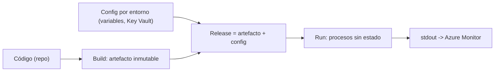

# Las doce factores (12-factor)

Parte de: [[09-Arquitectura-Patrones/03 Patrones de nube y sistemas distribuidos/_Índice Patrones de nube y sistemas distribuidos|Patrones de nube y sistemas distribuidos]]

> [!info] Cómo avanzar
> `progreso`: **pendiente** → **viendo** (estudiando) → **visto** (contestaste la autoevaluación sin abrir las respuestas) → **dominado** (hiciste el laboratorio o lo aplicaste de verdad).

## Contenido

### Qué es
La metodología **12-factor** (*The Twelve-Factor App*) es un conjunto de doce principios para construir aplicaciones que se despliegan como servicios (web apps, APIs, SaaS), publicado por ingenieros de Heroku alrededor de 2011. Busca aplicaciones **portables entre entornos, fáciles de desplegar continuamente y de escalar horizontalmente**. Aunque es anterior a los contenedores y Kubernetes, casi todo lo que hoy se considera "cloud native" se apoya en estas ideas.

### Cómo funciona
Los doce factores, con su aplicación en .NET y Azure:

| # | Factor | En la práctica |
|---|---|---|
| I | **Código base:** un repo por app, muchos despliegues | Un repo en Azure DevOps, desplegado a dev, QA y prod |
| II | **Dependencias** explícitas y aisladas | `PackageReference` en el `.csproj`, `packages.lock.json`; nada instalado "a mano" en el servidor |
| III | **Configuración** en el entorno | Variables de entorno, App Settings, Key Vault; nada de secretos en `appsettings.json` del repo |
| IV | **Servicios de respaldo** como recursos conectables | SQL, Redis, Service Bus se ubican por configuración; cambiar de servidor es cambiar una variable |
| V | **Build, release, run** separados | Pipeline: compila un artefacto una vez, lo combina con config por entorno, lo ejecuta |
| VI | **Procesos** sin estado | Nada de sesión en memoria ni archivos locales; estado en servicios de respaldo |
| VII | **Asignación de puertos** | La app expone HTTP por sí misma (Kestrel) en el puerto que le indiquen |
| VIII | **Concurrencia** escalando por procesos | Más instancias o réplicas, y tipos de proceso distintos (web, worker) |
| IX | **Desechabilidad** | Arranque rápido y apagado elegante (atender `SIGTERM`, terminar lo que está en curso) |
| X | **Paridad dev/prod** | Mismos servicios en todos los entornos (SQL Server en Docker local, no SQLite) |
| XI | **Logs** como flujos de eventos | Escribir a stdout; la plataforma los recoge y enruta |
| XII | **Procesos de administración** como tareas puntuales | Migraciones y scripts como comandos del mismo código y versión |



#### Configuración (III)
Todo lo que **cambia entre entornos** (cadenas de conexión, URLs de servicios, llaves, banderas) vive **fuera del código**, en el entorno. Prueba ácida: ¿podrías hacer público el repositorio ahora mismo sin exponer ninguna credencial? En .NET, el sistema de configuración ya lee variables de entorno (con `__` para secciones: `ConnectionStrings__Dionisio`), y en local usas [[Secretos con User Secrets]]. En Azure, App Settings y referencias a Key Vault. Encaja con la regla del usuario: secretos fuera del repo.

#### Procesos (VI)
La app se ejecuta como uno o más procesos **sin estado y que no comparten nada** (*share-nothing*). Cualquier dato que deba persistir va a un servicio de respaldo (base, caché, Blob). La memoria y el disco local son solo caché temporal de una petición. Esto es lo que permite [[Escalabilidad horizontal y vertical|escalar horizontalmente]] y matar o reemplazar instancias sin perder nada.

### Ejemplo
```csharp
var builder = WebApplication.CreateBuilder(args);
// III: configuración del entorno (appsettings + variables de entorno + Key Vault en Azure)
if (builder.Environment.IsProduction())
    builder.Configuration.AddAzureKeyVault(
        new Uri(builder.Configuration["KeyVault:Uri"]!), new DefaultAzureCredential());

// XI: logs a stdout en JSON; la plataforma los recoge
builder.Logging.ClearProviders();
builder.Logging.AddJsonConsole();

// IX: tiempo para terminar trabajo en curso al apagarse
builder.Services.Configure<HostOptions>(o => o.ShutdownTimeout = TimeSpan.FromSeconds(30));

var app = builder.Build();
app.MapControllers();
app.Run(); // VII: Kestrel escucha en el puerto que indique ASPNETCORE_URLS / ASPNETCORE_HTTP_PORTS
```

### Error común relacionado con logs
Escribir los logs **a archivos locales** con rotación propia dentro de la app (`C:\logs\api-2026-11-09.txt`). En la nube eso falla de varias formas: el disco de la instancia es efímero y se pierde al reiniciar o escalar, con varias instancias cada una tiene sus propios archivos y no puedes correlacionar, el disco se llena, y la app se ocupa de algo que no le corresponde. El factor XI dice: la app **no gestiona ni enruta** sus logs; escribe eventos a stdout (idealmente estructurados en JSON) y el entorno (App Service, Container Apps, Azure Monitor / Application Insights, OpenTelemetry) los recolecta, indexa y retiene.

### Cuándo usarlo y cuándo no
- **Úsalo** como checklist para cualquier API o worker que vaya a la nube o a contenedores.
- **Adapta** en apps de escritorio, móviles o procesos batch muy específicos, donde algunos factores (puertos, concurrencia por procesos) no aplican.
- Hoy se complementa con observabilidad (trazas y métricas), seguridad y diseño de APIs, que la metodología original apenas trata.

### Errores comunes
1. **Secretos en `appsettings.json`** versionado.
2. **Compilar por entorno** (un build para QA y otro para prod): rompe "build, release, run"; compila una vez.
3. **Estado en memoria** o archivos locales.
4. **Logs a archivo** (ver arriba).
5. **Migraciones manuales** desde la máquina de alguien en lugar de un paso del pipeline.

### Para profundizar
- [The Twelve-Factor App](https://12factor.net/)
- [Factor III: Configuración](https://12factor.net/config)
- [Logging en .NET y ASP.NET Core (Microsoft Learn)](https://learn.microsoft.com/en-us/aspnet/core/fundamentals/logging/)

## Autoevaluación

Contesta primero en voz alta o en papel; luego despliega la respuesta.

> [!question]- ¿Qué es la metodología 12-factor?
> Un conjunto de prácticas para construir apps desplegables en la nube: portables, configurables por entorno y escalables horizontalmente.

> [!question]- ¿Qué dicen los factores de configuración y de procesos?
> Configuración: en el entorno (variables), no en el código. Procesos: sin estado; lo que persiste va a servicios de respaldo (base, caché).

> [!question]- Menciona otros tres factores.
> Un código base en control de versiones; dependencias declaradas; servicios de respaldo como recursos adjuntos; separar build/release/run; logs como flujo de eventos a stdout; paridad dev/prod; procesos de administración como tareas puntuales; desechabilidad (arranque rápido y apagado limpio).

> [!question]- Error común relacionado con logs.
> Que la app escriba y rote sus propios archivos de log; en 12-factor escribe a stdout y la plataforma los recolecta.

