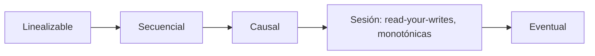

# Modelos de consistencia (fuerte, eventual, read-your-writes)

Parte de: [[09-Arquitectura-Patrones/03 Patrones de nube y sistemas distribuidos/_Índice Patrones de nube y sistemas distribuidos|Patrones de nube y sistemas distribuidos]]

> [!info] Cómo avanzar
> `progreso`: **pendiente** → **viendo** (estudiando) → **visto** (contestaste la autoevaluación sin abrir las respuestas) → **dominado** (hiciste el laboratorio o lo aplicaste de verdad).

## Contenido

### Qué es
Un modelo de consistencia es el **contrato que un sistema de datos replicado ofrece sobre qué valores puede devolver una lectura** respecto a las escrituras que ya ocurrieron. No es binario ("consistente o no"): hay un espectro entre la garantía más fuerte (todos ven lo mismo, como si hubiera una sola copia) y la más débil (eventualmente convergen). Conocerlo te permite elegir, dato por dato, cuánta frescura necesitas y cuánto pagas en latencia y disponibilidad. Complementa a [[Consistencia eventual y teorema CAP]].

### Cómo funciona
#### Consistencia fuerte (linealizable)
La **linealizabilidad** garantiza que el sistema se comporta **como si existiera una sola copia del dato** y cada operación ocurriera de forma atómica en un instante entre su inicio y su fin. Consecuencia práctica: **en cuanto una escritura se confirma, toda lectura posterior (de cualquier cliente, en cualquier nodo) ve ese valor o uno más nuevo**; nunca "regresa en el tiempo". Es lo que esperas de un solo SQL Server: haces `UPDATE`, confirmas, y cualquiera que lea después ve el cambio. En sistemas distribuidos cuesta latencia (coordinación entre réplicas) y disponibilidad ante particiones.

#### Consistencia eventual
Si no hay escrituras nuevas, todas las réplicas convergen. Mientras tanto, una lectura puede devolver cualquier versión anterior, y dos lecturas seguidas pueden incluso ver versiones en desorden.

#### Modelos intermedios (garantías de sesión y otras)
Entre ambos extremos hay garantías más baratas que la linealizabilidad pero útiles:
- **Read-your-writes (lee tus escrituras):** un cliente **siempre ve sus propias escrituras** confirmadas. Otros clientes pueden ver el dato viejo un rato.
- **Monotonic reads (lecturas monótonas):** si un cliente leyó la versión 5, nunca después leerá la 4.
- **Monotonic writes:** las escrituras de un cliente se aplican en el orden en que las hizo.
- **Writes-follow-reads:** si leíste algo y luego escribes, tu escritura se ordena después de lo que leíste.
- **Consistencia causal:** operaciones relacionadas causalmente (una respuesta a un comentario) se ven en orden por todos; las no relacionadas pueden verse en cualquier orden.
- **Consistencia secuencial:** todos ven las operaciones en el mismo orden, aunque no necesariamente en tiempo real.
- **Bounded staleness (atraso acotado):** las lecturas pueden ir atrasadas, pero como máximo K versiones o T segundos.

Azure Cosmos DB expone cinco niveles: *strong*, *bounded staleness*, *session* (que combina read-your-writes, lecturas y escrituras monótonas dentro de una sesión), *consistent prefix* y *eventual*.


(de izquierda a derecha: más garantías y más costo → menos garantías, más rápido y disponible)

#### Read-your-writes con réplicas de lectura
Con una réplica de lectura (SQL Server Always On con secundaria legible, o réplicas de Azure SQL), la escritura va al primario y se replica de forma asíncrona. Si inmediatamente después lees de la réplica, puedes ver el dato viejo. Formas de lograr read-your-writes:
1. **Leer del primario después de escribir:** durante X segundos tras una escritura del usuario (guardado en su sesión o una cookie con marca de tiempo), sus lecturas van al primario.
2. **Token de versión:** la escritura devuelve una versión o LSN; la lectura en la réplica espera o se redirige si la réplica no ha alcanzado esa versión (así funciona el *session token* de Cosmos DB).
3. **Leer del primario las pantallas de "mi propio dato"** (perfil, configuración) y usar réplicas para listados y reportes.
4. **Devolver el recurso actualizado en la respuesta** del `PUT` para que el front no tenga que releer.

### Ejemplo
**Caso:** el usuario edita su perfil, guarda, recarga y ve el dato viejo. Causas probables, de la más a la menos común:
- La lectura viene de una **réplica atrasada** (la escritura fue al primario).
- Una **caché** (servidor, CDN, [[Output caching]] o el navegador) devuelve la versión anterior porque no se invalidó.
- En el front, el estado de React o una caché de consultas no se refrescó.

Solución en una API con Dapper y dos conexiones:

```csharp
public sealed class SelectorConexion(IHttpContextAccessor http, IConfiguration cfg)
{
    private const string Cookie = "ultima_escritura";

    public SqlConnection ParaLectura()
    {
        var ultima = http.HttpContext?.Request.Cookies[Cookie];
        bool reciente = long.TryParse(ultima, out var ticks) &&
                        DateTimeOffset.UtcNow - new DateTimeOffset(ticks, TimeSpan.Zero) < TimeSpan.FromSeconds(30);
        // Read-your-writes: tras escribir, 30 s leyendo del primario
        return new SqlConnection(cfg.GetConnectionString(reciente ? "Primario" : "Replica"));
    }

    public SqlConnection ParaEscritura()
    {
        http.HttpContext?.Response.Cookies.Append(Cookie, DateTimeOffset.UtcNow.UtcTicks.ToString(),
            new CookieOptions { HttpOnly = true, Secure = true, SameSite = SameSiteMode.Strict });
        return new SqlConnection(cfg.GetConnectionString("Primario"));
    }
}
// "Replica": "...;ApplicationIntent=ReadOnly"  -> el listener la manda a una secundaria legible
```

### Cuándo usarlo y cuándo no
- **Fuerte:** dinero, inventario al vender, permisos, unicidad (no dos usuarios con el mismo correo).
- **Sesión / read-your-writes:** casi toda la experiencia de usuario sobre sus propios datos. Es el mínimo para que la app "se sienta" correcta.
- **Eventual / atraso acotado:** listados públicos, contadores, reportes, búsquedas.

### Errores comunes
1. **Usar réplicas sin read-your-writes** y recibir tickets de "no se guardó".
2. **Validar reglas de negocio contra una réplica** (existencias, duplicados).
3. **Confundir "consistencia" de ACID** (integridad de reglas) con la de sistemas distribuidos (frescura entre réplicas).
4. **Prometer "fuerte"** cuando hay una caché en medio sin invalidar.

### Para profundizar
- [Modelos de consistencia (Jepsen)](https://jepsen.io/consistency)
- [Niveles de consistencia en Azure Cosmos DB (Microsoft Learn)](https://learn.microsoft.com/en-us/azure/cosmos-db/consistency-levels)
- [Réplicas secundarias legibles en Always On (Microsoft Learn)](https://learn.microsoft.com/en-us/sql/database-engine/availability-groups/windows/active-secondaries-readable-secondary-replicas-always-on-availability-groups)

Relacionado: [[Replicación y réplicas de lectura]].

## Autoevaluación

Contesta primero en voz alta o en papel; luego despliega la respuesta.

> [!question]- Define consistencia fuerte (linealizable).
> Cada operación parece ocurrir en un instante único; tras confirmarse una escritura, cualquier lectura posterior la ve.

> [!question]- ¿Qué es read-your-writes y cómo se logra con réplicas de lectura?
> El usuario siempre ve sus propias escrituras. Se logra leyendo del primario un tiempo después de que ese usuario escribe, o pasando un token de versión/LSN y esperando a que la réplica lo alcance.

> [!question]- Otros modelos intermedios.
> *Monotonic reads* (no ves retroceder el tiempo), *consistent prefix* (ves las escrituras en orden), consistencia causal, *bounded staleness*.

> [!question]- Caso: el usuario edita su perfil y al recargar ve el dato viejo. ¿Qué pasó?
> La lectura fue a una réplica con retraso. Falta read-your-writes.

