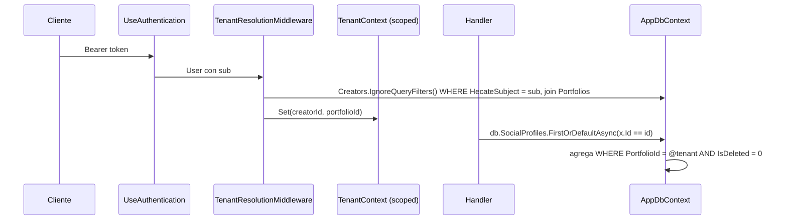

# Multi-tenancy

> Una sola aplicación y una sola base sirven a muchos clientes (tenants) sin que uno vea los datos de otro; en [[Itzamna.Dionisio]] cada creador es un tenant y el aislamiento lo aplican filtros globales de [[Entity Framework Core]].

## Qué es y qué problema resuelve
En un SaaS, cada cliente debe ver solo lo suyo. Hay tres modelos de aislamiento:

| Modelo | Aislamiento | Costo |
|---|---|---|
| Base por tenant | Máximo | Alto (una base por cliente) |
| Esquema por tenant | Alto | Medio |
| **Tabla compartida + columna `TenantId`** | Lógico (depende del código) | Bajo |

El tercero es el más común y barato, pero un `WHERE` olvidado filtra datos de otro cliente. Por eso se automatiza: el tenant se resuelve **en el servidor** (nunca desde el body) y se aplica en todas las consultas.

## Cómo funciona por dentro
1. **Resolver el tenant** por petición (token, subdominio, header) y guardarlo en un servicio *scoped*.
2. **Filtrar siempre**: filtros globales del ORM, Row-Level Security de la base, o repositorios que lo agregan.
3. **Escribir con el tenant del contexto**, no con el que mande el cliente.
4. **Escape controlado** para casos legítimos sin tenant (lectura pública, resolución, seed).



## Cuándo usarla y cuándo no
### Ventajas
- Un solo despliegue y una sola base: barato y fácil de operar.
- Con filtros globales, el código de negocio no repite `WHERE TenantId`.
### Desventajas
- El aislamiento es lógico: un `IgnoreQueryFilters()` mal puesto expone datos.
- "Vecino ruidoso": un tenant pesado afecta a todos.
- Respaldos/restauraciones por cliente son más difíciles.

## Alternativas
| Alternativa | En qué se diferencia |
|---|---|
| Row-Level Security (SQL Server) | El motor filtra con `SESSION_CONTEXT`; protege incluso SQL a mano. |
| Base por tenant | Aislamiento físico; migraciones por cada base. |
| Filtro manual en cada consulta | Sin magia, pero fácil de olvidar. |

## Cómo se usó en Itzamna
Tenant = **creador + su portfolio** (hoy 1 a 1).
- `ITenantContext` / `TenantContext` (`Application/Abstractions/Services.cs`): `CreatorId`, `PortfolioId`, `Set(...)`; registrado *scoped*.
- `TenantResolutionMiddleware` (`API/Middleware/`): con el `sub` del token busca el creador y su portfolio. Comentario: "Nunca se usan ids enviados por el frontend para decidir de quién son los datos."
- `GET /api/me` (`EnsureCreator`) crea creador + portfolio la primera vez ([[Perfil del creador]]).
- `TenantExtensions.RequirePortfolioId()` lanza `ForbiddenException` (403) si el usuario aún no tiene portfolio.
- **Filtros globales** en `AppDbContext.OnModelCreating` (`Itzamna.Dionisio/src/Itzamna.Dionisio.Infrastructure/Persistence/AppDbContext.cs`):
```csharp
// EF parametriza estas propiedades en cada consulta: los filtros usan el tenant de la petición actual.
private Guid TenantPortfolioId => tenant.PortfolioId ?? Guid.Empty;
private Guid TenantCreatorId => tenant.CreatorId ?? Guid.Empty;

// Aislamiento por tenant + borrado lógico. Sin tenant (Guid.Empty) no se ve nada.
modelBuilder.Entity<Creator>().HasQueryFilter(c => c.Id == TenantCreatorId);
modelBuilder.Entity<Portfolio>().HasQueryFilter(p => p.Id == TenantPortfolioId);
modelBuilder.Entity<SocialProfile>().HasQueryFilter(x => !x.IsDeleted && x.PortfolioId == TenantPortfolioId);
modelBuilder.Entity<MediaAsset>().HasQueryFilter(a => !a.IsDeleted && a.CreatorId == TenantCreatorId);
```
- Las entidades de portfolio heredan de `PortfolioItem` (`IPortfolioOwned`); la biblioteca de medios es del **creador** (`MediaAsset.CreatorId`).
- Convención (`.ai/02_CONVENTIONS.md`): "nunca filtrar a mano por `PortfolioId` en consultas normales".

Usos de `IgnoreQueryFilters()` encontrados:
| Dónde | Por qué |
|---|---|
| `TenantResolutionMiddleware` | Aún no hay tenant: lo está resolviendo. |
| `GetPublicPortfolioHandler` | Lectura anónima por slug, solo publicados. |
| `UploadMediaHandler` (cuota `MaxTotalBytes`) | Suma de toda la plataforma (reaplica `!a.IsDeleted` a mano). |
| `JatzSeeder` | Saber si el demo ya existe. |

Funcionalidad: [[Multi-tenant y aislamiento]]. Ver también [[Borrado lógico y auditoría]].

> [!note] Pendiente de confirmar
> La convención dice "`IgnoreQueryFilters()` solo en el seed o en el endpoint público", pero el código también lo usa en el middleware y en la cuota global de medios. Son usos razonables; la convención podría actualizarse. `SlugRedirect` no tiene filtro global (es público por diseño).

> [!tip] Reutilizable
> Tenant *scoped* + middleware que lo resuelve del token + filtros globales que leen propiedades del `DbContext` (EF las parametriza por consulta) + `Guid.Empty` como "no ves nada" es un molde portable a cualquier SaaS con EF Core.


Falta en la tabla de usos: `EnsureCreatorHandler` (`Features/Me/EnsureCreator.cs`) también usa `IgnoreQueryFilters()` para buscar al creador por `HecateSubject` y, si existe, hace `tenant.Set(...)`; si no, crea creador, portfolio, secciones y tema por defecto. Es el otro punto (junto con el middleware) donde se "entra" al tenant.


## Errores comunes y buenas prácticas
- Tomar el `portfolioId` de la URL o el body para decidir dueño: siempre del token.
- Filtros con valores capturados en variables (no propiedades del contexto): EF los "congela" en el modelo cacheado. Dionisio usa propiedades del `DbContext`, que sí se parametrizan.
- Sin tenant → ver todo: aquí `Guid.Empty` hace que no se vea nada.
- `IgnoreQueryFilters()` también quita el filtro de borrado lógico: reaplicarlo si importa.

## Qué estudiar después
- [[Entity Framework Core]], [[Borrado lógico y auditoría]], [[JWT y autenticación con Bearer]]
- Row-Level Security en SQL Server; multi-tenancy con varios portfolios por creador.

## Documentación oficial
- https://learn.microsoft.com/ef/core/miscellaneous/multitenancy
- https://learn.microsoft.com/ef/core/querying/filters
- https://learn.microsoft.com/azure/architecture/guide/multitenant/overview

## Autoevaluación

Contesta primero en voz alta o en papel; luego despliega la respuesta.

> [!question]- ¿Qué tres modelos de aislamiento hay y cuál es el más común?
> Base por tenant, esquema por tenant, tabla compartida con `TenantId`. El tercero es el más barato y común; su aislamiento es lógico.

> [!question]- ¿Por qué el tenant nunca debe venir del body?
> El cliente podría mandar el de otro. Se resuelve en el servidor desde el token, subdominio o un mapeo confiable.

> [!question]- ¿Qué pasa con un `IgnoreQueryFilters()` mal puesto?
> La consulta trae datos de todos los tenants. Por eso debe estar limitado a casos explícitos y cubierto por pruebas.

> [!question]- Caso: un tenant grande degrada a todos (*noisy neighbor*). Opciones.
> Throttling por tenant ([[Bulkhead y throttling]]), mover ese tenant a su propia base o pool, colas separadas.

