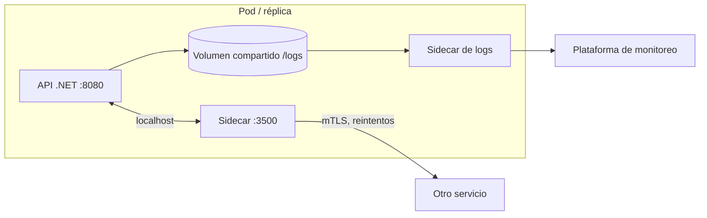

# Sidecar

Parte de: [[09-Arquitectura-Patrones/03 Patrones de nube y sistemas distribuidos/_Índice Patrones de nube y sistemas distribuidos|Patrones de nube y sistemas distribuidos]]

> [!info] Cómo avanzar
> `progreso`: **pendiente** → **viendo** (estudiando) → **visto** (contestaste la autoevaluación sin abrir las respuestas) → **dominado** (hiciste el laboratorio o lo aplicaste de verdad).

## Contenido

### Qué es
Un *sidecar* es un **proceso o contenedor auxiliar que se despliega junto a la aplicación principal, comparte su ciclo de vida y sus recursos (red, almacenamiento) y le agrega capacidades** sin modificar su código. El nombre viene del carrito lateral de una motocicleta: va pegado, nace y muere con ella. Sirve para resolver preocupaciones transversales (proxy, TLS, observabilidad, configuración, acceso a secretos) de forma uniforme y en cualquier lenguaje.

### Cómo funciona
1. La aplicación y el sidecar corren **en la misma unidad de despliegue**: el mismo *pod* en Kubernetes, la misma réplica en Azure Container Apps (que permite varios contenedores por app, incluidos sidecars) o el mismo host.
2. Se comunican por **localhost** o por un volumen compartido, así que la latencia es mínima y no hay red externa entre ellos.
3. Se despliegan, escalan y reinician **juntos**: si hay 5 réplicas de la app, hay 5 sidecars.
4. La aplicación delega en el sidecar tareas genéricas: en vez de implementar TLS mutuo, reintentos o publicar métricas, habla HTTP plano con el sidecar y él se encarga.



### Ejemplos
- **Proxy de service mesh** (Envoy en Istio, o el de Linkerd): intercepta todo el tráfico de entrada y salida del contenedor y agrega TLS mutuo, reintentos, circuit breaking, enrutamiento y métricas sin tocar el código.
- **Dapr:** un sidecar que ofrece APIs HTTP/gRPC para invocar servicios, publicar/suscribirse a mensajes, guardar estado y leer secretos, con el backend (Service Bus, Redis, Key Vault) configurable por componentes. Azure Container Apps lo integra como opción.
- **Recolectores de logs y telemetría** (un agente de OpenTelemetry Collector o Fluent Bit) que leen archivos o reciben datos por localhost y los envían a la plataforma de monitoreo.
- **Recargadores de configuración o certificados** que actualizan archivos en un volumen compartido cuando cambian.
- **Adaptadores de protocolo** para una app legada que solo habla un formato antiguo.

Ejemplo de invocación a otro servicio a través del sidecar de Dapr desde .NET, usando solo `HttpClient` (la app no sabe dónde está el otro servicio ni cómo asegurarlo):

```csharp
// El sidecar de Dapr escucha en localhost; resuelve "facturacion", aplica mTLS y reintentos
builder.Services.AddHttpClient("facturacion", c =>
    c.BaseAddress = new Uri("http://localhost:3500/v1.0/invoke/facturacion/method/"));

public sealed class SolicitarFactura(IHttpClientFactory f)
{
    public Task<HttpResponseMessage> EnviarAsync(int pedidoId, CancellationToken ct) =>
        f.CreateClient("facturacion").PostAsJsonAsync("api/facturas", new { pedidoId }, ct);
}
```

### Cuándo no conviene
- **Aplicaciones pequeñas o un solo servicio:** un sidecar agrega un contenedor más por réplica, configuración y otra pieza que falla; una librería (por ejemplo `AddStandardResilienceHandler` para resiliencia y el SDK de OpenTelemetry para telemetría) resuelve lo mismo con menos operación.
- **Latencia muy sensible:** cada llamada pasa por un salto extra (aunque sea local); en rutas de microsegundos se nota.
- **Recursos limitados:** cada sidecar consume CPU y memoria en **cada** réplica; con muchas réplicas el costo suma.
- **Cuando necesita escalar distinto que la app:** el sidecar escala 1 a 1 con ella; si el componente auxiliar necesita escalar por su cuenta, debe ser un servicio aparte.
- **Si la plataforma ya lo ofrece:** App Service o Container Apps ya recogen stdout, gestionan TLS de entrada e identidades administradas; no dupliques.
- **Comunicación muy acoplada** que requiere compartir memoria o llamadas en proceso: ahí una librería es más natural.

### Cuándo usarlo
- Varios servicios en **lenguajes distintos** que necesitan las mismas capacidades transversales.
- Una aplicación **que no puedes modificar** (legado, de un tercero) y a la que hay que agregar TLS, métricas o un protocolo.
- Plataformas con **service mesh** donde la seguridad entre servicios se resuelve de manera uniforme.

### Errores comunes
1. **Meter lógica de negocio en el sidecar:** debe ser genérico y reutilizable; si sabe de pedidos, es otro servicio.
2. **Ignorar el orden de arranque y apagado:** la app arranca antes que el sidecar y sus primeras llamadas fallan, o el sidecar muere antes y se pierden logs. Usa sondas de salud y el soporte de la plataforma para sidecars.
3. **No dimensionar recursos** del sidecar y que lo maten por memoria, tumbando la réplica.
4. **Duplicar responsabilidades** (reintentos en la app y en el sidecar), multiplicando intentos.
5. **Adoptar un service mesh completo** para tres servicios.

### Para profundizar
- [Patrón Sidecar (Azure Architecture Center)](https://learn.microsoft.com/en-us/azure/architecture/patterns/sidecar)
- [Contenedores en Azure Container Apps, incluye sidecars (Microsoft Learn)](https://learn.microsoft.com/en-us/azure/container-apps/containers)
- [Panorama de Dapr](https://docs.dapr.io/concepts/overview/)

## Autoevaluación

Contesta primero en voz alta o en papel; luego despliega la respuesta.

> [!question]- ¿Qué es un sidecar?
> Un proceso/contenedor que corre junto a la aplicación (mismo pod/host) y le da capacidades transversales: proxy, mTLS, logs, configuración.

> [!question]- Ejemplos.
> Proxy de un *service mesh* (p. ej. Envoy), recolector de OpenTelemetry, Dapr.

> [!question]- ¿Cuándo no conviene?
> Si la latencia extra por salto local o el consumo de recursos importan mucho, o si una librería en proceso resuelve lo mismo con menos piezas.

