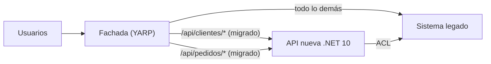

# Strangler fig

Parte de: [[09-Arquitectura-Patrones/03 Patrones de nube y sistemas distribuidos/_Índice Patrones de nube y sistemas distribuidos|Patrones de nube y sistemas distribuidos]]

> [!info] Cómo avanzar
> `progreso`: **pendiente** → **viendo** (estudiando) → **visto** (contestaste la autoevaluación sin abrir las respuestas) → **dominado** (hiciste el laboratorio o lo aplicaste de verdad).

## Contenido

### Qué es
El patrón *strangler fig* (higuera estranguladora) es una estrategia para **reemplazar un sistema legado de forma gradual**: construyes el sistema nuevo alrededor del viejo, **desviando funcionalidad por funcionalidad** hacia el nuevo, hasta que el viejo ya no atiende nada y puedes apagarlo. El nombre, propuesto por Martin Fowler, viene de las higueras que crecen sobre un árbol, lo rodean y terminan sustituyéndolo. Sirve para modernizar sin el riesgo de una reescritura total.

### Cómo funciona
1. **Pon una fachada** (proxy o gateway) delante del sistema legado; al principio enruta el 100% al viejo. En .NET, YARP es una opción natural; en Azure, API Management o Front Door.
2. **Elige una funcionalidad** acotada y de valor (una pantalla, un endpoint, un reporte).
3. **Impleméntala en el sistema nuevo** (con vertical slices, sus `.sql`, ProblemDetails, etc.).
4. **Cambia la ruta** en la fachada para que esa funcionalidad vaya al nuevo. Si algo sale mal, regresas la ruta (rollback barato).
5. **Repite** hasta que el viejo no reciba tráfico.
6. **Apaga** el legado y retira la fachada si ya no aporta.



### Ejemplo
Configuración de YARP en la fachada: lo migrado va a la API nueva, el resto al legado.

```json
{
  "ReverseProxy": {
    "Routes": {
      "clientes-nuevo": { "ClusterId": "nuevo",  "Order": 1, "Match": { "Path": "/api/clientes/{**resto}" } },
      "pedidos-nuevo":  { "ClusterId": "nuevo",  "Order": 1, "Match": { "Path": "/api/pedidos/{**resto}" } },
      "todo-legado":    { "ClusterId": "legado", "Order": 100, "Match": { "Path": "{**resto}" } }
    },
    "Clusters": {
      "nuevo":  { "Destinations": { "d1": { "Address": "https://api-nueva.interna/" } } },
      "legado": { "Destinations": { "d1": { "Address": "https://legado.interno/" } } }
    }
  }
}
```

```csharp
var builder = WebApplication.CreateBuilder(args);
builder.Services.AddReverseProxy()
    .LoadFromConfig(builder.Configuration.GetSection("ReverseProxy"));
var app = builder.Build();
app.MapReverseProxy();
app.Run();
```

Migrar un módulo nuevo es agregar una ruta; revertirlo es quitarla. Puedes incluso enrutar solo un porcentaje o ciertos usuarios al nuevo con una bandera de funcionalidad para probar en producción con poco riesgo. Cuando lo nuevo necesita datos o funciones que siguen en el legado, accede a través de una [[Anti-corruption layer]] para no heredar su modelo.

### Por qué es mejor que una reescritura total
- **Entrega valor pronto:** cada funcionalidad migrada ya está en producción, en lugar de esperar uno o dos años al "big bang".
- **Riesgo pequeño y reversible:** si una parte falla, solo esa ruta regresa al legado.
- **Aprendes en el camino:** las reglas ocultas del sistema viejo (que nadie documentó) aparecen de una en una, no todas el día del lanzamiento.
- **El negocio no se congela:** en una reescritura, el legado sigue cambiando y el nuevo persigue un objetivo móvil; con strangler, cada cambio nuevo se hace ya en el sistema nuevo.
- **Puedes detenerte:** si a mitad del camino cambian las prioridades, lo migrado ya funciona.

### Qué complica la migración de datos
El código se puede desviar por rutas; **los datos no**. Problemas típicos:
- **Base compartida:** al inicio, el sistema nuevo suele leer y escribir la base del legado. Es rápido, pero te ata a su esquema y a sus triggers, y dos sistemas escriben las mismas tablas.
- **Dos fuentes de verdad:** si el nuevo tiene su propia base, durante la transición hay que **sincronizar** en uno o ambos sentidos (eventos, procesos batch o *change data capture*), con riesgo de conflictos y desfases.
- **Escrituras duales** (escribir en ambas bases desde la app) fallan a medias igual que la doble escritura de eventos.
- **Reportes y procesos batch** del legado que leen tablas directamente y se rompen cuando los datos se mueven.
- **Integridad referencial** entre datos ya migrados y no migrados.
- **Calidad de datos:** el nuevo modelo exige reglas (RFC válido, catálogos del SAT) que los datos viejos no cumplen.

Estrategia habitual: migra por **área de datos** junto con su funcionalidad, define un único dueño de escritura por tabla en cada momento, y sincroniza hacia el otro lado en solo lectura.

### Cuándo usarlo y cuándo no
- **Úsalo** para sistemas legados grandes y en uso, especialmente sistemas web o APIs donde las peticiones se pueden interceptar.
- **No lo uses** si el sistema es pequeño (reescribir puede ser más barato), si no puedes interceptar las llamadas, o si el legado se apagará pronto por otra razón.

### Errores comunes
1. **Nunca terminar:** dos sistemas para siempre. Define un plan y una fecha para apagar el legado.
2. **Migrar primero lo más difícil:** empieza por algo acotado para validar la fachada y el flujo.
3. **Fachada con lógica de negocio:** solo enruta.
4. **Ignorar los datos** hasta el final.
5. **Copiar el modelo del legado** en el sistema nuevo "para que sea fácil sincronizar".

### Para profundizar
- [Strangler Fig Application (Martin Fowler)](https://martinfowler.com/bliki/StranglerFigApplication.html)
- [Patrón Strangler Fig (Azure Architecture Center)](https://learn.microsoft.com/en-us/azure/architecture/patterns/strangler-fig)
- [YARP en ASP.NET Core (Microsoft Learn)](https://learn.microsoft.com/en-us/aspnet/core/fundamentals/servers/yarp/yarp-overview)

Relacionado: [[Modernizar código legado]].

## Autoevaluación

Contesta primero en voz alta o en papel; luego despliega la respuesta.

> [!question]- ¿Qué es el patrón strangler fig?
> Reemplazar un sistema legado poco a poco: un proxy/fachada enruta cada funcionalidad migrada al sistema nuevo y el resto al viejo, hasta que el viejo se puede apagar.

> [!question]- ¿Por qué es mejor que una reescritura total?
> Entrega valor y aprende en producción en pasos pequeños y reversibles; una reescritura "big bang" acumula riesgo y suele atrasarse mientras el viejo sigue cambiando.

> [!question]- ¿Qué complica la migración de datos?
> Ambos sistemas pueden necesitar los mismos datos: sincronización (eventos, CDC, doble escritura con cuidado) hasta que el nuevo sea dueño. Ver [[Modernizar código legado]].

