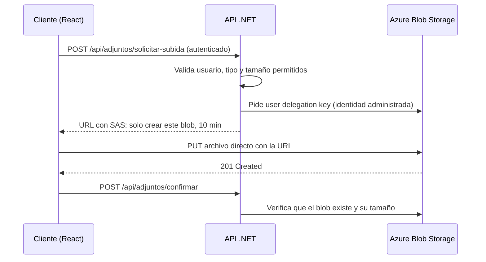

# Valet key (URLs firmadas)

Parte de: [[09-Arquitectura-Patrones/03 Patrones de nube y sistemas distribuidos/_Índice Patrones de nube y sistemas distribuidos|Patrones de nube y sistemas distribuidos]]

> [!info] Cómo avanzar
> `progreso`: **pendiente** → **viendo** (estudiando) → **visto** (contestaste la autoevaluación sin abrir las respuestas) → **dominado** (hiciste el laboratorio o lo aplicaste de verdad).

## Contenido

### Qué es
El patrón *valet key* (llave de valet) consiste en que tu API **entregue al cliente un token o una URL firmada con permisos limitados y temporales** para que acceda **directamente** a un recurso de almacenamiento (subir o descargar un archivo), en lugar de que todo el contenido pase por tu servidor. Como el valet de un estacionamiento, que recibe una llave que solo enciende el auto, no abre la cajuela. En Azure Storage la llave es una **SAS** (*Shared Access Signature*); en S3 son las *presigned URLs*.

Sirve para quitar carga a la API (no procesas los bytes de archivos grandes), reducir costo y latencia, y aun así mantener el control de quién accede a qué.

### Cómo funciona


1. El cliente se autentica con tu API y pide permiso para una operación concreta.
2. La API valida reglas de negocio (¿puede este usuario subir a este pedido?) y genera una SAS **acotada**.
3. El cliente usa la URL directamente contra Blob Storage.
4. La API confirma el resultado (o reacciona a un evento de Event Grid "blob creado") y registra el archivo.

#### Restricciones que debe llevar la URL
- **Alcance mínimo:** un **solo blob** (nombre generado por el servidor, por ejemplo con GUID), no el contenedor ni la cuenta.
- **Permisos mínimos:** solo `Create`/`Write` para subir, o solo `Read` para descargar. Nunca `Delete` o `List` si no se necesitan.
- **Expiración corta:** minutos, no días. Empieza la validez unos minutos antes para tolerar diferencias de reloj.
- **Solo HTTPS** (`SasProtocol.Https`).
- Opcionalmente **rango de IP**, y encabezados de respuesta (`Content-Disposition`) para controlar cómo se descarga.
- **Tipo de SAS:** prefiere la **user delegation SAS**, firmada con credenciales de Microsoft Entra ID (identidad administrada) en lugar de la llave de la cuenta; se puede revocar revocando las llaves de delegación y queda auditada con la identidad que la generó. La llave de delegación tiene una vigencia máxima de 7 días.

### Ejemplo
```csharp
public sealed class SolicitarSubidaHandler(BlobServiceClient blobs, TimeProvider reloj)
{
    public async Task<SolicitudSubida> Handle(int pedidoId, string extension, CancellationToken ct)
    {
        string[] permitidas = [".pdf", ".jpg", ".png"];
        if (!permitidas.Contains(extension.ToLowerInvariant()))
            throw new ReglaDeNegocioException("TIPO_NO_PERMITIDO", "Solo PDF, JPG o PNG.");

        var ahora = reloj.GetUtcNow();
        var inicio = ahora.AddMinutes(-5);           // tolerancia de reloj
        var fin = ahora.AddMinutes(10);              // vida corta

        // Firmada con identidad administrada (DefaultAzureCredential), no con la llave de la cuenta
        UserDelegationKey llave = await blobs.GetUserDelegationKeyAsync(inicio, fin, ct);

        var contenedor = blobs.GetBlobContainerClient("adjuntos");
        var blob = contenedor.GetBlobClient($"pedidos/{pedidoId}/{Guid.NewGuid()}{extension}");

        var sas = new BlobSasBuilder
        {
            BlobContainerName = contenedor.Name,
            BlobName = blob.Name,
            Resource = "b",                          // un solo blob
            StartsOn = inicio,
            ExpiresOn = fin,
            Protocol = SasProtocol.Https
        };
        sas.SetPermissions(BlobSasPermissions.Create | BlobSasPermissions.Write);

        var uri = new BlobUriBuilder(blob.Uri)
        {
            Sas = sas.ToSasQueryParameters(llave, blobs.AccountName)
        }.ToUri();

        return new SolicitudSubida(uri, blob.Name, fin);
    }
}
```

El `BlobServiceClient` se registra como singleton con `DefaultAzureCredential`, y la identidad necesita un rol que permita generar llaves de delegación (por ejemplo, *Storage Blob Data Contributor* sobre la cuenta o el contenedor). En el front, el archivo se sube con `fetch(url, { method: "PUT", headers: { "x-ms-blob-type": "BlockBlob" }, body: archivo })`; la cuenta de almacenamiento necesita CORS configurado para el origen de la SPA. Ver [[Azure Blob Storage]].

### Cuándo usarlo y cuándo no
- **Úsalo** para subir o descargar archivos medianos o grandes (fotos, PDFs, reportes de Excel de Wee.Reporteria), y cuando quieres que la API escale sin mover bytes.
- **No lo uses** si necesitas inspeccionar o transformar el contenido antes de guardarlo (en ese caso sube a un contenedor de "cuarentena" con SAS y procesa después), o si el archivo es diminuto y una petición normal es más simple.

### Errores comunes
1. **SAS de cuenta o de contenedor con todos los permisos y meses de vigencia** "para no batallar": cualquiera que la obtenga tiene acceso total.
2. **Firmar con la llave de la cuenta** guardada en configuración: si se filtra, cualquiera genera SAS; rotarla rompe todo. Usa user delegation SAS o, si usas llave, una *stored access policy* para poder revocar.
3. **Registrar la URL completa en logs** o devolverla en errores: el token viaja en el query string.
4. **Confiar en lo que el cliente dice que subió** sin verificar tamaño, tipo y existencia del blob.
5. **Dejar que el cliente elija el nombre del blob**: puede sobrescribir archivos ajenos.

### Para profundizar
- [Patrón Valet Key (Azure Architecture Center)](https://learn.microsoft.com/en-us/azure/architecture/patterns/valet-key)
- [Introducción a SAS en Azure Storage (Microsoft Learn)](https://learn.microsoft.com/en-us/azure/storage/common/storage-sas-overview)
- [Crear una user delegation SAS con .NET (Microsoft Learn)](https://learn.microsoft.com/en-us/azure/storage/blobs/storage-blob-user-delegation-sas-create-dotnet)

## Autoevaluación

Contesta primero en voz alta o en papel; luego despliega la respuesta.

> [!question]- ¿Qué es el patrón valet key?
> El servidor entrega al cliente un token o URL firmada con permisos limitados y caducidad para que suba o baje directo del almacenamiento (Blob, S3/R2), sin pasar el archivo por la API.

> [!question]- ¿Qué restricciones debe llevar la URL?
> Mínimo permiso (solo escritura a *ese* blob), expiración corta, idealmente tipo y tamaño máximo, y HTTPS. En Azure: SAS (preferible *user delegation SAS*); en S3/R2: *presigned URL*.

> [!question]- Error común.
> Firmar con permisos a todo el contenedor o con expiración de días; o confiar en el archivo subido sin validarlo después (tipo real, antivirus).

