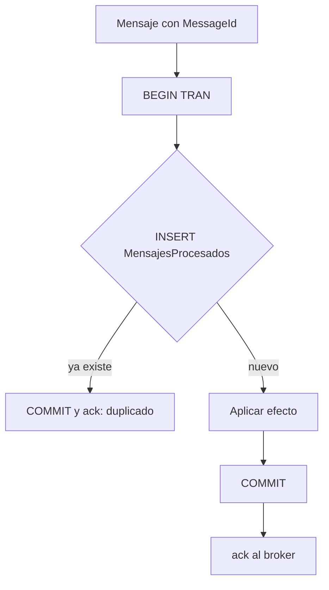

# Consumidores idempotentes

Parte de: [[09-Arquitectura-Patrones/04 Mensajería/_Índice Mensajería|Mensajería]]

> [!info] Cómo avanzar
> `progreso`: **pendiente** → **viendo** (estudiando) → **visto** (contestaste la autoevaluación sin abrir las respuestas) → **dominado** (hiciste el laboratorio o lo aplicaste de verdad).

## Contenido

### Qué es
Un **consumidor idempotente** es el que deja el sistema en el mismo estado final si procesa un mensaje una vez o diez veces. Como casi todos los brokers entregan *at-least-once*, los duplicados son normales (reinicios, locks vencidos, reintentos del productor). La idempotencia es lo que convierte esa realidad en un resultado correcto: [[Entrega exactly-once (efectiva)]].

### Cómo funciona
Hay tres técnicas, que se pueden combinar:

**1. Registro de mensajes procesados (inbox).** Una tabla con el identificador del mensaje como llave primaria. Antes de aplicar el efecto, intentas insertar el id; si ya existe, el mensaje es un duplicado y lo confirmas sin hacer nada. La clave es que el insert y el efecto vayan **en la misma transacción**:
- Si van separados y el proceso cae entre ambos, puedes quedar con el efecto aplicado sin registro (se repetirá) o con el registro sin el efecto (el mensaje se considera procesado y se pierde).
- En la misma transacción, o pasan los dos o ninguno.

**2. Operaciones naturalmente idempotentes.** Algunas operaciones dan el mismo resultado al repetirse: `UPDATE Pedidos SET Estado = 'Pagado' WHERE Id = @Id`, un `MERGE`/upsert, "fijar valor" en lugar de "sumar". Cambiar `Saldo = Saldo + @Monto` por un asiento con id único es un ejemplo de rediseño hacia idempotencia.

**3. Concurrencia optimista / condiciones.** `UPDATE ... WHERE Id = @Id AND Version = @Version`: si el mensaje ya se aplicó, la versión cambió y no afecta filas.



**¿De dónde sale el id?** Debe venir del **productor** (el `MessageId` del mensaje) o derivarse del contenido de negocio (`PedidoId + tipo de evento`). Si lo generara el consumidor al recibir, cada reentrega tendría un id distinto y nunca detectarías el duplicado.

### Ejemplo
Procedimiento en SQL Server (archivo `AplicarPagoIdempotente.sql` en el slice) llamado con Dapper dentro de una transacción:

```sql
CREATE OR ALTER PROCEDURE dbo.AplicarPagoIdempotente
    @MessageId NVARCHAR(128), @PedidoId BIGINT, @Monto DECIMAL(18,2)
AS
BEGIN
    SET NOCOUNT ON; SET XACT_ABORT ON;
    BEGIN TRAN;
    IF EXISTS (SELECT 1 FROM dbo.MensajesProcesados WITH (UPDLOCK, HOLDLOCK) WHERE MessageId = @MessageId)
    BEGIN
        COMMIT; SELECT CAST(0 AS INT) AS Aplicado; RETURN;
    END
    INSERT dbo.MensajesProcesados (MessageId, ProcesadoEn) VALUES (@MessageId, SYSUTCDATETIME());
    INSERT dbo.Pagos (PedidoId, Monto, MessageId) VALUES (@PedidoId, @Monto, @MessageId);
    UPDATE dbo.Pedidos SET Estado = 'Pagado' WHERE Id = @PedidoId;
    COMMIT;
    SELECT CAST(1 AS INT) AS Aplicado;
END
```

```csharp
public sealed class AplicarPagoHandler(IDbConnectionFactory db) : IAplicarPago
{
    public async Task<bool> EjecutarAsync(string messageId, PagoRecibido p, CancellationToken ct)
    {
        await using var cn = await db.AbrirAsync(ct);
        var aplicado = await cn.ExecuteScalarAsync<int>(new CommandDefinition(
            "dbo.AplicarPagoIdempotente",
            new { MessageId = messageId, p.PedidoId, p.Monto },
            commandType: CommandType.StoredProcedure, cancellationToken: ct));
        return aplicado == 1; // false = duplicado, igual se confirma el mensaje
    }
}
```

La llave primaria de `MensajesProcesados` es la red de seguridad final: aunque dos workers reciban el mismo mensaje a la vez, uno de los dos fallará por violación de llave y su transacción se revertirá.

### Cuándo usarlo y cuándo no
- Siempre que consumas con at-least-once y el efecto no sea naturalmente idempotente.
- En webhooks de pasarelas (usa el id del evento del proveedor) y en APIs que reciben `Idempotency-Key`.
- Si el efecto es un upsert puro o "fijar estado", la tabla de procesados puede sobrar.
- Depura la tabla de procesados con una retención mayor que el tiempo máximo en que podría llegar un duplicado (días o semanas, no minutos).

### Errores comunes
- **Verificar y aplicar en transacciones separadas** ("¿existe?" → luego insertar): dos workers pasan la verificación al mismo tiempo.
- **Id generado por el consumidor** (`Guid.NewGuid()` al recibir): no detecta nada.
- **Efectos externos fuera de la transacción**: un correo o una llamada HTTP no se revierten; para eso, guarda la intención en un outbox o usa la clave de idempotencia del proveedor.
- **Tabla sin depurar**: crece sin límite y vuelve lentos los inserts.

### Para profundizar
- [Patrón Idempotent Consumer (microservices.io)](https://microservices.io/patterns/communication-style/idempotent-consumer.html)
- [Service Bus: detección de duplicados](https://learn.microsoft.com/azure/service-bus-messaging/duplicate-detection)
- [Patrón Competing Consumers (Azure Architecture Center)](https://learn.microsoft.com/azure/architecture/patterns/competing-consumers)

## Autoevaluación

Contesta primero en voz alta o en papel; luego despliega la respuesta.

> [!question]- ¿Qué es un consumidor idempotente?
> Uno que produce el mismo efecto final si procesa el mismo mensaje una o varias veces.

> [!question]- Técnicas para lograrlo.
> Tabla `MensajesProcesados(MessageId PK)` insertada en la misma transacción que el efecto; operaciones naturalmente idempotentes (upsert, `SET estado = 'Pagado'`); versiones/condiciones (`WHERE version = @v`).

> [!question]- ¿Por qué el registro del mensaje y el efecto deben ir en la misma transacción?
> Si se guardan por separado, un fallo entre ambos deja el efecto aplicado sin registro (se repetirá) o el registro sin efecto (se perderá).

> [!question]- ¿Qué pasa si el `MessageId` lo genera el consumidor?
> Cada reentrega tendría un id nuevo y no detectarías duplicados. El id debe venir del productor (o derivarse del contenido de negocio).

## Práctica

- [[Lab 3 - Outbox y consumidor idempotente]]

