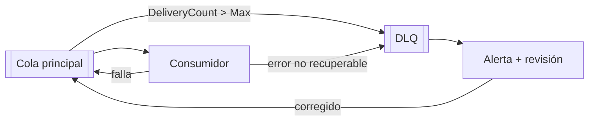

# Dead letter queues y mensajes venenosos

Parte de: [[09-Arquitectura-Patrones/04 Mensajería/_Índice Mensajería|Mensajería]]

> [!info] Cómo avanzar
> `progreso`: **pendiente** → **viendo** (estudiando) → **visto** (contestaste la autoevaluación sin abrir las respuestas) → **dominado** (hiciste el laboratorio o lo aplicaste de verdad).

## Contenido

### Qué es
Un **mensaje venenoso** (*poison message*) es uno que falla **siempre** al procesarse, no por un problema pasajero sino por su contenido: JSON inválido, una versión de contrato que el consumidor no entiende, un `PedidoId` que no existe, un dato que viola una regla de negocio. Reintentarlo no sirve; solo consume recursos y, en colas ordenadas, bloquea a los que vienen detrás.

Una **dead letter queue (DLQ)** es la cola aparte a donde se mueven esos mensajes (y los que expiraron) para sacarlos del flujo principal sin perderlos, y poder revisarlos, corregirlos y reenviarlos.

### Cómo funciona
1. El consumidor falla con un mensaje y no lo confirma.
2. El broker lo reentrega e incrementa su contador de entregas.
3. Al superar el máximo de intentos, el broker lo mueve a la DLQ con un motivo.
4. El flujo principal sigue con los demás mensajes.
5. Una persona o un proceso revisa la DLQ, corrige la causa y reenvía o descarta.



En **Azure Service Bus** cada cola y cada suscripción tiene su DLQ como subcola (`<cola>/$deadletterqueue`). Un mensaje llega ahí:
- Por superar `MaxDeliveryCount` (predeterminado: 10), con motivo `MaxDeliveryCountExceeded`.
- Por expirar su TTL si la entidad tiene habilitado el dead-lettering por expiración.
- Porque tu código lo manda explícitamente con `DeadLetterMessageAsync`, con motivo y descripción propios.

La DLQ de Service Bus **no se limpia sola** ni respeta TTL: los mensajes se quedan hasta que alguien los lee y completa. En el SDK se lee con `SubQueue = SubQueue.DeadLetter`.

En **RabbitMQ** se configura un *dead letter exchange* (`x-dead-letter-exchange`) en la cola. Desde RabbitMQ 4.0 las colas quorum tienen un límite de entregas predeterminado de 20; si no configuras dead-lettering, al llegar al límite el mensaje se descarta.

### Ejemplo
Distinguir errores transitorios de errores permanentes en el handler, y mandar a DLQ de inmediato lo que nunca va a funcionar:

```csharp
processor.ProcessMessageAsync += async args =>
{
    PedidoCreado? evento;
    try
    {
        evento = args.Message.Body.ToObjectFromJson<PedidoCreado>();
    }
    catch (JsonException ex)
    {
        // Venenoso: reintentar no lo arregla
        await args.DeadLetterMessageAsync(args.Message, "FormatoInvalido", ex.Message);
        return;
    }

    var resultado = await handler.EjecutarAsync(evento!, args.CancellationToken);
    if (resultado.EsErrorDeNegocio) // p. ej. pedido inexistente
    {
        await args.DeadLetterMessageAsync(args.Message, resultado.Codigo, resultado.Detalle);
        return;
    }
    await args.CompleteMessageAsync(args.Message);
    // Excepciones transitorias (timeout SQL) se propagan: el mensaje se reintenta
};
```

Herramienta para revisar y reenviar desde la DLQ:

```csharp
await using var dlq = client.CreateReceiver("pedidos", new ServiceBusReceiverOptions { SubQueue = SubQueue.DeadLetter });
await using var sender = client.CreateSender("pedidos");
foreach (var m in await dlq.ReceiveMessagesAsync(50, TimeSpan.FromSeconds(5)))
{
    logger.LogWarning("DLQ {Id}: {Motivo} {Detalle}", m.MessageId, m.DeadLetterReason, m.DeadLetterErrorDescription);
    await sender.SendMessageAsync(new ServiceBusMessage(m)); // copia, tras corregir la causa
    await dlq.CompleteMessageAsync(m);
}
```

### Cuándo usarlo y cuándo no
- Toda cola de negocio debe tener DLQ configurada y monitoreada. Es tu red de seguridad contra pérdida y contra bloqueos.
- Manda a DLQ **de inmediato** los errores permanentes (formato, validación); deja los transitorios para [[Reintentos con backoff]].
- No uses la DLQ como "cola de pendientes" del negocio: si muchos mensajes legítimos terminan ahí, el problema es el diseño del consumidor o del contrato.

### Errores comunes
- **Nadie mira la DLQ.** Crece en silencio y se descubre meses después. Pon una alerta en Azure Monitor sobre la métrica de mensajes en dead-letter mayor que cero.
- **Reenviar sin corregir.** El mensaje vuelve a la DLQ diez intentos después.
- **No guardar el motivo.** Sin `DeadLetterReason` ni descripción, diagnosticar cuesta horas.
- **Reintentar errores de validación.** Diez intentos de un JSON roto solo retrasan el diagnóstico.
- **Reenviar mensajes no idempotentes en lote** sin verificar si alguno sí se procesó parcialmente.

### Para profundizar
- [Service Bus: colas de mensajes fallidos](https://learn.microsoft.com/azure/service-bus-messaging/service-bus-dead-letter-queues)
- [RabbitMQ: dead letter exchanges](https://www.rabbitmq.com/docs/dlx)
- [RabbitMQ: colas quorum en 4.0](https://www.rabbitmq.com/blog/2024/08/28/quorum-queues-in-4.0)

## Autoevaluación

Contesta primero en voz alta o en papel; luego despliega la respuesta.

> [!question]- ¿Qué es un mensaje venenoso?
> Uno que siempre falla al procesarse (formato inválido, dato imposible). Si se reintenta sin fin, bloquea o consume la cola.

> [!question]- ¿Qué es una DLQ?
> Una cola donde se mueven los mensajes que superaron el número máximo de intentos o que expiraron, para revisarlos sin detener el flujo.

> [!question]- ¿Qué debes hacer con la DLQ?
> Monitorearla con alertas, guardar el motivo del fallo, y tener un proceso para corregir y reenviar (o descartar) — no dejarla crecer en silencio.

## Práctica

- [[Lab 3 - Outbox y consumidor idempotente]]

