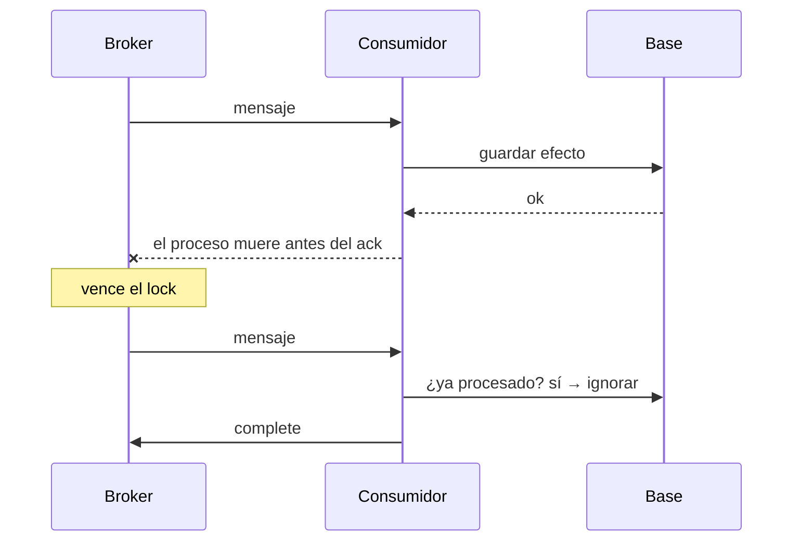

# Entrega at-least-once

Parte de: [[Garantías de entrega (at-most, at-least y exactly-once)]]

> [!info] Cómo avanzar
> `progreso`: **pendiente** → **viendo** (estudiando) → **visto** (contestaste la autoevaluación sin abrir las respuestas) → **dominado** (hiciste el laboratorio o lo aplicaste de verdad).

## Contenido

### Qué es
**At-least-once** ("al menos una vez") garantiza que ningún mensaje se pierde: si algo falla, el broker lo vuelve a entregar hasta que alguien confirme que lo procesó. El precio es que un mismo mensaje **puede procesarse más de una vez**. Es la garantía más común en sistemas de negocio y la base del "exactly-once efectivo".

Es parte de [[Garantías de entrega (at-most, at-least y exactly-once)]].

### Cómo funciona
1. El broker entrega el mensaje y lo deja **pendiente** (bloqueado o sin confirmar).
2. El consumidor procesa y guarda el efecto.
3. Solo entonces confirma (ack / complete / commit del offset).
4. Si el consumidor falla, se cae o tarda más que el lock, el broker lo reentrega.



La ventana de duplicado está entre "guardé el efecto" y "el broker recibió mi ack". También aparecen duplicados del lado del productor: si envía, no recibe respuesta por un timeout y reenvía, el broker tiene dos copias.

En Azure Service Bus el modo `PeekLock` implementa esto. Cada reentrega incrementa `DeliveryCount`; al superar `MaxDeliveryCount` (10 por defecto) el mensaje se mueve a la cola de mensajes muertos ([[Dead letter queues y mensajes venenosos]]).

### Ejemplo
Worker de Itzamna.Dionisio que aplica pagos. Confirma después de procesar y el handler es idempotente gracias a una tabla de mensajes procesados dentro de la misma transacción:

```csharp
processor.ProcessMessageAsync += async args =>
{
    var msg = args.Message;
    var pago = msg.Body.ToObjectFromJson<PagoRecibido>()!;

    await using var cn = new SqlConnection(cadena);
    await cn.OpenAsync(args.CancellationToken);
    await using var tx = await cn.BeginTransactionAsync(args.CancellationToken);

    // Inserta el MessageId; si ya existía, el procedimiento devuelve 0 y no aplica el pago
    var aplicado = await cn.ExecuteScalarAsync<int>(
        Sql.AplicarPagoIdempotente, // SQL en archivo .sql
        new { msg.MessageId, pago.PedidoId, pago.Monto },
        tx);

    await tx.CommitAsync(args.CancellationToken);
    await args.CompleteMessageAsync(msg); // ack después del commit
};

processor.ProcessErrorAsync += args =>
{
    logger.LogError(args.Exception, "Error en {Entidad}", args.EntityPath);
    return Task.CompletedTask;
};
```

Si el handler lanza una excepción, no se llama a `CompleteMessageAsync`; el lock vence (o se hace `AbandonMessageAsync`) y el mensaje se reintenta.

### Cuándo usarlo y cuándo no
Úsalo por defecto para eventos y comandos de negocio: pedidos, pagos, altas, sincronización con otros sistemas, envío de correos. Combínalo siempre con:
- [[Consumidores idempotentes]] para neutralizar duplicados.
- [[Reintentos con backoff]] para errores transitorios.
- Una DLQ para los que nunca van a funcionar.

No lo necesitas para datos efímeros que se reemplazan solos (ahí basta [[Entrega at-most-once]]). Tampoco lo resuelve todo: si el efecto es una llamada a un tercero que no acepta clave de idempotencia, la ventana de duplicado sigue existiendo y debes decidir explícitamente si prefieres arriesgar un duplicado o una pérdida.

### Errores comunes
- **Handler no idempotente.** Un `INSERT` simple o un "sumar saldo" duplicará efectos en la primera reentrega.
- **Procesos más largos que el lock.** En Service Bus el lock dura por defecto 1 minuto; si tu proceso tarda más, otro consumidor recibe el mismo mensaje en paralelo. Ajusta `MaxAutoLockRenewalDuration` en el procesador o divide el trabajo.
- **Reintentos infinitos.** Sin límite de entregas, un mensaje venenoso bloquea recursos para siempre.
- **Efectos externos sin clave de idempotencia.** Llamar al API de una pasarela sin `Idempotency-Key` hace que cada reentrega sea un cobro nuevo.

### Para profundizar
- [Service Bus: bloqueo PeekLock y liquidación](https://learn.microsoft.com/azure/service-bus-messaging/message-transfers-locks-settlement)
- [RabbitMQ: confirmaciones y publisher confirms](https://www.rabbitmq.com/docs/confirms)
- [Kafka: semántica de entrega](https://kafka.apache.org/documentation/#semantics)

## Autoevaluación

Contesta primero en voz alta o en papel; luego despliega la respuesta.

> [!question]- ¿Cómo se implementa?
> El consumidor confirma (ack) **después** de procesar con éxito; si muere o falla, el broker lo vuelve a entregar.

> [!question]- ¿Qué riesgo trae y cómo se mitiga?
> Duplicados. Se mitiga con [[Consumidores idempotentes]] (tabla de mensajes procesados, upserts, idempotency keys).

## Práctica

- [[Lab 3 - Outbox y consumidor idempotente]]

