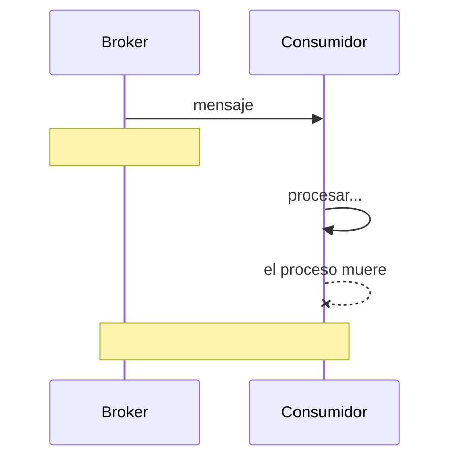

# Entrega at-most-once

Parte de: [[Garantías de entrega (at-most, at-least y exactly-once)]]

> [!info] Cómo avanzar
> `progreso`: **pendiente** → **viendo** (estudiando) → **visto** (contestaste la autoevaluación sin abrir las respuestas) → **dominado** (hiciste el laboratorio o lo aplicaste de verdad).

## Contenido

### Qué es
**At-most-once** ("como máximo una vez") significa que cada mensaje se procesa una vez o ninguna, pero nunca dos. Se consigue confirmando el mensaje **en cuanto se recibe**, antes de hacer el trabajo, y sin reintentos. Es la garantía más barata y la más rápida, a cambio de aceptar que algunos mensajes se pierdan.

Es parte de [[Garantías de entrega (at-most, at-least y exactly-once)]].

### Cómo funciona
1. El consumidor pide un mensaje al broker.
2. El broker lo entrega y lo da por consumido (lo borra o avanza el offset) en ese momento.
3. El consumidor procesa.
4. Si el proceso falla o se cae en el paso 3, **nadie** vuelve a entregar ese mensaje.



Formas típicas de implementarlo:
- **Azure Service Bus**: modo `ReceiveAndDelete`. El mensaje se elimina al recibirlo.
- **RabbitMQ**: `autoAck: true` en `BasicConsumeAsync`.
- **Kafka**: confirmar (commit) el offset antes de procesar, o `enable.auto.commit=true` con un procesamiento que puede quedar a medias cuando ya se hizo el commit.
- **Productor** que envía "dispara y olvida" (sin esperar confirmación del broker, o `acks=0` en Kafka): el mensaje puede no llegar nunca.

### Ejemplo
Ocelotl.Hermes recibe la posición de repartidores cada 2 segundos y solo le interesa la última. Perder una lectura no importa: en 2 segundos llega otra.

```csharp
await using var receiver = client.CreateReceiver("posiciones", new ServiceBusReceiverOptions
{
    ReceiveMode = ServiceBusReceiveMode.ReceiveAndDelete // at-most-once
});

while (!ct.IsCancellationRequested)
{
    var lote = await receiver.ReceiveMessagesAsync(maxMessages: 100, maxWaitTime: TimeSpan.FromSeconds(5), ct);
    foreach (var m in lote)
    {
        var p = m.Body.ToObjectFromJson<Posicion>()!;
        // Solo actualiza la última posición en caché; si falla, la siguiente lectura la corrige
        await cache.StringSetAsync($"pos:{p.RepartidorId}", m.Body.ToString(), TimeSpan.FromMinutes(1));
    }
}
```

Ventajas aquí: no hay locks que renovar, no hay reentregas que dupliquen trabajo y el throughput es mayor.

### Cuándo usarlo y cuándo no
Úsalo cuando el dato **pierde valor rápido** o se **reemplaza** con el siguiente:
- Métricas y telemetría de alta frecuencia.
- Posiciones, estados "en vivo", latidos (heartbeats).
- Logs de depuración no críticos.
- Notificaciones "nice to have" donde un faltante no daña a nadie.

No lo uses cuando el mensaje representa un hecho de negocio único: un pedido, un pago, un alta de usuario, un correo de restablecimiento de contraseña. Ahí la pérdida es un incidente y necesitas [[Entrega at-least-once]].

Pregunta útil: "si se pierde este mensaje, ¿alguien lo va a notar o reclamar?". Si la respuesta es sí, no es at-most-once.

### Errores comunes
- **Usarlo sin saberlo.** Llamar a `CompleteMessageAsync` o hacer commit del offset al inicio del handler "para que no se repita" convierte el flujo en at-most-once aunque el broker esté en PeekLock.
- **Auto-commit de Kafka con procesamiento asíncrono.** El commit periódico puede avanzar el offset de mensajes que tu código todavía no termina; si el proceso cae, se pierden.
- **Atrapar excepciones y seguir.** Un `catch { }` que solo registra el error y continúa equivale a descartar el mensaje.
- **No medir la pérdida.** Si aceptas perder mensajes, al menos cuenta cuántos fallan para saber si sigue siendo aceptable.

### Para profundizar
- [Service Bus: modo ReceiveAndDelete](https://learn.microsoft.com/azure/service-bus-messaging/message-transfers-locks-settlement)
- [RabbitMQ: confirmaciones del consumidor](https://www.rabbitmq.com/docs/confirms)
- [Kafka: semántica de entrega](https://kafka.apache.org/documentation/#semantics)

## Autoevaluación

Contesta primero en voz alta o en papel; luego despliega la respuesta.

> [!question]- ¿Cómo se implementa y cuándo es aceptable?
> Se confirma el mensaje al recibirlo (o no se reintenta). Aceptable para datos que pierden valor rápido: métricas, posiciones GPS frecuentes, logs no críticos.

> [!question]- ¿Qué pasa si el consumidor muere a mitad del proceso?
> El mensaje ya fue confirmado: se pierde.

