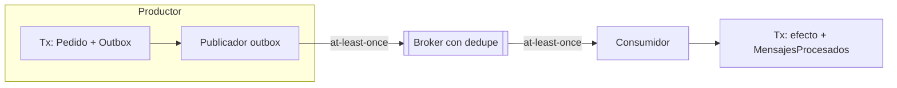

# Entrega exactly-once (efectiva)

Parte de: [[Garantías de entrega (at-most, at-least y exactly-once)]]

> [!info] Cómo avanzar
> `progreso`: **pendiente** → **viendo** (estudiando) → **visto** (contestaste la autoevaluación sin abrir las respuestas) → **dominado** (hiciste el laboratorio o lo aplicaste de verdad).

## Contenido

### Qué es
**Exactly-once** significa que el efecto de cada mensaje ocurre una sola vez. En sistemas distribuidos reales no se consigue como garantía de transporte de punta a punta: la red puede perder la confirmación, y el emisor no puede distinguir "no llegó" de "llegó pero no me avisaron". Lo que sí se logra es **exactly-once efectivo** (*effectively once*): entrega at-least-once + procesamiento idempotente, de modo que los duplicados existen pero no cambian el resultado.

Es parte de [[Garantías de entrega (at-most, at-least y exactly-once)]].

### Cómo funciona
Hay dos caminos, y conviene distinguirlos:

**1. Dentro de un mismo sistema (transacciones del broker).** Kafka ofrece productor idempotente (el broker descarta reenvíos del mismo productor por número de secuencia) y **transacciones** que escriben en varios topics y confirman offsets de lectura de forma atómica. Un consumidor con `isolation.level=read_committed` solo ve lo confirmado. Eso da exactly-once en flujos *leer de Kafka → procesar → escribir en Kafka*. En cuanto el efecto sale a SQL Server o a un API externo, esa garantía ya no te cubre.

**2. Entre sistemas (lo más común).** Se arma con piezas:
- **Deduplicación en el broker**: Azure Service Bus tiene *duplicate detection* por `MessageId` dentro de una ventana de tiempo configurable (niveles Standard y Premium). Evita duplicados del productor, no del consumidor.
- **Outbox transaccional** en el productor: el evento se guarda en la misma transacción que el cambio de negocio y un proceso lo publica después (puede publicarlo dos veces, pero nunca lo pierde).
- **Consumidor idempotente**: registra el `MessageId` en la misma transacción que el efecto ([[Consumidores idempotentes]]).



El resultado: puede haber varias entregas, pero solo un efecto.

### Ejemplo
Configurar deduplicación en una cola de Service Bus con el SDK de administración y publicar con un `MessageId` estable derivado del negocio:

```csharp
var admin = new ServiceBusAdministrationClient(fqdn, new DefaultAzureCredential());
await admin.CreateQueueAsync(new CreateQueueOptions("cobros")
{
    RequiresDuplicateDetection = true,
    DuplicateDetectionHistoryTimeWindow = TimeSpan.FromMinutes(30)
});

// MessageId estable: el mismo cobro siempre produce el mismo id
var mensaje = new ServiceBusMessage(BinaryData.FromObjectAsJson(cobro))
{
    MessageId = $"cobro-{cobro.PedidoId}-{cobro.Intento}"
};
await sender.SendMessageAsync(mensaje);
```

Del lado consumidor, la tabla `MensajesProcesados` cierra el círculo. Así el sistema de cobros de un SaaS no cobra doble aunque el worker se reinicie a mitad del proceso.

En Kafka con Confluent.Kafka, el productor idempotente se activa con `EnableIdempotence = true` (implica `Acks = Acks.All`) y las transacciones con `TransactionalId`, `InitTransactions`, `BeginTransaction`, `SendOffsetsToTransaction` y `CommitTransaction`.

### Cuándo usarlo y cuándo no
- Vale la pena en flujos donde un duplicado cuesta dinero o confianza: cobros, inventario, saldos, folios fiscales.
- Para correos informativos o actualizaciones de caché, at-least-once con una idempotencia sencilla (upsert) basta.
- Las transacciones de Kafka sirven para *stream processing* dentro de Kafka; no las uses como sustituto de idempotencia en tu base.

### Errores comunes
- **Creer en el marketing.** "Exactly-once" de un broker cubre su propio sistema, no tu base de datos ni el API de la pasarela.
- **Confiar solo en la deduplicación del broker.** Tiene ventana de tiempo y no protege contra reentregas al consumidor.
- **Generar el `MessageId` aleatorio en cada reintento del productor.** Rompe la deduplicación: cada reintento parece un mensaje nuevo.
- **Separar efecto y registro en dos transacciones.** Reabre la ventana de duplicado o de pérdida.

### Para profundizar
- [Service Bus: detección de duplicados](https://learn.microsoft.com/azure/service-bus-messaging/duplicate-detection)
- [Kafka: semántica de entrega y transacciones](https://kafka.apache.org/documentation/#semantics)
- [Patrón Transactional Outbox (microservices.io)](https://microservices.io/patterns/data/transactional-outbox.html)

## Autoevaluación

Contesta primero en voz alta o en papel; luego despliega la respuesta.

> [!question]- ¿Existe exactly-once de punta a punta en la red?
> No de forma general: lo que se logra es *efectivamente una vez* = entrega at-least-once + procesamiento idempotente (o transacciones dentro de un mismo sistema).

> [!question]- ¿Qué ofrecen los brokers que dicen "exactly-once"?
> Garantías dentro de su propio sistema (p. ej. productor idempotente y transacciones de Kafka entre leer y escribir topics). En cuanto el efecto sale a otra base o API, necesitas idempotencia.

