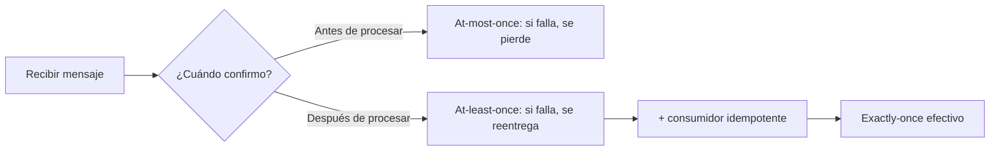

# Garantías de entrega (at-most, at-least y exactly-once)

Parte de: [[09-Arquitectura-Patrones/04 Mensajería/_Índice Mensajería|Mensajería]]

> [!info] Cómo avanzar
> `progreso`: **pendiente** → **viendo** (estudiando) → **visto** (contestaste la autoevaluación sin abrir las respuestas) → **dominado** (hiciste el laboratorio o lo aplicaste de verdad).

## Contenido

### Qué es
Una **garantía de entrega** describe cuántas veces, como máximo o como mínimo, un mensaje llega a producir su efecto en el consumidor cuando hay fallos de red, caídas de procesos o reinicios del broker. No es una propiedad mágica del producto que eliges: es el resultado de **cómo confirmas** (ack) los mensajes, cómo reintentas y cómo está escrito el consumidor.

Hay tres niveles:

| Garantía | Veces que se procesa | Riesgo | Nota |
|---|---|---|---|
| At-most-once | 0 o 1 | Pérdida | [[Entrega at-most-once]] |
| At-least-once | 1 o más | Duplicados | [[Entrega at-least-once]] |
| Exactly-once | 1 (efectivo) | Complejidad | [[Entrega exactly-once (efectiva)]] |

### Cómo funciona
Todo se reduce a una pregunta: **¿cuándo le dice el consumidor al broker "ya terminé"?**



- Si confirmas **antes** de procesar y el proceso muere a la mitad, el broker ya borró el mensaje: se perdió.
- Si confirmas **después** de procesar y el proceso muere justo entre "procesé" y "confirmé", el broker no sabe que terminaste y lo vuelve a entregar: duplicado.
- No existe un punto intermedio que elimine las dos ventanas al mismo tiempo, porque el efecto (escribir en tu base, llamar a un API) y el ack al broker son dos sistemas distintos sin una transacción común.

Por eso la combinación más usada en la industria es **at-least-once + idempotencia**: aceptas que los duplicados ocurran y haces que no importen.

En Azure Service Bus esto se ve en el modo de recepción:
- `ReceiveAndDelete`: el broker borra el mensaje al entregarlo → at-most-once.
- `PeekLock` (el predeterminado): el mensaje queda bloqueado; tú lo completas al terminar o el lock expira y se reentrega → at-least-once.

### Ejemplo
Itzamna.Dionisio publica `PedidoCreado` y un worker de facturación lo consume. Con `PeekLock` y `AutoCompleteMessages = false`, el worker solo completa después de guardar la factura:

```csharp
var processor = client.CreateProcessor("pedidos", new ServiceBusProcessorOptions
{
    ReceiveMode = ServiceBusReceiveMode.PeekLock, // at-least-once
    AutoCompleteMessages = false,
    MaxConcurrentCalls = 8
});

processor.ProcessMessageAsync += async args =>
{
    var evento = args.Message.Body.ToObjectFromJson<PedidoCreado>()!;
    // El handler es idempotente: usa args.Message.MessageId para detectar duplicados
    await facturacion.GenerarAsync(evento, args.Message.MessageId, args.CancellationToken);
    await args.CompleteMessageAsync(args.Message); // ack DESPUÉS del efecto
};
```

Si el proceso muere antes de `CompleteMessageAsync`, el mensaje vuelve a la cola cuando vence el lock y otro worker lo procesa. El handler debe soportar eso (ver [[Consumidores idempotentes]]).

### Cuándo usarlo y cuándo no
- **At-most-once**: telemetría frecuente, métricas, posiciones GPS que se reemplazan cada segundo. Perder uno no importa y el procesamiento es más barato.
- **At-least-once**: casi todo lo de negocio (pedidos, pagos, correos, sincronizaciones). Es el valor predeterminado razonable.
- **Exactly-once efectivo**: cuando un duplicado cuesta dinero o confianza (cobros, inventario). Se logra con idempotencia, outbox y, dentro de Kafka, con transacciones.

Elige la garantía por el **costo del error**: ¿qué es peor para el negocio, perder un mensaje o procesarlo dos veces?

### Errores comunes
- **Creer que el broker decide la garantía.** La decide tu código: un `CompleteMessageAsync` al inicio del handler convierte PeekLock en at-most-once.
- **Activar autocompletado sin pensarlo.** En el SDK de Service Bus `AutoCompleteMessages` es `true` por defecto; completa al terminar el handler, pero si atrapas excepciones y no las relanzas, completarás mensajes que fallaron.
- **Asumir que "no hay duplicados" porque nunca los viste en desarrollo.** Aparecen con reinicios, despliegues y locks vencidos en producción.
- **Olvidar el lado del productor.** Si el productor reintenta un envío que sí llegó, también genera duplicados; por eso conviene un `MessageId` estable.

### Para profundizar
- [Azure Service Bus: modos de recepción y liquidación de mensajes](https://learn.microsoft.com/azure/service-bus-messaging/message-transfers-locks-settlement)
- [Kafka: semántica de entrega](https://kafka.apache.org/documentation/#semantics)
- [Patrón Competing Consumers (Azure Architecture Center)](https://learn.microsoft.com/azure/architecture/patterns/competing-consumers)

## Subtemas

- [[Entrega at-most-once]]
- [[Entrega at-least-once]]
- [[Entrega exactly-once (efectiva)]]

## Autoevaluación

Contesta primero en voz alta o en papel; luego despliega la respuesta.

> [!question]- ¿Qué tres garantías de entrega existen?
> *At-most-once* (0 o 1 vez; puede perderse), *at-least-once* (1 o más; puede duplicarse) y *exactly-once* (una vez). Ver los subtemas.

> [!question]- ¿Cuál es la más común y qué te obliga a hacer?
> At-least-once. Obliga a que el consumidor sea idempotente.

> [!question]- ¿Qué decide la garantía en la práctica?
> El momento en que se confirma (ack): antes de procesar → at-most-once; después de procesar → at-least-once.

## Práctica

- [[Lab 3 - Outbox y consumidor idempotente]]

## Progreso de los subtemas

```base
filters:
  and:
    - file.inFolder("09-Arquitectura-Patrones/04 Mensajería/Garantías de entrega (at-most, at-least y exactly-once)")
    - file.name != "Garantías de entrega (at-most, at-least y exactly-once)"
views:
  - type: table
    name: Progreso
    order:
      - file.name
      - progreso
      - nivel
```
