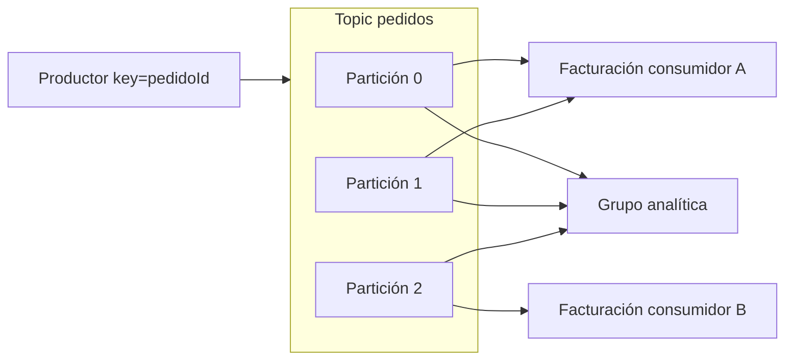

# Kafka

Parte de: [[09-Arquitectura-Patrones/04 Mensajería/_Índice Mensajería|Mensajería]]

> [!info] Cómo avanzar
> `progreso`: **pendiente** → **viendo** (estudiando) → **visto** (contestaste la autoevaluación sin abrir las respuestas) → **dominado** (hiciste el laboratorio o lo aplicaste de verdad).

## Contenido

### Qué es
**Apache Kafka** es una plataforma de *event streaming*: un **log distribuido, particionado y replicado** donde los productores agregan registros al final y los consumidores leen a su ritmo. A diferencia de una cola, leer no borra: los registros se conservan según una política de retención (tiempo, tamaño o compactación por clave), así que varios sistemas pueden leer el mismo flujo de forma independiente y se puede **reprocesar el historial**.

### Cómo funciona
Conceptos clave:
- **Topic**: flujo nombrado de eventos (`pedidos`).
- **Partición**: cada topic se divide en N particiones; cada una es un log **ordenado** e inmutable, replicado en varios brokers (un líder y seguidores).
- **Offset**: posición de un registro dentro de su partición (0, 1, 2…). El orden solo está garantizado **dentro** de una partición.
- **Clave**: el productor elige partición con `hash(clave) mod particiones`. Misma clave → misma partición → orden garantizado para esa entidad.
- **Grupo de consumidores**: varios consumidores con el mismo `group.id` se reparten las particiones; **cada partición la lee como máximo un consumidor del grupo**. Por eso el número de particiones limita el paralelismo: con 6 particiones, el séptimo consumidor se queda ocioso.
- **Commit de offsets**: el grupo guarda hasta dónde leyó. Otro grupo (analítica) lleva su propio offset sobre el mismo topic.



Durabilidad: con `acks=all` el líder espera a las réplicas sincronizadas antes de confirmar; `min.insync.replicas` define cuántas deben estar al día. Desde Kafka 4.0 el clúster funciona solo en modo **KRaft** (sin ZooKeeper).

### Ejemplo
Con el cliente Confluent.Kafka en .NET, publicando con la clave del pedido para conservar el orden de sus eventos:

```csharp
var config = new ProducerConfig
{
    BootstrapServers = "localhost:9092",
    EnableIdempotence = true, // evita duplicados por reintentos del productor
    Acks = Acks.All
};
using var producer = new ProducerBuilder<string, string>(config).Build();
await producer.ProduceAsync("pedidos", new Message<string, string>
{
    Key = pedido.Id.ToString(),
    Value = JsonSerializer.Serialize(new PedidoPagado(pedido.Id, pedido.Total))
});
```

Consumidor con commit manual **después** de procesar (at-least-once):

```csharp
var cfg = new ConsumerConfig
{
    BootstrapServers = "localhost:9092",
    GroupId = "facturacion",
    EnableAutoCommit = false,
    AutoOffsetReset = AutoOffsetReset.Earliest
};
using var consumer = new ConsumerBuilder<string, string>(cfg).Build();
consumer.Subscribe("pedidos");
while (!ct.IsCancellationRequested)
{
    var r = consumer.Consume(ct);
    await handler.EjecutarAsync(r.Message.Key, r.Message.Value, ct); // idempotente
    consumer.Commit(r);
}
```

**En Azure**: Azure Event Hubs expone un endpoint compatible con el protocolo de Kafka (puerto 9093, `SASL_SSL`) en los niveles Standard, Premium y Dedicated; el mismo código funciona cambiando `BootstrapServers` y la autenticación. Algunas funciones (transacciones, Kafka Streams) solo están en Premium/Dedicated y en versión preliminar, así que revisa la tabla de compatibilidad antes de depender de ellas.

### Cuándo usarlo y cuándo no
Prefiere Kafka (o Event Hubs) cuando:
- El volumen es alto (telemetría, clics, logs, cambios de base con CDC).
- Varios consumidores independientes necesitan el mismo flujo.
- Necesitas **reprocesar** desde una fecha (corregiste un bug y quieres recalcular).
- Haces *stream processing* (agregaciones por ventana, joins de flujos).

Prefiere una cola ([[RabbitMQ]], Azure Service Bus) cuando:
- Son tareas puntuales (enviar un correo, generar un PDF) que se borran al terminar.
- Necesitas DLQ integrada por mensaje, prioridades, mensajes programados o enrutamiento por patrones.
- El equipo es pequeño y no quiere operar un clúster.

### Errores comunes
- **Pocas particiones**: no se pueden reducir y aumentarlas cambia el mapeo clave→partición (rompe el orden durante la transición). Dimensiona según el paralelismo que esperas.
- **Clave mal elegida**: sin clave no hay orden por entidad; una clave muy desigual (un cliente gigante) crea una partición caliente.
- **Auto-commit con procesamiento lento**: puede avanzar el offset antes de terminar → pérdida.
- **Esperar DLQ automática**: Kafka no la trae; se implementa con un topic de errores y lógica propia.
- **Procesar un registro por minutos** sin pausar: el consumidor excede `max.poll.interval.ms`, el grupo lo saca y se reasignan particiones (rebalanceo).

### Para profundizar
- [Documentación de Apache Kafka](https://kafka.apache.org/documentation/)
- [Cliente .NET de Confluent](https://docs.confluent.io/kafka-clients/dotnet/current/overview.html)
- [Azure Event Hubs para Apache Kafka](https://learn.microsoft.com/azure/event-hubs/azure-event-hubs-apache-kafka-overview)

## Autoevaluación

Contesta primero en voz alta o en papel; luego despliega la respuesta.

> [!question]- ¿Qué es un topic, una partición y un offset?
> Topic: flujo nombrado de eventos. Partición: log ordenado y replicado en el que se divide el topic. Offset: posición de un registro en la partición.

> [!question]- ¿Cómo se garantiza orden por entidad?
> Usando la misma **clave** (p. ej. `pedidoId`): todos sus eventos caen en la misma partición, que se lee en orden.

> [!question]- ¿Qué limita el paralelismo de un grupo de consumidores?
> El número de particiones: cada partición la lee como máximo un consumidor del grupo.

> [!question]- ¿Cuándo preferir Kafka sobre una cola tradicional?
> Alto volumen, necesidad de reprocesar el historial, varios consumidores independientes del mismo flujo o *streaming*. Para tareas puntuales con enrutamiento flexible, una cola suele bastar.

