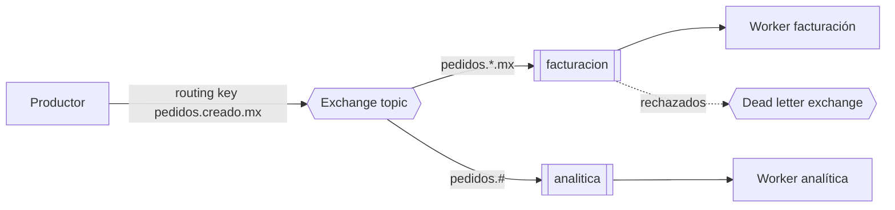

# RabbitMQ

Parte de: [[09-Arquitectura-Patrones/04 Mensajería/_Índice Mensajería|Mensajería]]

> [!info] Cómo avanzar
> `progreso`: **pendiente** → **viendo** (estudiando) → **visto** (contestaste la autoevaluación sin abrir las respuestas) → **dominado** (hiciste el laboratorio o lo aplicaste de verdad).

## Contenido

### Qué es
**RabbitMQ** es un broker de mensajes de código abierto que implementa AMQP 0-9-1 (y desde la serie 4.x también AMQP 1.0 de forma nativa). Su modelo es el de **colas**: los productores publican, el broker enruta a una o varias colas, y los consumidores reciben y confirman; un mensaje confirmado se elimina. Es fuerte en enrutamiento flexible, colas de trabajo y patrones request/reply.

### Cómo funciona
Las piezas básicas:
- **Productor**: publica en un *exchange*, nunca directo en una cola.
- **Exchange**: decide a qué colas va cada mensaje según su tipo y los *bindings*:
  - `direct`: coincidencia exacta de *routing key*.
  - `topic`: patrones con comodines (`pedidos.*.mx`, `pedidos.#`).
  - `fanout`: a todas las colas enlazadas, ignora la routing key.
  - `headers`: por encabezados del mensaje.
- **Binding**: regla que une un exchange con una cola.
- **Cola**: guarda los mensajes hasta que se consumen. Tipos: clásicas, **quorum** (replicadas con Raft, la opción recomendada para datos importantes) y **streams** (log persistente estilo Kafka).
- **Consumidor**: recibe con *prefetch* (cuántos mensajes sin confirmar puede tener) y responde `ack`, `nack` o `reject`.



**Diferencia con Kafka:** en RabbitMQ (colas clásicas y quorum) el mensaje confirmado desaparece y cada mensaje lo procesa un consumidor de la cola; para que dos sistemas reciban lo mismo, cada uno tiene su propia cola enlazada al exchange. En [[Kafka]] los mensajes permanecen según la retención y cada grupo de consumidores lleva su propio offset, así que se puede releer el historial.

**Para no perder mensajes** necesitas todo esto junto:
1. Colas **durables** (mejor quorum).
2. Mensajes **persistentes** (`Persistent = true`).
3. **Publisher confirms**: el broker confirma al productor que guardó el mensaje.
4. **Ack manual** del consumidor después de procesar.
5. Un **dead letter exchange** para lo que falla repetidamente ([[Dead letter queues y mensajes venenosos]]).

### Ejemplo
Con el cliente oficial RabbitMQ.Client 7.x (API asíncrona):

```csharp
var factory = new ConnectionFactory { HostName = "localhost" };
await using var conn = await factory.CreateConnectionAsync();
await using var ch = await conn.CreateChannelAsync(new CreateChannelOptions(
    publisherConfirmationsEnabled: true, publisherConfirmationTrackingEnabled: true));

await ch.ExchangeDeclareAsync("pedidos", ExchangeType.Topic, durable: true);
await ch.QueueDeclareAsync("facturacion", durable: true, exclusive: false, autoDelete: false,
    arguments: new Dictionary<string, object?>
    {
        ["x-queue-type"] = "quorum",
        ["x-dead-letter-exchange"] = "pedidos.dlx"
    });
await ch.QueueBindAsync("facturacion", "pedidos", "pedidos.*.mx");

// Publicar persistente; con confirmaciones activas, la llamada espera la confirmación del broker
var props = new BasicProperties { Persistent = true, MessageId = pedido.Id.ToString() };
await ch.BasicPublishAsync("pedidos", "pedidos.creado.mx", mandatory: true, basicProperties: props,
    body: JsonSerializer.SerializeToUtf8Bytes(pedido));

// Consumir con ack manual y prefetch acotado (backpressure)
await ch.BasicQosAsync(prefetchSize: 0, prefetchCount: 20, global: false);
var consumer = new AsyncEventingBasicConsumer(ch);
consumer.ReceivedAsync += async (_, ea) =>
{
    try
    {
        await handler.EjecutarAsync(ea.Body, ea.BasicProperties.MessageId);
        await ch.BasicAckAsync(ea.DeliveryTag, multiple: false);
    }
    catch (Exception)
    {
        await ch.BasicNackAsync(ea.DeliveryTag, multiple: false, requeue: false); // va al DLX
    }
};
await ch.BasicConsumeAsync("facturacion", autoAck: false, consumer: consumer);
```

Para desarrollo local: `docker run -p 5672:5672 -p 15672:15672 rabbitmq:4-management` y la consola en `http://localhost:15672`.

### Cuándo usarlo y cuándo no
- **Úsalo** para colas de trabajo, enrutamiento por patrones, prioridades, RPC asíncrono y cuando quieres un broker que puedes correr tú mismo (on-premises, Docker, Kubernetes).
- **En Azure**, el equivalente administrado más directo es **Azure Service Bus** (colas, temas, sesiones, DLQ integrada); no hay RabbitMQ administrado por Microsoft, aunque existen ofertas de terceros.
- **Prefiere Kafka** si necesitas releer historial, muchos consumidores independientes del mismo flujo o volumen de streaming muy alto.

### Errores comunes
- **`autoAck: true` en flujos de negocio**: es at-most-once ([[Entrega at-most-once]]).
- **Prefetch ilimitado**: un consumidor acapara miles de mensajes en memoria y los demás se quedan sin trabajo.
- **`requeue: true` en un error permanente**: bucle infinito con un mensaje venenoso.
- **Colas quorum sin DLX en 4.x**: al alcanzar el límite de entregas predeterminado, el mensaje se descarta.
- **Abrir una conexión por mensaje**: las conexiones son caras; reutiliza una conexión y usa canales.

### Para profundizar
- [Documentación de RabbitMQ](https://www.rabbitmq.com/docs)
- [RabbitMQ: confirmaciones de consumidor y publicador](https://www.rabbitmq.com/docs/confirms)
- [RabbitMQ: colas quorum](https://www.rabbitmq.com/docs/quorum-queues)
- [Tutoriales de RabbitMQ para .NET](https://www.rabbitmq.com/tutorials)

## Autoevaluación

Contesta primero en voz alta o en papel; luego despliega la respuesta.

> [!question]- ¿Cuáles son las piezas básicas de RabbitMQ?
> Productor → *exchange* → (bindings con routing key) → colas → consumidores. Tipos de exchange: direct, topic, fanout, headers.

> [!question]- ¿Qué diferencia hay con Kafka en cómo se consumen los mensajes?
> RabbitMQ es un broker de colas: el mensaje confirmado se elimina. Kafka es un log: los mensajes permanecen según retención y cada grupo de consumidores lleva su propio offset.

> [!question]- ¿Qué configurarías para no perder mensajes?
> Colas durables, mensajes persistentes, *publisher confirms*, ack manual tras procesar y una DLQ (dead-letter exchange).

## Práctica

- [[Lab 3 - Outbox y consumidor idempotente]]

