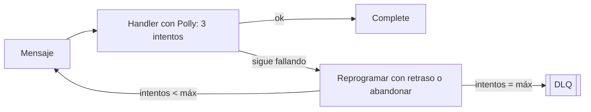

# Reintentos con backoff

Parte de: [[09-Arquitectura-Patrones/04 Mensajería/_Índice Mensajería|Mensajería]]

> [!info] Cómo avanzar
> `progreso`: **pendiente** → **viendo** (estudiando) → **visto** (contestaste la autoevaluación sin abrir las respuestas) → **dominado** (hiciste el laboratorio o lo aplicaste de verdad).

## Contenido

### Qué es
**Reintentar con backoff** es volver a intentar una operación que falló por una causa transitoria (timeout, 503, conexión reiniciada, bloqueo de base) esperando un tiempo **creciente** entre intentos. El backoff **exponencial** duplica la espera en cada intento; el **jitter** agrega aleatoriedad para que miles de clientes no reintenten en el mismo instante.

Sirve tanto en llamadas HTTP como en consumidores de mensajes; aquí nos enfocamos en mensajería, y su pareja en llamadas síncronas es [[Circuit breaker y reintentos]].

### Cómo funciona
Fórmula típica con **full jitter**:

```text
espera(intento) = aleatorio(0, min(tope, base × 2^intento))
```

Con base 100 ms y tope 1 s, el límite superior va 100, 200, 400, 800 ms y luego se queda en 1,000 ms. El tope evita esperas absurdas y el aleatorio reparte los reintentos en el tiempo.

¿Por qué no reintentar de inmediato? Si una base de datos se saturó, mil clientes reintentando al mismo milisegundo la vuelven a tumbar (*thundering herd*, estampida). El exponencial le da tiempo de recuperarse y el jitter desincroniza a los clientes.

Toda política necesita **límites**:
- Número máximo de intentos **o** tiempo total máximo.
- Tope por espera.
- Solo errores **transitorios**: un 400, un error de validación o un JSON inválido no se arreglan esperando.

En mensajería hay dos niveles de reintento:
1. **Dentro del handler** (en memoria, unos cuantos intentos rápidos con Polly).
2. **Del broker** (reentregas): cada vez que el mensaje no se confirma, vuelve a la cola y sube su `DeliveryCount`. Al agotar el máximo, va a la DLQ ([[Dead letter queues y mensajes venenosos]]).



Service Bus no aplica backoff a las reentregas por sí solo: el mensaje abandonado está disponible de inmediato. Para esperar entre reentregas se puede **reprogramar** una copia con `ScheduleMessageAsync` (o `ScheduledEnqueueTime`) y completar el original, llevando un contador propio en `ApplicationProperties`.

### Ejemplo
Polly v8 (`Microsoft.Extensions.Resilience`) para reintentos dentro del handler, solo con errores transitorios de SQL Server:

```csharp
var pipeline = new ResiliencePipelineBuilder()
    .AddRetry(new RetryStrategyOptions
    {
        MaxRetryAttempts = 3,
        BackoffType = DelayBackoffType.Exponential,
        UseJitter = true,
        Delay = TimeSpan.FromMilliseconds(200),
        MaxDelay = TimeSpan.FromSeconds(2),
        ShouldHandle = new PredicateBuilder()
            .Handle<SqlException>(ex => ex.IsTransient)
            .Handle<TimeoutException>()
    })
    .Build();

processor.ProcessMessageAsync += async args =>
{
    await pipeline.ExecuteAsync(async ct => await handler.EjecutarAsync(args.Message, ct), args.CancellationToken);
    await args.CompleteMessageAsync(args.Message);
};
```

Reentrega con retraso creciente controlada por la aplicación:

```csharp
static readonly TimeSpan[] Esperas = [TimeSpan.FromSeconds(1), TimeSpan.FromSeconds(2), TimeSpan.FromSeconds(4)];

async Task ReprogramarAsync(ProcessMessageEventArgs args, ServiceBusSender sender)
{
    var intento = args.Message.ApplicationProperties.TryGetValue("intento", out var v) ? (int)v : 0;
    if (intento >= Esperas.Length)
    {
        await args.DeadLetterMessageAsync(args.Message, "ReintentosAgotados");
        return;
    }
    var copia = new ServiceBusMessage(args.Message);
    copia.ApplicationProperties["intento"] = intento + 1;
    await sender.ScheduleMessageAsync(copia, DateTimeOffset.UtcNow + Esperas[intento]);
    await args.CompleteMessageAsync(args.Message);
}
```

Combinando ambos (3 intentos inmediatos en el handler y luego 3 reentregas con 1, 2 y 4 s) cuentas cuántas veces se ejecuta el trabajo sumando el original más cada reintento, y la espera mínima es la suma de los retrasos programados.

### Cuándo usarlo y cuándo no
- Úsalo con dependencias que fallan de forma intermitente: SQL en Azure (reconfiguraciones), APIs con 429/503, red.
- No reintentes errores permanentes (4xx de validación, formato): mándalos directo a DLQ o devuelve el error.
- No reintentes operaciones no idempotentes sin clave de idempotencia: cada reintento podría duplicar el efecto.
- Respeta `Retry-After` cuando el servidor lo envía.

### Errores comunes
- **Reintentos sin jitter**: todos los workers golpean juntos al mismo tiempo.
- **Reintentos anidados**: Polly en el cliente HTTP, Polly en el handler y reentregas del broker se multiplican (3 × 3 × 10 = 90 intentos).
- **Sin tope de tiempo total**: un mensaje tarda horas en llegar a la DLQ y nadie se entera.
- **Reintentar todo**: incluido un `ArgumentException` que nunca va a cambiar.

### Para profundizar
- [Estrategia de reintento en Polly](https://www.pollydocs.org/strategies/retry.html)
- [Patrón Retry (Azure Architecture Center)](https://learn.microsoft.com/azure/architecture/patterns/retry)
- [AWS Architecture Blog: Exponential Backoff and Jitter](https://aws.amazon.com/blogs/architecture/exponential-backoff-and-jitter/)

## Ejercicios

Resuélvelos en papel o en la herramienta; la solución está plegada.

> [!question]- Backoff con *full jitter*: espera = aleatorio entre 0 y min(tope, base·2^intento). Base 100 ms, tope 1 s. ¿Rango de espera para los intentos 0 a 4?
> Intento 0: 0–100 ms; 1: 0–200; 2: 0–400; 3: 0–800; 4: 0–**1000** (1600 topado a 1000).

> [!question]- Un consumidor reintenta 3 veces de inmediato y luego 3 con backoff 1 s, 2 s, 4 s. ¿Cuántos intentos totales y cuánto espera como mínimo antes de mandar a DLQ?
> 1 original + 3 + 3 = **7 intentos**; espera mínima ≈ 1 + 2 + 4 = **7 s** (más el tiempo de proceso).

## Autoevaluación

Contesta primero en voz alta o en papel; luego despliega la respuesta.

> [!question]- ¿Por qué backoff exponencial con *jitter*?
> El exponencial da tiempo a que la dependencia se recupere; el jitter (aleatoriedad) evita que todos los clientes reintenten al mismo tiempo (*thundering herd*).

> [!question]- ¿Qué límites debe tener una política de reintentos?
> Máximo de intentos o tiempo total, tope por espera, y solo para errores transitorios.

> [!question]- En mensajería, ¿qué pasa al agotar los reintentos?
> El mensaje va a la DLQ ([[Dead letter queues y mensajes venenosos]]).

## Práctica

- [[Lab 3 - Outbox y consumidor idempotente]]

