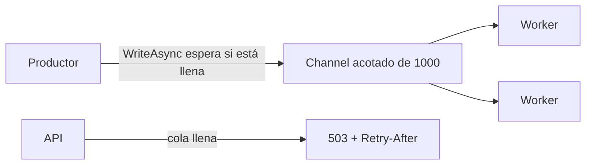

# Backpressure

Parte de: [[09-Arquitectura-Patrones/05 Diseño de sistemas/_Índice Diseño de sistemas|Diseño de sistemas]]

> [!info] Cómo avanzar
> `progreso`: **pendiente** → **viendo** (estudiando) → **visto** (contestaste la autoevaluación sin abrir las respuestas) → **dominado** (hiciste el laboratorio o lo aplicaste de verdad).

## Contenido

### Qué es
**Backpressure** (contrapresión) es el mecanismo por el cual un componente lento **frena** a quien le envía trabajo, en lugar de aceptar todo y acumularlo sin límite. Si el productor genera 80 mensajes por segundo y el consumidor procesa 50, la diferencia tiene que ir a algún lado: o se frena al productor, o se rechaza, o se descarta, o se escala el consumidor. Lo que no puede pasar es acumular en memoria hasta que el proceso muera.

### Cómo funciona
Primero, la aritmética: si la tasa de llegada supera la de procesamiento, la cola crece a razón de `(llegada − proceso)` por segundo; cuando la llegada baja de la capacidad, se vacía a razón de `(proceso − llegada)`. Esa cuenta te dice cuánto debe aguantar el buffer y cuánto tarda en recuperarse.

Formas de aplicar backpressure:
- **Colas acotadas**: el buffer tiene capacidad máxima; al llenarse, el productor espera, o se descarta el más viejo o el más nuevo.
- **Rechazar al cliente**: `429 Too Many Requests` (por cuota) o `503 Service Unavailable` con `Retry-After` (por saturación). Ver [[Bulkhead y throttling]] y [[Caso - rate limiter]].
- **Limitar concurrencia**: un número máximo de operaciones en vuelo (semáforo, `MaxConcurrentCalls`, `MaxDegreeOfParallelism`).
- **Control de flujo del broker**: *prefetch* en RabbitMQ, número de mensajes por lote en Service Bus; el consumidor solo pide lo que puede procesar.
- **Nivelar con una cola durable**: el API acepta y encola; los workers procesan a su ritmo ([[Competing consumers]]). La cola absorbe el pico, pero también debe vigilarse.
- **Descartar o muestrear** cuando el dato lo permite (telemetría).
- **Escalar** consumidores según la longitud de la cola (KEDA en Azure Container Apps).



**¿Y una cola en memoria sin límite?** Funciona en desarrollo y falla en producción: crece hasta agotar memoria, la latencia de cada elemento se dispara (todo espera detrás de miles) y si el proceso se reinicia se pierde todo lo encolado.

### Ejemplo
`System.Threading.Channels` con capacidad acotada en un servicio de fondo de ASP.NET Core:

```csharp
public sealed class ColaReportes
{
    private readonly Channel<SolicitudReporte> _canal = Channel.CreateBounded<SolicitudReporte>(
        new BoundedChannelOptions(capacity: 500)
        {
            FullMode = BoundedChannelFullMode.Wait, // el productor espera: backpressure
            SingleReader = false
        });

    public bool TryEncolar(SolicitudReporte s) => _canal.Writer.TryWrite(s); // false si está llena
    public IAsyncEnumerable<SolicitudReporte> LeerTodo(CancellationToken ct) => _canal.Reader.ReadAllAsync(ct);
}

[ApiController, Route("reportes")]
public sealed class ReportesController(ColaReportes cola) : ControllerBase
{
    [HttpPost]
    public IActionResult Solicitar(SolicitudReporte s)
    {
        if (!cola.TryEncolar(s))
        {
            Response.Headers.RetryAfter = "30";
            return Problem(statusCode: 503, title: "Cola de reportes llena",
                extensions: new Dictionary<string, object?> { ["codigo"] = "REPORTES_SATURADO" });
        }
        return Accepted();
    }
}
```

El worker (un `BackgroundService`) consume con `await foreach` y procesa con concurrencia limitada. Para trabajo que no debe perderse, la cola real debe ser durable (Service Bus); el `Channel` es para buffers internos y efímeros.

### Cuándo usarlo y cuándo no
- **Siempre** que haya un productor que puede ir más rápido que el consumidor: pipelines, ingestión, exportaciones, webhooks entrantes.
- Elige la política según el dato: esperar (no perder), rechazar con 503 (que el cliente reintente), descartar (telemetría).
- Si el desbalance es permanente, backpressure no basta: hay que escalar o optimizar el consumidor.

### Errores comunes
- **`Channel.CreateUnbounded` o `ConcurrentQueue` sin límite** para trabajo de usuarios.
- **Reintentos agresivos del cliente** al recibir 503, sin respetar `Retry-After`, que empeoran la saturación.
- **Prefetch enorme** que mete miles de mensajes en memoria de un solo consumidor.
- **No medir**: sin métricas de longitud de cola y edad del mensaje más viejo, te enteras por los usuarios.
- **Confiar en la cola durable como infinita**: también tiene cuotas y una cola con horas de atraso es un incidente.

### Para profundizar
- [.NET: System.Threading.Channels](https://learn.microsoft.com/dotnet/core/extensions/channels)
- [Patrón Queue-Based Load Leveling (Azure Architecture Center)](https://learn.microsoft.com/azure/architecture/patterns/queue-based-load-leveling)
- [Patrón Throttling (Azure Architecture Center)](https://learn.microsoft.com/azure/architecture/patterns/throttling)

## Ejercicios

Resuélvelos en papel o en la herramienta; la solución está plegada.

> [!question]- Un worker procesa 50 msg/s y llegan 80 msg/s durante 10 min. ¿Cuánto crece la cola y cuánto tarda en vaciarse si luego llegan 20 msg/s?
> Crece (80−50) × 600 s = **18,000 mensajes**. Vaciado neto 50−20 = 30/s → 18,000 / 30 = **600 s (10 min)**.

## Autoevaluación

Contesta primero en voz alta o en papel; luego despliega la respuesta.

> [!question]- ¿Qué es backpressure?
> Mecanismo para que un consumidor lento frene al productor (o rechace trabajo) en lugar de acumular sin límite hasta quedarse sin memoria.

> [!question]- Formas de aplicarlo.
> Colas acotadas (`Channel.CreateBounded` en .NET con `FullMode`), 429/503 al cliente, limitar concurrencia, pausar el consumo del broker (prefetch), descartar o muestrear.

> [!question]- ¿Qué pasa con una cola en memoria sin límite?
> Crece hasta agotar memoria, la latencia se dispara y al caer el proceso se pierde todo lo encolado.

