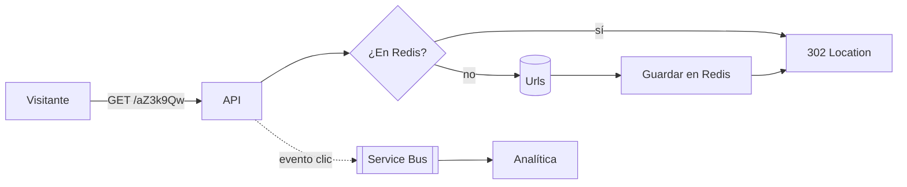

# Caso - acortador de URLs

Parte de: [[09-Arquitectura-Patrones/05 Diseño de sistemas/_Índice Diseño de sistemas|Diseño de sistemas]]

> [!info] Cómo avanzar
> `progreso`: **pendiente** → **viendo** (estudiando) → **visto** (contestaste la autoevaluación sin abrir las respuestas) → **dominado** (hiciste el laboratorio o lo aplicaste de verdad).

## Contenido

### Qué es
Un **acortador de URLs** (estilo bit.ly) recibe una URL larga, devuelve un código corto (`https://xo.lt/aZ3k9Qw`) y, cuando alguien visita el código, redirige a la URL original. Es el caso clásico para practicar porque es simple de entender y concentra tres decisiones de diseño muy comunes: **generación de identificadores únicos**, **caché para un sistema dominado por lecturas** y **semántica HTTP de redirección**. Resuélvelo siguiendo [[Diseño de sistemas - cómo abordarlo]] antes de ver la solución del ejercicio.

### Cómo funciona
**Perfil de carga.** Las lecturas (redirecciones) superan por mucho a las escrituras, y una URL casi nunca cambia después de creada. Eso empuja todo el diseño hacia: API sin estado y escalable horizontalmente, caché agresiva y una base con acceso por clave.

**Generar códigos únicos.** Hay tres familias de soluciones:
1. **Id numérico + base62.** Una secuencia (o un rango de ids reservado por cada instancia) se codifica con `[0-9a-zA-Z]`. Sin colisiones por construcción. Con 7 caracteres hay 62^7 ≈ 3.5 billones de combinaciones. Desventaja: los códigos son consecutivos y adivinables.
2. **Aleatorio + verificación.** Generar 7–8 caracteres aleatorios con un generador criptográfico e insertar con llave única; si choca, generar otro. Códigos no adivinables; requiere manejar la colisión (rara con espacio grande).
3. **Hash de la URL** (truncar un SHA-256). La misma URL produce el mismo código, pero truncar genera colisiones que hay que resolver.

**Rangos pre-asignados** evitan ir a la base por cada id: cada instancia pide "dame 1,000 ids" (un `UPDATE ... OUTPUT` atómico sobre un contador) y los reparte en memoria.

**Caché.** Pocas URLs concentran la mayoría de las visitas. Una caché en Redis (cache-aside, ver [[Cache-aside y estrategias de caché]]) con las populares reduce la latencia y protege la base. Al ser datos casi inmutables, el TTL puede ser largo.

**301 vs 302.** `301 Moved Permanently` (o `308`) lo cachea el navegador: las siguientes visitas ni siquiera llegan a tu servidor, lo que ahorra carga pero **pierdes la analítica** de clics y no puedes cambiar el destino. `302 Found` (o `307`) obliga a pasar por tu servidor cada vez: puedes contar clics, expirar y cambiar destinos.



### Ejemplo
Codificador base62 y endpoint de redirección con cache-aside:

```csharp
public static class Base62
{
    private const string Alfabeto = "0123456789abcdefghijklmnopqrstuvwxyzABCDEFGHIJKLMNOPQRSTUVWXYZ";
    public static string Codificar(long n)
    {
        if (n == 0) return "0";
        Span<char> buf = stackalloc char[11];
        var i = buf.Length;
        while (n > 0) { buf[--i] = Alfabeto[(int)(n % 62)]; n /= 62; }
        return new string(buf[i..]);
    }
}

[ApiController]
public sealed class RedireccionController(IDatabase redis, IBuscarUrlQuery buscar, IPublicadorClics clics) : ControllerBase
{
    [HttpGet("/{codigo}")]
    public async Task<IActionResult> Redirigir(string codigo, CancellationToken ct)
    {
        var url = (string?)await redis.StringGetAsync($"url:{codigo}");
        if (url is null)
        {
            url = await buscar.EjecutarAsync(codigo, ct); // Dapper + SQL en archivo
            if (url is null) return NotFound();
            await redis.StringSetAsync($"url:{codigo}", url, TimeSpan.FromHours(24));
        }
        _ = clics.PublicarAsync(codigo); // asíncrono, no frena la redirección
        return Redirect(url);            // 302
    }
}
```

`Redirect()` en ASP.NET Core devuelve 302; `RedirectPermanent()` devuelve 301.

### Cuándo usarlo y cuándo no
Las ideas de este caso se reutilizan en cualquier sistema con **identificadores públicos cortos** (folios, enlaces de invitación, códigos de descarga) y en cualquier sistema **dominado por lecturas**. Si las URLs son privadas o sensibles, no uses ids secuenciales: usa aleatorios largos o firma los enlaces. Si solo necesitas unos cientos de enlaces internos, una tabla con `IDENTITY` y sin caché es suficiente.

### Errores comunes
- **Empezar por la base de datos** sin estimar: con ~40 escrituras/s no hace falta sharding desde el día uno.
- **Usar 301** y luego querer analítica o expiración.
- **Contar clics de forma síncrona** con un `UPDATE` por visita: convierte cada lectura en una escritura y crea contención.
- **Ids secuenciales para contenido privado**: cualquiera enumera los códigos.
- **No validar la URL destino**: el acortador se vuelve herramienta de phishing; valida esquema (`https`) y considera listas de bloqueo.

### Para profundizar
- [MDN: redirecciones en HTTP](https://developer.mozilla.org/en-US/docs/Web/HTTP/Guides/Redirections)
- [Patrón Cache-Aside (Azure Architecture Center)](https://learn.microsoft.com/azure/architecture/patterns/cache-aside)
- [System Design Primer (GitHub)](https://github.com/donnemartin/system-design-primer)

## Ejercicios

Resuélvelos en papel o en la herramienta; la solución está plegada.

> [!question]- Hazlo primero sin mirar la solución (30–45 min). Sigue el orden: requisitos → estimaciones → API y datos → diagrama → profundizar → trade-offs.

**Enunciado:** diseña un acortador tipo bit.ly: 100 M URLs nuevas al mes, lecturas 100:1, retención 5 años, redirección p99 < 50 ms.
> **Requisitos.** F: crear código para una URL, redirigir, expiración opcional, alias personalizado. NF: disponibilidad alta en lectura, baja latencia, códigos no adivinables (deseable).
>
> **Estimaciones.** ~39 escrituras/s, ~3,900 lecturas/s promedio (pico ×5 ≈ 20 k/s). 6 mil millones de registros × 500 B = 3 TB. Códigos: 62^7 ≈ 3.5 billones → 7 caracteres sobran.
>
> **API.** `POST /urls {url, alias?, expira?}` → `201 {codigo}`; `GET /{codigo}` → `302 Location`.
>
> **Datos.** `Urls(Codigo PK, UrlLarga, CreadaEn, ExpiraEn, UsuarioId)`. Acceso por clave → base clave-valor o SQL con índice por `Codigo`.
>
> ```mermaid
> flowchart LR
>   C[Cliente] --> LB[Balanceador]
>   LB --> API[API sin estado]
>   API --> R[(Caché Redis)]
>   API --> DB[(Base Urls)]
>   API --> GEN[Generador de ids por rangos]
>   API -. clic .-> Q[[Cola]] --> AN[Analítica]
> ```
>
> **Profundizar.** Generación: cada instancia pide un rango de 1,000 ids a la base y los codifica en base62 (sin coordinación por petición). Caché: LRU con las URLs más visitadas; 20% de las URLs generan la mayoría del tráfico.
>
> **Trade-offs.** 302 + evento a cola para analítica (latencia baja, conteo eventual). Ids por rango son predecibles → mezclar con un sufijo aleatorio si hay URLs privadas. Sharding por hash del código cuando la base no alcance.

## Autoevaluación

Contesta primero en voz alta o en papel; luego despliega la respuesta.

> [!question]- ¿Por qué conviene usar caché en un acortador?
> La relación lectura/escritura es muy alta (≈100:1) y los datos casi no cambian: una caché de las URLs populares reduce latencia y carga a la base.

> [!question]- ¿Cómo generas códigos cortos únicos sin colisiones?
> Id numérico de una secuencia (o rangos pre-asignados por instancia) codificado en base62; o hash + verificación de colisión. El id secuencial es predecible; si importa, usa aleatorio de 7+ caracteres con verificación.

> [!question]- ¿301 o 302 al redirigir?
> 301 (permanente) lo cachea el navegador: menos carga pero pierdes analítica. 302/307 permite contar cada clic.

