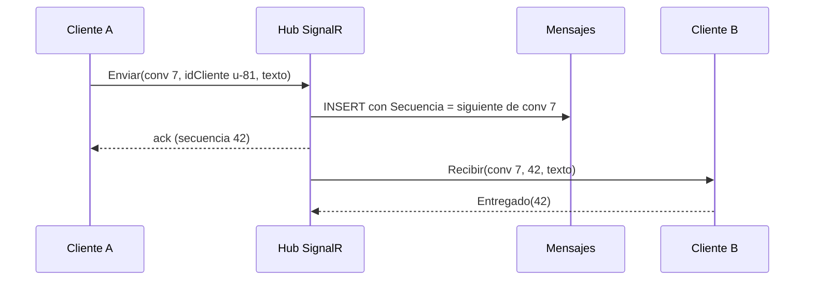

# Caso - chat en tiempo real

Parte de: [[09-Arquitectura-Patrones/05 Diseño de sistemas/_Índice Diseño de sistemas|Diseño de sistemas]]

> [!info] Cómo avanzar
> `progreso`: **pendiente** → **viendo** (estudiando) → **visto** (contestaste la autoevaluación sin abrir las respuestas) → **dominado** (hiciste el laboratorio o lo aplicaste de verdad).

## Contenido

### Qué es
Un **chat en tiempo real** entrega mensajes entre usuarios (1 a 1 y grupos) en menos de un segundo, conserva el historial, muestra estados (entregado, leído) y quién está en línea. Los retos de diseño son: **conexiones persistentes** a escala, **enrutar** un mensaje cuando emisor y receptor están en servidores distintos, **ordenar** los mensajes de una conversación y **no perder** ninguno aunque la red del celular se corte.

### Cómo funciona
**Por qué WebSockets y no polling.** Con polling, cada cliente pregunta "¿hay algo nuevo?" cada segundo: millones de peticiones vacías y latencia de hasta un segundo. Con una conexión **persistente y bidireccional** (WebSocket), el servidor empuja el mensaje en cuanto llega. En .NET, **SignalR** abstrae el transporte (WebSocket con *fallback* a Server-Sent Events o long polling), maneja reconexión y grupos.

**Enrutar entre servidores.** Con muchas conexiones, los clientes quedan repartidos entre varios servidores. Si A está en el servidor 1 y B en el servidor 3, el servidor 1 necesita hacer llegar el mensaje al 3:
- **Backplane pub/sub**: todos los servidores se suscriben a un canal (Redis) y reenvían a sus conexiones locales.
- **Servicio administrado**: **Azure SignalR Service** mantiene las conexiones de los clientes; tus servidores solo envían "a usuario X" o "a grupo Y" y el servicio entrega.
- **Registro de presencia** `usuario → servidor` para enrutar de forma directa.

**Orden.** La hora del cliente no sirve (relojes distintos y manipulables; ver [[Locks distribuidos y relojes]]). El servidor asigna un **número de secuencia por conversación** al guardar el mensaje; los clientes ordenan por esa secuencia y detectan huecos ("tengo hasta el 41, me llegó el 43: pido el 42").

**No perder mensajes.** Primero se **guarda**, luego se **publica**. El cliente manda cada mensaje con un id generado por él (para deduplicar reenvíos) y lo reintenta hasta recibir confirmación. Si el destinatario no está conectado, se envía push notification y, al reconectar, el cliente pide "todo lo posterior a mi última secuencia".

**Presencia** con *heartbeat* y TTL: cada cliente renueva una clave cada 30 s; si expira, está desconectado. Es aproximada a propósito, para no inundar a todos con cambios de estado.



### Ejemplo
Hub de SignalR que persiste antes de enviar, escalado con Azure SignalR Service:

```csharp
builder.Services.AddSignalR().AddAzureSignalR(); // cadena en configuración, fuera del repo

[Authorize]
public sealed class ChatHub(IGuardarMensaje guardar) : Hub
{
    public async Task<long> Enviar(long conversacionId, Guid idCliente, string texto)
    {
        // Idempotente por idCliente: si el cliente reintenta, devuelve la misma secuencia
        var m = await guardar.EjecutarAsync(conversacionId, Context.UserIdentifier!, idCliente, texto);
        await Clients.Group($"conv:{conversacionId}").SendAsync("Recibir", m);
        return m.Secuencia;
    }

    public Task Unirse(long conversacionId) =>
        Groups.AddToGroupAsync(Context.ConnectionId, $"conv:{conversacionId}"); // validar membresía antes
}
```

La secuencia por conversación se asigna en un procedimiento almacenado, por ejemplo con `UPDATE Conversaciones SET UltimaSecuencia = UltimaSecuencia + 1 OUTPUT inserted.UltimaSecuencia WHERE Id = @Id` dentro de la misma transacción que el `INSERT` del mensaje, y un índice único en `(ConversacionId, IdCliente)` para deduplicar.

Sin Azure SignalR Service, el backplane de Redis se agrega con `.AddStackExchangeRedis(cadena)`; requiere *sticky sessions* en el balanceador para los transportes que no son WebSocket.

### Cuándo usarlo y cuándo no
- WebSockets/SignalR para chat, colaboración en vivo, tableros, notificaciones instantáneas, seguimiento de pedidos en Ocelotl.Hermes.
- Si las actualizaciones son poco frecuentes y solo del servidor al cliente, **Server-Sent Events** o un polling cada 30 s pueden bastar con mucho menos costo.
- El historial se particiona por conversación ([[Sharding y particionamiento]]): lecturas de una conversación eficientes, búsquedas globales más difíciles.

### Errores comunes
- **Ordenar por la hora del cliente** o del servidor que recibió.
- **Enviar antes de guardar**: si el proceso cae, el receptor vio un mensaje que no existe en el historial.
- **Un solo servidor sin backplane**: funciona en desarrollo y falla al escalar a dos instancias.
- **Presencia exacta en tiempo real** para todos los contactos: genera más tráfico que los propios mensajes.
- **No autorizar la unión a grupos**: cualquiera escucha conversaciones ajenas.

### Para profundizar
- [ASP.NET Core SignalR: introducción](https://learn.microsoft.com/aspnet/core/signalr/introduction)
- [SignalR: escalado y backplanes](https://learn.microsoft.com/aspnet/core/signalr/scale)
- [Azure SignalR Service](https://learn.microsoft.com/azure/azure-signalr/signalr-overview)

## Ejercicios

Resuélvelos en papel o en la herramienta; la solución está plegada.

> [!question]- Hazlo primero sin mirar la solución (30–45 min). Sigue el orden: requisitos → estimaciones → API y datos → diagrama → profundizar → trade-offs.

**Enunciado:** chat 1 a 1 y grupos pequeños: 5 M usuarios activos diarios, 1 M conexiones simultáneas, 50 mensajes por usuario al día, historial permanente, indicador de "en línea".
> **Requisitos.** F: enviar/recibir, historial, entregado/leído, presencia, grupos ≤ 100. NF: entrega < 500 ms, no perder mensajes, orden por conversación.
>
> **Estimaciones.** 250 M mensajes/día ≈ **2,900/s**. 100 B por mensaje → 25 GB/día ≈ 9 TB/año. 1 M conexiones / ~50 k por servidor ≈ 20 servidores de conexiones (Pendiente de confirmar según pruebas).
>
> ```mermaid
> flowchart LR
>   A[Cliente A] <-->|WebSocket| G1[Gateway 1]
>   B[Cliente B] <-->|WebSocket| G2[Gateway 2]
>   G1 --> MS[Servicio de mensajes]
>   MS --> DB[(Mensajes: partición por conversación)]
>   MS --> PB[[Pub/Sub]]
>   PB --> G2
>   G1 & G2 --> PR[(Presencia con TTL)]
>   MS -->|offline| PN[Push notifications]
> ```
>
> **Profundizar.** Al recibir, el servicio asigna secuencia, guarda y luego publica; el cliente confirma y reenvía si no recibe ack (con id de cliente para deduplicar). Presencia por *heartbeat* con TTL.
>
> **Trade-offs.** Base particionada por conversación (lecturas del historial eficientes) vs consultas globales difíciles. Presencia aproximada (TTL) para no saturar con actualizaciones.

## Autoevaluación

Contesta primero en voz alta o en papel; luego despliega la respuesta.

> [!question]- ¿Por qué WebSockets (o SignalR) y no polling?
> Conexión persistente bidireccional: el servidor empuja mensajes al instante sin que el cliente pregunte cada segundo (menos latencia y menos peticiones).

> [!question]- ¿Cómo entregas un mensaje si el destinatario está conectado a otro servidor?
> Un *backplane* pub/sub (Redis, Azure SignalR Service, broker) o un registro de presencia `usuario → servidor` para enrutarlo.

> [!question]- ¿Cómo ordenas mensajes en una conversación?
> Con un número de secuencia por conversación asignado por el servidor (no con la hora del cliente).

