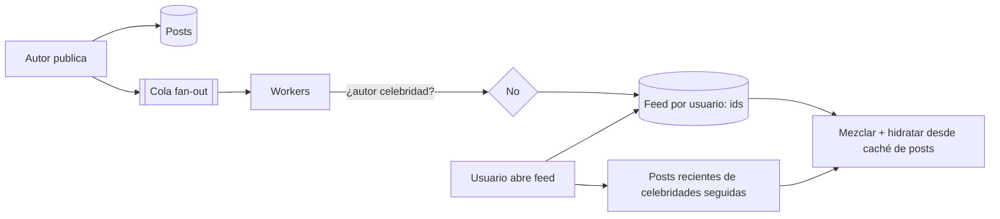

# Caso - feed de noticias

Parte de: [[09-Arquitectura-Patrones/05 Diseño de sistemas/_Índice Diseño de sistemas|Diseño de sistemas]]

> [!info] Cómo avanzar
> `progreso`: **pendiente** → **viendo** (estudiando) → **visto** (contestaste la autoevaluación sin abrir las respuestas) → **dominado** (hiciste el laboratorio o lo aplicaste de verdad).

## Contenido

### Qué es
Un **feed de noticias** muestra a cada usuario las publicaciones recientes de las cuentas que sigue, ordenadas por fecha o por relevancia. El reto es que cada usuario ve una mezcla distinta, se abre muchas veces al día y debe cargar en milisegundos, mientras que las publicaciones llegan continuamente. Es el caso clásico para entender **fan-out**, **cachés precalculadas**, **cuentas con millones de seguidores** y **paginación sobre datos que cambian**.

### Cómo funciona
**Fan-out en escritura (push).** Cuando alguien publica, un proceso inserta el id del post en el feed precalculado de cada seguidor (una lista por usuario en Redis o en una tabla). Leer el feed es leer una lista: rapidísimo. Escribir es caro: un post de alguien con 200 seguidores genera 200 inserciones.

**Fan-out en lectura (pull).** No se precalcula nada. Al abrir el feed, se buscan los posts recientes de todos los seguidos y se mezclan. Publicar es barato; leer es caro, y se repite cada vez que el usuario abre la app.

**Híbrido (lo que se usa en la práctica).** Fan-out en escritura para cuentas normales; las **celebridades** (millones de seguidores) se excluyen del fan-out porque una sola publicación generaría millones de escrituras. Sus posts se mezclan **al leer**: el feed precalculado + los últimos posts de las pocas celebridades que el usuario sigue.



**Guardar ids, no posts.** El feed por usuario guarda solo ids (8 bytes cada uno) y los últimos N (p. ej. 500). Los datos del post se **hidratan** desde una caché de posts; así, editar un post no requiere tocar millones de feeds.

**Paginación con cursor.** Con `OFFSET 20`, si llegan 5 posts nuevos mientras el usuario hace scroll, la segunda página repite 5 elementos. Con un **cursor** ("dame los anteriores al id 98431") la página siguiente siempre continúa donde quedó, sin duplicados ni saltos, y la consulta usa el índice en lugar de contar filas.

**Consistencia eventual aceptada:** que un post tarde unos segundos en aparecer en los feeds es aceptable para el negocio, y es lo que permite procesar el fan-out en segundo plano con [[Competing consumers]].

### Ejemplo
Worker de fan-out con Redis (listas recortadas) y endpoint con cursor:

```csharp
public sealed class FanOutHandler(IDatabase redis, ISeguidoresQuery seguidores)
{
    public async Task EjecutarAsync(PostPublicado e, CancellationToken ct)
    {
        if (e.EsCelebridad) return; // se mezcla al leer
        await foreach (var lote in seguidores.PorLotesAsync(e.AutorId, tamano: 1000, ct))
        {
            var batch = redis.CreateBatch();
            var tareas = lote.Select(uid =>
            {
                var k = $"feed:{uid}";
                return Task.WhenAll(
                    batch.SortedSetAddAsync(k, e.PostId, e.PostId), // score = id (ordenable por tiempo)
                    batch.SortedSetRemoveRangeByRankAsync(k, 0, -501)); // conservar 500
            }).ToList();
            batch.Execute();
            await Task.WhenAll(tareas);
        }
    }
}

[HttpGet("feed")]
public async Task<IActionResult> Feed([FromQuery] long? antesDe, CancellationToken ct)
{
    var max = antesDe.HasValue ? antesDe.Value - 1 : double.PositiveInfinity;
    var ids = await redis.SortedSetRangeByScoreAsync($"feed:{UsuarioId}", double.NegativeInfinity, max,
        order: Order.Descending, take: 20);
    var posts = await hidratar.EjecutarAsync(ids.Select(i => (long)i), ct);
    return Ok(new { items = posts, siguiente = posts.LastOrDefault()?.Id });
}
```

Los ids deben ser ordenables por tiempo (secuencia de la base o un id tipo Snowflake) para que sirvan como score y cursor.

### Cuándo usarlo y cuándo no
El patrón de feed precalculado sirve para timelines, bandejas de actividad, notificaciones in-app y dashboards personalizados. Si los usuarios siguen pocas fuentes y los datos son pocos, el **pull** con una buena consulta indexada basta y es mucho más simple. El push se justifica cuando las lecturas son muy superiores a las escrituras y la latencia de lectura es el requisito dominante.

### Errores comunes
- **Fan-out para todos**, incluidas celebridades: una publicación satura las colas durante minutos.
- **Guardar el post completo en cada feed**: memoria enorme y ediciones imposibles.
- **Paginar con `OFFSET`** en un feed vivo.
- **Fan-out síncrono en el request de publicar**: el autor espera a que se actualicen miles de feeds.
- **Feeds sin recortar**: listas que crecen para siempre en Redis.

### Para profundizar
- [Redis: sorted sets](https://redis.io/docs/latest/develop/data-types/sorted-sets/)
- [Patrón Competing Consumers (Azure Architecture Center)](https://learn.microsoft.com/azure/architecture/patterns/competing-consumers)
- [System Design Primer (GitHub)](https://github.com/donnemartin/system-design-primer)

## Ejercicios

Resuélvelos en papel o en la herramienta; la solución está plegada.

> [!question]- Hazlo primero sin mirar la solución (30–45 min). Sigue el orden: requisitos → estimaciones → API y datos → diagrama → profundizar → trade-offs.

**Enunciado:** feed de una red social: 10 M usuarios activos diarios, abren el feed 10 veces al día, 1 M posts/día, 200 seguidores en promedio.
> **Requisitos.** F: publicar, seguir, ver feed ordenado por fecha (luego ranking). NF: feed p99 < 200 ms; un post puede tardar segundos en aparecer.
>
> **Estimaciones.** Lecturas 100 M/día ≈ **1,160/s** (pico ~3.5 k/s). Posts ≈ 12/s. Fan-out: 1 M × 200 = 200 M inserciones/día ≈ **2,300/s**. Feed en caché: 10 M usuarios × 500 ids × 8 B ≈ 40 GB.
>
> ```mermaid
> flowchart LR
>   U[Usuario] --> API
>   API -->|publicar| PS[(Posts)]
>   API -->|evento| Q[[Cola fan-out]]
>   Q --> FW[Workers fan-out]
>   FW --> G[(Grafo de seguidores)]
>   FW --> FC[(Caché de feeds: lista por usuario)]
>   API -->|leer feed| FC
>   API -->|hidratar| PC[(Caché de posts)]
> ```
>
> **Profundizar.** El feed en caché guarda solo ids; se hidrata con la caché de posts. Celebridades: excluidas del fan-out y unidas al leer.
>
> **Trade-offs.** Consistencia eventual (el post aparece con retraso) a cambio de lecturas baratas. Memoria de caché vs recalcular: guardar solo los últimos N por usuario.

## Autoevaluación

Contesta primero en voz alta o en papel; luego despliega la respuesta.

> [!question]- Fan-out en escritura vs en lectura.
> Escritura (*push*): al publicar, se inserta el post en el feed precalculado de cada seguidor → lectura rapidísima, escritura cara. Lectura (*pull*): al abrir el feed se juntan los posts de los seguidos → escritura barata, lectura cara.

> [!question]- ¿Qué haces con cuentas de millones de seguidores?
> Híbrido: fan-out en escritura para cuentas normales; para celebridades, sus posts se mezclan en lectura.

> [!question]- ¿Cómo paginas un feed que cambia constantemente?
> Con cursor (id o timestamp del último elemento visto), no con `OFFSET`, para no repetir ni saltar elementos.

