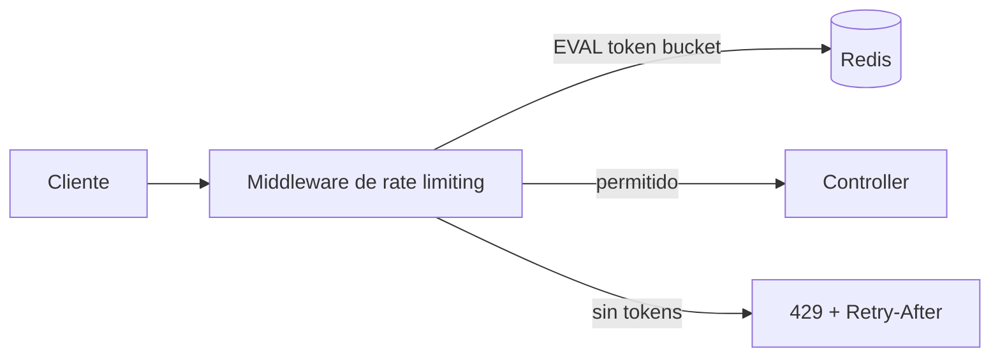

# Caso - rate limiter

Parte de: [[09-Arquitectura-Patrones/05 Diseño de sistemas/_Índice Diseño de sistemas|Diseño de sistemas]]

> [!info] Cómo avanzar
> `progreso`: **pendiente** → **viendo** (estudiando) → **visto** (contestaste la autoevaluación sin abrir las respuestas) → **dominado** (hiciste el laboratorio o lo aplicaste de verdad).

## Contenido

### Qué es
Un **rate limiter** limita cuántas peticiones puede hacer un cliente en un periodo (p. ej. 100 por minuto por API key). Protege al sistema de abusos y picos, reparte la capacidad de forma justa entre clientes y permite vender planes con cuotas. Es un caso de diseño excelente porque mezcla **algoritmos**, **estado compartido entre instancias**, **atomicidad** y la decisión de qué hacer cuando la propia pieza de control falla. Se implementa en el [[Lab 4 - Diseño e implementación de un rate limiter]].

### Cómo funciona
**Algoritmos principales:**
- **Ventana fija**: un contador por cliente y por minuto (`INCR` + `EXPIRE`). Muy simple, pero en el borde entre dos ventanas permite hasta el doble del límite (100 al final de un minuto y 100 al inicio del siguiente).
- **Ventana deslizante (log o contador)**: cuenta las peticiones de los últimos 60 s reales. Más precisa; el log guarda cada marca de tiempo (más memoria), el contador aproxima ponderando la ventana anterior.
- **Token bucket**: una cubeta con capacidad C que se rellena a R tokens por segundo; cada petición consume uno. Permite **ráfagas** hasta C y una **tasa sostenida** R, con muy poco estado (`tokens` y `última recarga`). Es el más usado en APIs.
- **Leaky bucket**: procesa a tasa constante y encola o descarta el exceso; suaviza el tráfico de salida.

**Estado con varias instancias.** Un limitador en memoria limita **por instancia**: con 30 instancias, el cliente obtiene hasta 30 veces su cuota. Para un límite global, el estado vive en un almacén compartido de baja latencia (Redis) y la operación leer-recargar-consumir debe ser **atómica**, con un script Lua o `INCR`, para evitar condiciones de carrera.

**Respuesta al limitar:** `429 Too Many Requests` con `Retry-After`, y opcionalmente encabezados con la cuota restante.

**Si Redis cae**, decide de antemano:
- *Fail open*: dejar pasar (prioriza disponibilidad; típico en APIs de negocio) y alertar.
- *Fail closed*: rechazar (prioriza protección; típico en login o endpoints caros).



### Ejemplo
ASP.NET Core trae `Microsoft.AspNetCore.RateLimiting` con token bucket **por instancia**, particionado por API key:

```csharp
builder.Services.AddRateLimiter(o =>
{
    o.RejectionStatusCode = StatusCodes.Status429TooManyRequests;
    o.AddPolicy("por-api-key", ctx =>
    {
        var key = ctx.Request.Headers["X-Api-Key"].ToString();
        var particion = string.IsNullOrEmpty(key) ? $"ip:{ctx.Connection.RemoteIpAddress}" : $"key:{key}";
        return RateLimitPartition.GetTokenBucketLimiter(particion, _ => new TokenBucketRateLimiterOptions
        {
            TokenLimit = 20,                              // ráfaga
            TokensPerPeriod = 5,
            ReplenishmentPeriod = TimeSpan.FromSeconds(3), // ≈ 100/min sostenido
            QueueLimit = 0,
            AutoReplenishment = true
        });
    });
    o.OnRejected = (c, _) =>
    {
        c.HttpContext.Response.Headers.RetryAfter = "3";
        return ValueTask.CompletedTask;
    };
});
app.UseRateLimiter();
// En el controller: [EnableRateLimiting("por-api-key")]
```

Para un límite **global** entre instancias, la misma lógica va en un script Lua ejecutado en Redis:

```lua
-- KEYS[1]=clave, ARGV: capacidad, tasa_por_seg, ahora_ms
local d = redis.call('HMGET', KEYS[1], 't', 'ts')
local cap, tasa, ahora = tonumber(ARGV[1]), tonumber(ARGV[2]), tonumber(ARGV[3])
local t = tonumber(d[1]) or cap
local ts = tonumber(d[2]) or ahora
t = math.min(cap, t + (ahora - ts) / 1000 * tasa)
local ok = 0
if t >= 1 then t = t - 1; ok = 1 end
redis.call('HSET', KEYS[1], 't', t, 'ts', ahora)
redis.call('PEXPIRE', KEYS[1], math.ceil(cap / tasa * 1000))
return ok
```

En Azure, Azure API Management ofrece políticas `rate-limit-by-key` y `quota-by-key` si el API ya pasa por APIM.

### Cuándo usarlo y cuándo no
- **Límite por instancia** (el middleware integrado): suficiente para proteger cada instancia de sobrecarga o cuando el número de instancias es pequeño y fijo.
- **Límite global con Redis**: cuando la cuota es un contrato con el cliente (planes de pago) o hay muchas instancias que escalan.
- **En el gateway** (APIM, Front Door con WAF): para proteger antes de que el tráfico llegue a tu código.

### Errores comunes
- **Limitar solo por IP**: detrás de un NAT corporativo muchos usuarios comparten IP, y un atacante rota IPs. Limita por usuario o API key, con IP como respaldo para anónimos.
- **Leer y escribir el contador en dos operaciones** sin atomicidad: dos instancias consumen el mismo token.
- **No decidir qué pasa si Redis cae** y descubrirlo en un incidente.
- **No devolver `Retry-After`**: los clientes reintentan de inmediato y empeoran la carga.
- **Usar la hora de cada instancia** con relojes desfasados en el cálculo; mejor la hora de Redis (`TIME`) o tolerar el desfase.

### Para profundizar
- [ASP.NET Core: middleware de rate limiting](https://learn.microsoft.com/aspnet/core/performance/rate-limit)
- [RFC 6585: código 429 Too Many Requests](https://www.rfc-editor.org/rfc/rfc6585)
- [Patrón Rate Limiting (Azure Architecture Center)](https://learn.microsoft.com/azure/architecture/patterns/rate-limiting-pattern)

## Ejercicios

Resuélvelos en papel o en la herramienta; la solución está plegada.

> [!question]- Hazlo primero sin mirar la solución (30–45 min). Sigue el orden: requisitos → estimaciones → API y datos → diagrama → profundizar → trade-offs.

**Enunciado:** diseña un rate limiter para un API pública: 10 M usuarios, límite 100 peticiones/min por API key con ráfagas de hasta 20, 30 instancias de API.
> **Requisitos.** F: limitar por API key y por endpoint; reglas configurables; informar al cliente. NF: añade < 2 ms de latencia; altamente disponible; preciso "suficiente" (no exacto).
>
> **Estimaciones.** Estado por key ≈ 50 B × 10 M = 500 MB → un nodo Redis con réplica. Si el API recibe 50 k req/s → 50 k operaciones Redis/s, dentro de lo que maneja un nodo (Pendiente de confirmar con pruebas de carga).
>
> **Algoritmo.** Token bucket: capacidad 20, recarga 100/60 ≈ 1.67 tokens/s. Estado `{tokens, ultimaRecarga}` por key; en cada petición, recargar según el tiempo transcurrido, y consumir 1 si hay.
>
> ```mermaid
> flowchart LR
>   C[Cliente] --> GW[API Gateway / middleware]
>   GW -->|script atómico| R[(Redis)]
>   GW -->|permitido| API[Servicio]
>   GW -->|429 + Retry-After| C
>   CFG[(Reglas)] -. cache local .-> GW
> ```
>
> **Profundizar.** Atomicidad: el leer-recargar-consumir va en un script Lua para evitar carreras entre instancias. Reglas cacheadas en cada instancia con refresco periódico.
>
> **Trade-offs.** Centralizado en Redis = preciso pero un salto de red; alternativa: límite local por instancia (100/30) sin red pero impreciso con tráfico desigual. Fail open ante caída de Redis para no tumbar el API, con alerta.

## Autoevaluación

Contesta primero en voz alta o en papel; luego despliega la respuesta.

> [!question]- Compara token bucket y ventana fija.
> Token bucket: permite ráfagas hasta la capacidad y una tasa sostenida; poco estado. Ventana fija: simple, pero permite el doble de peticiones en el borde entre dos ventanas. Ventana deslizante corrige eso con más estado o aproximación.

> [!question]- ¿Dónde guardas el estado con varias instancias de la API?
> En un almacén compartido de baja latencia (Redis) con operaciones atómicas (script Lua o `INCR` + `EXPIRE`). Un limitador en memoria solo limita por instancia.

> [!question]- ¿Qué responde el servidor al limitar y qué pasa si Redis cae?
> 429 con `Retry-After` (y opcionalmente headers de cuota). Si Redis cae, decide de antemano: *fail open* (dejar pasar, prioriza disponibilidad) o *fail closed* (bloquear, prioriza protección).

> [!question]- Error común.
> Limitar solo por IP: detrás de un NAT muchos usuarios comparten IP, y un atacante rota IPs. Mejor por usuario/API key, con IP como respaldo.

## Práctica

- [[Lab 4 - Diseño e implementación de un rate limiter]]

