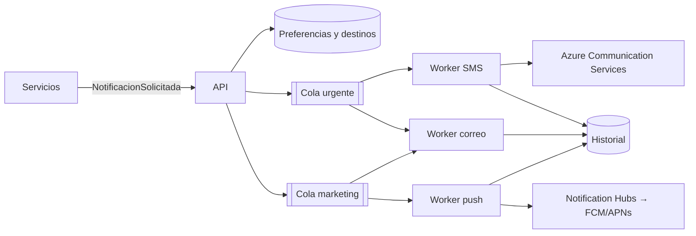

# Caso - sistema de notificaciones

Parte de: [[09-Arquitectura-Patrones/05 Diseño de sistemas/_Índice Diseño de sistemas|Diseño de sistemas]]

> [!info] Cómo avanzar
> `progreso`: **pendiente** → **viendo** (estudiando) → **visto** (contestaste la autoevaluación sin abrir las respuestas) → **dominado** (hiciste el laboratorio o lo aplicaste de verdad).

## Contenido

### Qué es
Un **sistema de notificaciones** recibe solicitudes de otros servicios ("avisa al usuario 81 que su pedido salió") y las entrega por el canal correcto: correo, SMS, push o in-app. Centraliza plantillas, preferencias del usuario, prioridades y reintentos para que cada servicio no reinvente el envío. El reto no es tanto el volumen como la **heterogeneidad**: cada proveedor externo tiene latencias, cuotas y fallos distintos, y algunas notificaciones (códigos OTP) son urgentes mientras otras (marketing) pueden esperar.

### Cómo funciona
**Separar la API de los workers por canal.** La API solo valida, consulta preferencias y encola. Cada canal tiene su cola y sus workers:
- Si el proveedor de SMS se cae, solo se acumula la cola de SMS; el correo sigue saliendo (**bulkhead**, ver [[Bulkhead y throttling]]).
- Cada canal escala según su carga y respeta los límites de su proveedor (throttling de salida).
- Las prioridades se resuelven con **colas separadas** (OTP y transaccionales vs marketing) y más workers para las urgentes.

**Antes de enviar, consultar:**
- Preferencias: canales habilitados por tipo de notificación, horario de silencio, idioma.
- Destinos vigentes: correo verificado, teléfono, tokens push de cada dispositivo (los tokens caducan; hay que limpiar los que el proveedor rechaza).
- Bajas (*opt-out*) y obligaciones legales: el marketing debe respetar la baja; un OTP no.

**No duplicar.** El flujo es at-least-once ([[Entrega at-least-once]]), así que cada notificación lleva una **clave de idempotencia** (`eventoId + usuario + canal`). El worker la registra antes o junto con el envío y, si ya existe, no reenvía. Es preferible a perder un OTP.

**Fallos.** Errores transitorios del proveedor → [[Reintentos con backoff]]; proveedor caído → circuit breaker y proveedor de respaldo (sobre todo para SMS); fallo definitivo → DLQ ([[Dead letter queues y mensajes venenosos]]) y estado "fallido" en el historial.



### Ejemplo
Worker de correo con idempotencia y envío por Azure Communication Services:

```csharp
public sealed class EnviarCorreoHandler(
    IRegistrarEnvio registro, EmailClient email, IPlantillas plantillas, ILogger<EnviarCorreoHandler> log)
{
    public async Task EjecutarAsync(NotificacionCorreo n, CancellationToken ct)
    {
        var clave = $"{n.EventoId}:{n.UsuarioId}:correo";
        if (!await registro.IntentarReservarAsync(clave, ct)) // INSERT con PK; false si ya existe
        {
            log.LogInformation("Duplicado ignorado {Clave}", clave);
            return;
        }
        var (asunto, html) = await plantillas.RenderizarAsync(n.Plantilla, n.Datos, n.Idioma, ct);
        var op = await email.SendAsync(WaitUntil.Started, "no-responder@midominio.mx", n.Correo, asunto, html, cancellationToken: ct);
        await registro.MarcarEnviadoAsync(clave, op.Id, ct);
    }
}
```

Si el envío falla después de reservar, el registro queda "reservado sin enviar"; un job puede reintentar esos casos o la reserva puede expirar. Es el precio de llamar a un sistema externo que no participa de tu transacción.

Para push, Azure Notification Hubs abstrae FCM (Android) y APNs (iOS); para correo y SMS, Azure Communication Services. Verifica disponibilidad de SMS para números de México en ACS antes de decidir el proveedor (Pendiente de confirmar).

### Cuándo usarlo y cuándo no
- Centraliza notificaciones cuando varios servicios envían por varios canales y necesitas preferencias, auditoría y plantillas comunes.
- Si solo un sistema manda correos transaccionales, una llamada a un proveedor desde un worker con outbox es suficiente.
- Las plantillas pueden renderizarse en el worker (flexible, la API no sabe de formatos) o en la API (más simple de depurar); decide y documenta.

### Errores comunes
- **Una sola cola para todo**: el marketing masivo retrasa los OTP.
- **Llamar al proveedor dentro del request** del servicio que origina la notificación.
- **No limpiar tokens push inválidos**: cada envío falla y consume cuota.
- **Ignorar el horario de silencio y las bajas**: problemas legales y usuarios molestos.
- **Reintentar sin idempotencia**: el usuario recibe tres veces el mismo SMS.

### Para profundizar
- [Azure Communication Services: introducción](https://learn.microsoft.com/azure/communication-services/overview)
- [Azure Notification Hubs](https://learn.microsoft.com/azure/notification-hubs/notification-hubs-push-notification-overview)
- [Patrón Priority Queue (Azure Architecture Center)](https://learn.microsoft.com/azure/architecture/patterns/priority-queue)

## Ejercicios

Resuélvelos en papel o en la herramienta; la solución está plegada.

> [!question]- Hazlo primero sin mirar la solución (30–45 min). Sigue el orden: requisitos → estimaciones → API y datos → diagrama → profundizar → trade-offs.

**Enunciado:** sistema que envía notificaciones por correo, SMS y push a partir de eventos de otros servicios: 50 M/día, algunas urgentes (códigos OTP) y muchas de marketing.
> **Requisitos.** F: recibir solicitudes, respetar preferencias, plantillas, prioridades, reintentos, historial. NF: OTP en segundos; marketing puede tardar; no duplicar; tolerar caída de un proveedor.
>
> **Estimaciones.** 579/s promedio, ~2,900/s pico. Historial 50 M × 1 KB = 50 GB/día → retención limitada (p. ej. 90 días) o almacenamiento frío.
>
> ```mermaid
> flowchart LR
>   S[Servicios] -->|evento| API[API de notificaciones]
>   API --> P[(Preferencias)]
>   API --> QA[[Cola alta prioridad]]
>   API --> QB[[Cola marketing]]
>   QA --> WE[Worker correo]
>   QA --> WS[Worker SMS]
>   QB --> WE
>   QB --> WP[Worker push]
>   WE --> PE[Proveedor correo]
>   WS --> PS[Proveedor SMS]
>   WP --> PP[FCM / APNs]
>   WE & WS & WP --> H[(Historial)]
>   WE & WS & WP -.fallo final.-> DLQ[[DLQ]]
> ```
>
> **Profundizar.** Prioridad: colas separadas y más workers para OTP. Proveedor caído: circuit breaker y proveedor de respaldo para SMS. Throttling hacia proveedores según sus límites.
>
> **Trade-offs.** At-least-once + idempotencia (mejor eso que perder un OTP). Plantillas renderizadas en el worker (flexible) vs en la API (más simple de depurar).

## Autoevaluación

Contesta primero en voz alta o en papel; luego despliega la respuesta.

> [!question]- ¿Por qué separar la API de envío de los workers por canal?
> Cada proveedor (correo, SMS, push) tiene su latencia, límites y fallos; con colas por canal, uno lento o caído no frena a los demás (bulkhead) y cada uno escala aparte.

> [!question]- ¿Cómo evitas mandar la misma notificación dos veces?
> Clave de idempotencia por notificación (`eventoId + usuario + canal`) registrada antes o junto con el envío; los workers son [[Consumidores idempotentes]].

> [!question]- ¿Qué datos del usuario necesitas consultar antes de enviar?
> Preferencias (canales habilitados, horario de silencio), dispositivos/tokens push vigentes y bajas (opt-out).

