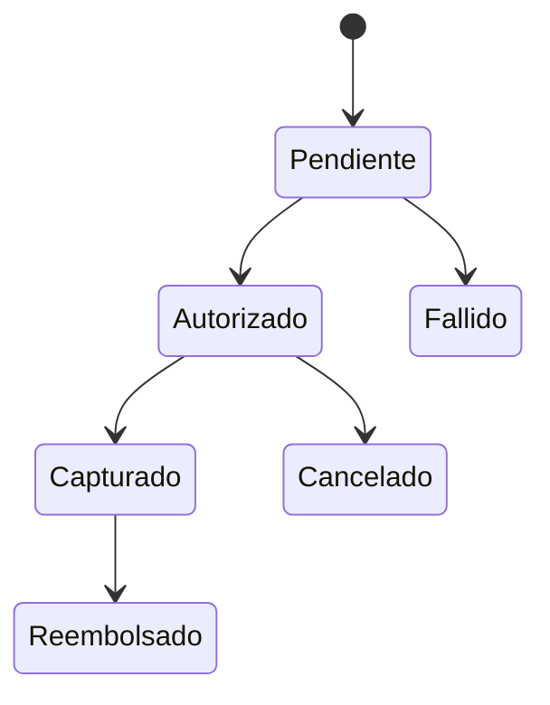

# Caso - sistema de pagos

Parte de: [[09-Arquitectura-Patrones/05 Diseño de sistemas/_Índice Diseño de sistemas|Diseño de sistemas]]

> [!info] Cómo avanzar
> `progreso`: **pendiente** → **viendo** (estudiando) → **visto** (contestaste la autoevaluación sin abrir las respuestas) → **dominado** (hiciste el laboratorio o lo aplicaste de verdad).

## Contenido

### Qué es
Un **sistema de pagos** crea cobros a través de una o varias pasarelas, consulta su estado, procesa reembolsos, recibe notificaciones (webhooks) del proveedor y concilia lo registrado con lo que el proveedor y el banco reportan. A diferencia de otros casos, el volumen suele ser bajo; el reto es la **corrección**: nunca cobrar doble, nunca perder un cobro y poder explicar cada centavo en una auditoría.

### Cómo funciona
**Idempotencia obligatoria.** Un timeout no te dice si el cobro ocurrió: la pasarela pudo haberlo procesado y la respuesta perderse. El cliente (o tu propio reintento) vuelve a llamar. Con una **idempotency key** enviada por el cliente, el segundo intento encuentra la clave guardada y devuelve el resultado del primero en lugar de cobrar otra vez. Además, a la pasarela se le pasa su propia clave de idempotencia (por ejemplo, el id interno del pago), porque tu llamada también puede repetirse.

**Máquina de estados.** Un pago pasa por `Pendiente → Autorizado → Capturado → Reembolsado` (o `Fallido`). Las transiciones se validan: no se reembolsa algo no capturado. Un timeout deja el pago en `Pendiente` y un job consulta el estado al proveedor; nunca se reintenta "a ciegas".

**Webhooks.** El proveedor notifica cambios de forma asíncrona, a veces duplicados y fuera de orden. El manejo correcto:
1. Verificar la firma (secreto compartido, fuera del repo).
2. Guardar el evento crudo.
3. Responder 2xx rápido.
4. Procesar en segundo plano, de forma idempotente por id de evento ([[Consumidores idempotentes]]), tolerando desorden (aplicar solo transiciones válidas).

**Ledger de doble partida.** En vez de un campo `Saldo` que se actualiza, cada movimiento se registra como asientos **inmutables** donde débitos = créditos (cliente → cuenta por cobrar → banco → comisión). Los saldos se calculan sumando asientos. Nunca se edita: un error se corrige con un asiento inverso. Esto permite auditar, reconstruir cualquier saldo a una fecha y detectar descuadres.

**Conciliación.** Periódicamente se compara tu registro con el reporte del proveedor y el estado de cuenta del banco: cobros sin registrar (webhook perdido), estados desfasados, comisiones distintas. Ningún diseño elimina las diferencias; la conciliación las encuentra.

**Pasarelas intercambiables** con [[Patrón Strategy]]: una interfaz común mínima y capacidades extra en interfaces separadas.



### Ejemplo
Endpoint con `Idempotency-Key` (ProblemDetails con `codigo`) en Itzamna.Dionisio:

```csharp
[HttpPost("cobros")]
public async Task<IActionResult> Crear([FromHeader(Name = "Idempotency-Key")] string? clave,
    CrearCobroRequest req, CancellationToken ct)
{
    if (string.IsNullOrWhiteSpace(clave))
        return Problem(statusCode: 400, title: "Falta Idempotency-Key",
            extensions: new Dictionary<string, object?> { ["codigo"] = "COBRO_SIN_CLAVE" });

    var previo = await idempotencia.BuscarAsync(TenantId, clave, ct);
    if (previo is not null)
        return previo.HashSolicitud == req.Hash()
            ? StatusCode(previo.Status, previo.Respuesta)       // mismo resultado que la primera vez
            : Problem(statusCode: 422, title: "Clave reutilizada con otra solicitud",
                extensions: new Dictionary<string, object?> { ["codigo"] = "COBRO_CLAVE_CONFLICTO" });

    var pago = await crearPago.EjecutarAsync(TenantId, clave, req, ct); // INSERT Pago(Pendiente) + clave, en una tx
    var resultado = await pasarelas.Para(req.Pasarela).CobrarAsync(pago, idempotencyKey: pago.Id.ToString(), ct);
    await actualizar.EjecutarAsync(pago.Id, resultado, ct); // estado + evento en outbox
    return CreatedAtAction(nameof(Obtener), new { id = pago.Id }, resultado.ToDto());
}
```

El `INSERT` de la clave tiene índice único `(TenantId, Clave)`: si dos peticiones idénticas llegan al mismo tiempo, una falla por llave duplicada y responde con el resultado de la otra (o 409 mientras está en proceso).

### Cuándo usarlo y cuándo no
Estos principios aplican a todo lo que mueve dinero o recursos escasos: pagos, saldos, puntos, inventario, timbrado de facturas. Para la parte de pagos usa siempre la tokenización del proveedor: si nunca tocas números de tarjeta, tu alcance de PCI DSS se reduce mucho. La base de pagos prioriza consistencia fuerte; la integración con el resto del sistema (envío, facturación) puede ser eventual mediante outbox y eventos.

### Errores comunes
- **Reintentar el cobro tras un timeout** sin idempotency key en la pasarela.
- **Procesar el webhook dentro del request** y tardar: el proveedor reintenta y llegan duplicados.
- **Confiar en el orden de los webhooks**.
- **Actualizar saldos con `UPDATE ... SET Saldo = Saldo + @x`** sin asientos: imposible auditar.
- **No conciliar**: las diferencias se descubren cuando reclama el cliente o el contador.

### Para profundizar
- [Stripe: solicitudes idempotentes](https://docs.stripe.com/api/idempotent_requests)
- [Stripe: buenas prácticas de webhooks](https://docs.stripe.com/webhooks)
- [PCI Security Standards Council](https://www.pcisecuritystandards.org/)

## Ejercicios

Resuélvelos en papel o en la herramienta; la solución está plegada.

> [!question]- Hazlo primero sin mirar la solución (30–45 min). Sigue el orden: requisitos → estimaciones → API y datos → diagrama → profundizar → trade-offs.

**Enunciado:** sistema de cobros para un SaaS multi-tenant que usa dos pasarelas (patrón Strategy), 1 M cobros/día, picos de 10× en fechas de corte.
> **Requisitos.** F: crear cobro, consultar estado, reembolsar, recibir webhooks, conciliar. NF: nunca cobrar doble, no perder cobros, auditoría completa, PCI: no tocar datos de tarjeta (tokenización del proveedor).
>
> **Estimaciones.** 1 M/día ≈ **12/s**, pico ~120/s: la carga es baja; el reto es la **corrección**, no la escala.
>
> ```mermaid
> sequenceDiagram
>   participant C as Cliente
>   participant API as API Pagos
>   participant DB as Base (Pagos + Outbox)
>   participant PG as Pasarela (Strategy)
>   C->>API: POST /cobros (Idempotency-Key)
>   API->>DB: buscar key; si existe, devolver resultado guardado
>   API->>DB: insertar Pago(Pendiente) + key
>   API->>PG: crear cargo (key del proveedor = id de pago)
>   PG-->>API: aprobado / pendiente / timeout
>   API->>DB: actualizar estado + evento en outbox
>   PG-->>API: webhook (asíncrono)
>   API->>DB: aplicar evento si no se procesó (por eventId)
> ```
>
> **Profundizar.** Máquina de estados (`Pendiente → Autorizado → Capturado → Reembolsado`, `Fallido`) con transiciones validadas. Timeout con la pasarela: queda `Pendiente` y un job consulta el estado; nunca se reintenta "a ciegas". Eventos al resto del sistema por outbox.
>
> **Trade-offs.** Consistencia fuerte en la base de pagos (CP); integración con otros servicios eventual. Strategy por pasarela, pero contrato mínimo común; capacidades extra por interfaces separadas.

## Autoevaluación

Contesta primero en voz alta o en papel; luego despliega la respuesta.

> [!question]- ¿Por qué la idempotencia es obligatoria en un API de pagos?
> Un timeout no dice si el cobro ocurrió; el cliente reintenta. Con *idempotency key* el segundo intento devuelve el resultado del primero en vez de cobrar otra vez.

> [!question]- ¿Qué es la conciliación y por qué se necesita?
> Comparar periódicamente tus registros con los del proveedor/banco para detectar diferencias (cobros sin registrar, estados desfasados por webhooks perdidos).

> [!question]- ¿Cómo manejas los webhooks del proveedor?
> Verificar la firma, guardar el evento crudo, responder 2xx rápido, procesar en segundo plano de forma idempotente (por id de evento) y tolerar desorden.

> [!question]- ¿Por qué un libro mayor (*ledger*) de doble partida?
> Movimientos inmutables y balanceados (débito = crédito) permiten auditar y reconstruir saldos; nunca se "edita" un saldo, se agrega un asiento.

