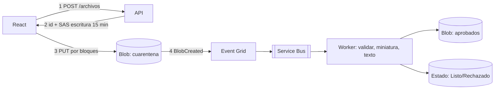

# Caso - subida y procesamiento de archivos

Parte de: [[09-Arquitectura-Patrones/05 Diseño de sistemas/_Índice Diseño de sistemas|Diseño de sistemas]]

> [!info] Cómo avanzar
> `progreso`: **pendiente** → **viendo** (estudiando) → **visto** (contestaste la autoevaluación sin abrir las respuestas) → **dominado** (hiciste el laboratorio o lo aplicaste de verdad).

## Contenido

### Qué es
El caso de **subida y procesamiento de archivos** cubre que los usuarios suban imágenes, PDFs o Excel (a veces de cientos de MB), que el sistema los valide y procese (miniaturas, extracción de texto, importación de datos) y que luego se puedan descargar de forma privada. La clave del diseño es **sacar los bytes del camino de la API**: el archivo va directo al almacenamiento de objetos y el procesamiento ocurre en segundo plano, disparado por eventos.

### Cómo funciona
**Por qué no subir a través de la API.** Si el archivo pasa por tu API, cada subida ocupa ancho de banda, memoria y una conexión durante segundos o minutos; los límites de tamaño de petición del servidor y del balanceador se vuelven tu techo, y una subida lenta en 4G bloquea recursos que deberían atender a otros usuarios. Con el patrón [[Valet key (URLs firmadas)]], la API solo emite una **URL firmada** de corta duración y con permiso mínimo (solo crear/escribir ese blob) y el cliente sube directo a Azure Blob Storage.

**Flujo:**
1. El cliente pide `POST /archivos` con nombre, tamaño y tipo. La API valida reglas de negocio (tamaño máximo, tipos permitidos, cuota del tenant), crea el registro en estado `Pendiente` y devuelve id + URL SAS.
2. El cliente sube por bloques (el SDK de JavaScript de Azure Storage lo hace por ti y permite reanudar).
3. **¿Cómo se entera el sistema?** Dos opciones: el evento `Microsoft.Storage.BlobCreated` de **Event Grid** (llega aunque el cliente cierre la app) o una confirmación explícita `POST /archivos/{id}/completar`. Cualquiera de las dos encola el procesamiento.
4. Un worker procesa y actualiza el estado a `Listo` o `Rechazado`.
5. La descarga usa otra URL firmada, solo lectura, de pocos minutos.

**Validar después de subir** (nunca confíes en lo que dijo el cliente):
- Tamaño real del blob.
- Tipo real por la **firma del archivo** (*magic bytes*: `%PDF`, `PK` para .xlsx, `FF D8 FF` para JPEG), no por la extensión ni el `Content-Type`.
- Antivirus (Microsoft Defender for Storage tiene escaneo de malware al subir).
- No servir el archivo, ni moverlo a la ubicación "pública" del tenant, hasta que pase todo.



### Ejemplo
Emitir una SAS de delegación de usuario (firmada con Entra ID, sin llave de cuenta) en el API:

```csharp
[HttpPost("archivos")]
public async Task<IActionResult> Iniciar(IniciarSubidaRequest req, CancellationToken ct)
{
    var id = Guid.NewGuid();
    var blob = contenedor.GetBlobClient($"{TenantId}/{id}");
    var expira = DateTimeOffset.UtcNow.AddMinutes(15);
    var llave = await servicioBlobs.GetUserDelegationKeyAsync(DateTimeOffset.UtcNow, expira, ct);

    var sas = new BlobSasBuilder
    {
        BlobContainerName = contenedor.Name,
        BlobName = blob.Name,
        Resource = "b",
        ExpiresOn = expira
    };
    sas.SetPermissions(BlobSasPermissions.Create | BlobSasPermissions.Write);

    var uri = new BlobUriBuilder(blob.Uri) { Sas = sas.ToSasQueryParameters(llave, servicioBlobs.AccountName) }.ToUri();
    await registrar.EjecutarAsync(id, TenantId, req.Nombre, req.Tamano, ct); // estado Pendiente
    return Ok(new { id, urlSubida = uri });
}
```

Validación de firma en el worker:

```csharp
static bool EsPdf(ReadOnlySpan<byte> cabecera) => cabecera.StartsWith("%PDF-"u8);
```

El worker debe ser idempotente por `id`: Event Grid entrega *at-least-once* y el mismo evento puede llegar dos veces.

### Cuándo usarlo y cuándo no
- Úsalo para cualquier archivo que no sea diminuto: documentos de clientes, fotos, importaciones de Excel en Wee.Reporteria, videos.
- Para archivos de unos pocos KB (un avatar pequeño), subir a través de la API con un límite estricto es aceptable y más simple.
- Mantén contenedores privados; nunca acceso anónimo para datos de tenants.

### Errores comunes
- **SAS con permisos de más** (lectura, listado, borrado) o de larga duración.
- **Usar la llave de la cuenta** para firmar en lugar de identidad administrada + delegación de usuario.
- **Validar por extensión**: un `.exe` renombrado a `.pdf` pasa.
- **Procesar en el request** de "completar" y hacer esperar al usuario minutos.
- **Olvidar los blobs huérfanos**: subidas que nunca se completaron; una política de ciclo de vida los borra después de N días.

### Para profundizar
- [Patrón Valet Key (Azure Architecture Center)](https://learn.microsoft.com/azure/architecture/patterns/valet-key)
- [Crear una SAS de delegación de usuario con .NET](https://learn.microsoft.com/azure/storage/blobs/storage-blob-user-delegation-sas-create-dotnet)
- [Reaccionar a eventos de Blob Storage con Event Grid](https://learn.microsoft.com/azure/storage/blobs/storage-blob-event-overview)

## Ejercicios

Resuélvelos en papel o en la herramienta; la solución está plegada.

> [!question]- Hazlo primero sin mirar la solución (30–45 min). Sigue el orden: requisitos → estimaciones → API y datos → diagrama → profundizar → trade-offs.

**Enunciado:** los usuarios suben imágenes y PDFs (hasta 100 MB); hay que generar miniaturas y extraer texto. 100 k archivos/día de 5 MB en promedio.
> **Requisitos.** F: subir, ver estado, descargar, procesar (miniatura, texto). NF: subidas grandes reanudables, procesamiento en minutos, archivos privados por tenant.
>
> **Estimaciones.** 100 k × 5 MB = **500 GB/día ≈ 15 TB/mes** → almacenamiento de objetos con niveles (hot → cool). ~1.2 subidas/s promedio: la API no es el problema, el almacenamiento y el procesamiento sí.
>
> ```mermaid
> sequenceDiagram
>   participant C as Cliente
>   participant API
>   participant B as Blob / R2
>   participant Q as Cola
>   participant W as Worker
>   C->>API: POST /archivos (nombre, tamaño, tipo)
>   API-->>C: id + URL firmada (solo escritura, 15 min)
>   C->>B: PUT archivo (por bloques)
>   B-->>Q: evento "blob creado"
>   Q->>W: procesar(id)
>   W->>B: leer, validar, miniatura, texto
>   W->>API: estado = Listo / Rechazado
>   C->>API: GET /archivos/{id}
> ```
>
> **Profundizar.** Worker idempotente por `id` (el evento puede llegar dos veces). Archivos grandes: subida por bloques. Descarga con URL firmada de lectura de corta duración.
>
> **Trade-offs.** Más piezas (cola, eventos, workers) a cambio de una API ligera; estado eventual ("Procesando") visible al usuario.

## Autoevaluación

Contesta primero en voz alta o en papel; luego despliega la respuesta.

> [!question]- ¿Por qué no subir el archivo a través de la API?
> Consume ancho de banda, memoria e hilos de la API y limita el tamaño. Con [[Valet key (URLs firmadas)|URL firmada]] el cliente sube directo al almacenamiento.

> [!question]- ¿Cómo te enteras de que el archivo ya se subió?
> Evento del almacenamiento (Event Grid en Azure, notificaciones de bucket) o el cliente confirma con `POST /archivos/{id}/completar`; luego se encola el procesamiento.

> [!question]- ¿Qué validaciones haces después de subir?
> Tamaño y tipo real (firma del archivo, no solo la extensión), antivirus, y no servirlo públicamente hasta que pase.

