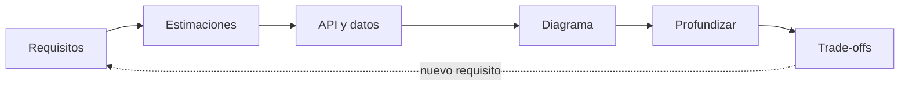

# Diseño de sistemas - cómo abordarlo

Parte de: [[09-Arquitectura-Patrones/05 Diseño de sistemas/_Índice Diseño de sistemas|Diseño de sistemas]]

> [!info] Cómo avanzar
> `progreso`: **pendiente** → **viendo** (estudiando) → **visto** (contestaste la autoevaluación sin abrir las respuestas) → **dominado** (hiciste el laboratorio o lo aplicaste de verdad).

## Contenido

### Qué es
**Diseño de sistemas** es el ejercicio de convertir un problema vago ("haz un acortador de URLs", "un chat") en una arquitectura concreta y justificada: qué componentes hay, cómo se comunican, dónde viven los datos y qué pasa cuando algo falla o la carga crece. Se practica en entrevistas senior, pero sobre todo sirve en el trabajo diario para tomar decisiones que luego documentarás en un [[ADR - registro de decisiones de arquitectura|ADR]].

### Cómo funciona
Un método en seis pasos, en este orden (no te saltes los primeros):

1. **Aclarar requisitos.** Funcionales (qué hace) y no funcionales (qué tan bien: latencia, disponibilidad, consistencia, costo). Pregunta escala, proporción lectura/escritura y qué queda fuera. Ver [[Requisitos funcionales y no funcionales]].
2. **Estimar.** Peticiones por segundo promedio y pico, almacenamiento a N años, ancho de banda, memoria de caché. Ver [[Estimaciones rápidas (carga, almacenamiento y costo)]].
3. **API y modelo de datos.** Endpoints principales con sus entradas y salidas; tablas o documentos con su clave de acceso.
4. **Diseño de alto nivel.** Un diagrama con cliente, balanceador, API, base, caché, colas y workers. Empieza simple: lo mínimo que cumple los requisitos.
5. **Profundizar** en 1 o 2 componentes críticos: generación de ids, fan-out, idempotencia, particionamiento, consistencia.
6. **Cuellos de botella, fallos y trade-offs.** ¿Qué se cae primero si la carga se multiplica por 10? ¿Qué pasa si muere la caché o el broker? ¿Qué sacrificaste y por qué?



**Cómo justificar una decisión**: átala a un requisito y nombra lo que pierdes. "Uso caché con TTL de 1 minuto porque las lecturas son 100:1 y el negocio tolera datos con un minuto de retraso; a cambio, un cambio de URL tarda hasta un minuto en verse". Una decisión sin requisito detrás es una preferencia; una decisión sin costo declarado es ingenua.

Piezas que reaparecen en casi todos los casos y que conviene dominar:
- Balanceador y API sin estado → [[Escalabilidad horizontal y vertical]].
- Caché → [[Cache-aside y estrategias de caché]].
- Colas y workers → [[Competing consumers]], [[Backpressure]].
- Datos a escala → [[Replicación y réplicas de lectura]], [[Sharding y particionamiento]].
- Coordinación → [[Locks distribuidos y relojes]].

### Ejemplo
Plantilla de 45 minutos para practicar los casos de esta sección ([[Caso - acortador de URLs]], [[Caso - rate limiter]], [[Caso - feed de noticias]], [[Caso - chat en tiempo real]], [[Caso - sistema de notificaciones]], [[Caso - sistema de pagos]], [[Caso - subida y procesamiento de archivos]]):

```text
00–05  Requisitos: 3–5 funcionales, 3–5 no funcionales con números, fuera de alcance
05–10  Estimaciones: QPS promedio y pico, almacenamiento 5 años, memoria de caché
10–15  API (3–4 endpoints) y modelo de datos (tablas con PK e índices)
15–25  Diagrama de alto nivel en Mermaid
25–38  Profundizar en 2 componentes
38–45  Fallos, cuellos de botella y trade-offs; qué cambiaría a 10x
```

Traducido al stack del usuario, un diseño típico queda: React (Itzamna.Clio) → Azure Front Door → ASP.NET Core en App Service o Container Apps (sin estado, varias instancias) → Azure SQL con procedimientos vía Dapper → Redis (Azure Managed Redis) como caché → Service Bus para trabajo asíncrono → workers en Container Apps o Functions.

### Cuándo usarlo y cuándo no
- Úsalo antes de construir cualquier cosa que cruce varios componentes, que tenga requisitos de escala o que sea difícil de revertir.
- Para un CRUD interno de 20 usuarios, los pasos 1–3 bastan; no dibujes shards que nunca vas a necesitar.
- El resultado de un diseño importante se vuelve un [[Design docs y RFCs|design doc]] y sus decisiones clave, ADRs en el `ARQUITECTURA.md` del repo.

### Errores comunes
- **Dibujar antes de preguntar.** Sin requisitos ni números no sabes si necesitas caché, colas o sharding; terminas con un diagrama genérico.
- **Sobre-diseñar.** Microservicios, Kafka y sharding para 40 escrituras por segundo.
- **Ignorar fallos.** Un diseño que solo funciona cuando todo funciona no es un diseño.
- **No declarar trade-offs.** Toda decisión sacrifica algo; si no lo dices, parece que no lo viste.
- **Profundizar en lo fácil.** Gastar 15 minutos en el balanceador y nada en la idempotencia de pagos.

### Para profundizar
- [Azure Architecture Center](https://learn.microsoft.com/azure/architecture/)
- [Azure Well-Architected Framework](https://learn.microsoft.com/azure/well-architected/)
- [System Design Primer (GitHub)](https://github.com/donnemartin/system-design-primer)

## Autoevaluación

Contesta primero en voz alta o en papel; luego despliega la respuesta.

> [!question]- ¿Cuáles son los pasos de un diseño de sistemas?
> 1) Aclarar requisitos funcionales y no funcionales. 2) Estimar carga y datos. 3) API y modelo de datos. 4) Diseño de alto nivel (diagrama). 5) Profundizar en 1–2 componentes críticos. 6) Cuellos de botella, fallos y trade-offs.

> [!question]- ¿Qué error es el más común al empezar?
> Dibujar componentes antes de preguntar: sin requisitos ni escala no sabes si necesitas caché, colas o sharding.

> [!question]- ¿Cómo justificas una decisión?
> Atándola a un requisito y diciendo qué se sacrifica: "uso caché porque lecturas 100:1 y toleramos 1 min de datos viejos".

## Práctica

- [[Lab 4 - Diseño e implementación de un rate limiter]]

