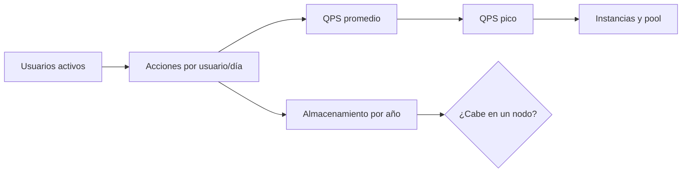

# Estimaciones rápidas (carga, almacenamiento y costo)

Parte de: [[09-Arquitectura-Patrones/05 Diseño de sistemas/_Índice Diseño de sistemas|Diseño de sistemas]]

> [!info] Cómo avanzar
> `progreso`: **pendiente** → **viendo** (estudiando) → **visto** (contestaste la autoevaluación sin abrir las respuestas) → **dominado** (hiciste el laboratorio o lo aplicaste de verdad).

## Contenido

### Qué es
Las **estimaciones rápidas** (*back-of-the-envelope*) son cálculos aproximados de tráfico, almacenamiento, memoria y costo que se hacen en minutos para decidir el **orden de magnitud** de un diseño. No buscan precisión: buscan saber si algo cabe en una base, si necesitas caché o si hace falta particionar. Un factor 10 cambia la arquitectura; un 20% casi nunca.

### Cómo funciona
**Constantes que conviene memorizar:**
- Un día tiene 86,400 s; se redondea a **~10^5 s**. Así, 1 millón por día ≈ 12 por segundo.
- Un mes ≈ 2.6 millones de segundos; un año ≈ 31.5 millones (≈ 3 × 10^7).
- 1 KB = 10^3 B, 1 MB = 10^6, 1 GB = 10^9, 1 TB = 10^12 (en estimación se usan potencias de 10).

**Fórmulas base:**
- **QPS promedio** = eventos por día / 86,400.
- **QPS pico** = promedio × factor de pico (típico 2 a 10; pregunta o asume y dilo).
- **Almacenamiento** = registros por periodo × tamaño por registro × periodos × factor de réplica.
- **Ancho de banda** = QPS × tamaño de respuesta.
- **Memoria de caché**: regla 80/20, cachear el 20% más consultado de lo que se lee en un día.
- **Ley de Little**: L = λ × W. Peticiones concurrentes = tasa de llegada × tiempo en el sistema. Sirve para dimensionar pools de conexiones, hilos e instancias.

**Por qué el pico y no el promedio:** la capacidad se dimensiona para el peor momento razonable (quincena, Buen Fin, cierre de mes). Un sistema dimensionado al promedio se cae justo cuando más importa.



### Ejemplo
Itzamna.Dionisio registra eventos de auditoría: 200,000 usuarios activos, 50 eventos por usuario al día, 1 KB por evento, retención 3 años, pico 5×.

```python
usuarios, eventos, kb = 200_000, 50, 1
dia = usuarios * eventos                 # 10 M eventos/día
qps = dia / 86_400                       # ≈ 116/s promedio
pico = qps * 5                           # ≈ 580/s
almacen_tb = dia * kb * 1e3 * 365 * 3 / 1e12   # ≈ 11 TB en 3 años
concurrentes = pico * 0.05               # Little con 50 ms por inserción ≈ 29
print(round(qps), round(pico), round(almacen_tb, 1), round(concurrentes))
```

Conclusiones que salen de ahí: 580 inserciones por segundo las aguanta una Azure SQL bien dimensionada; 11 TB en tres años sugieren tabla particionada por fecha, compresión y mover lo viejo a almacenamiento frío; el pool de conexiones de cada instancia con unas 30 conexiones concurrentes es suficiente.

**Costo**: con las cantidades estimadas (vCores, GB, operaciones, salida de red) se arma un presupuesto en la calculadora de precios de Azure. Los precios cambian por región y fecha; no los memorices, consúltalos al momento.

### Cuándo usarlo y cuándo no
- Al inicio de todo diseño, después de los requisitos ([[Diseño de sistemas - cómo abordarlo]]).
- Para justificar en un ADR por qué **no** necesitas sharding o Kafka: "39 escrituras/s caben en una base".
- No la uses como sustituto de pruebas de carga: la estimación dice si vas por el camino correcto; la prueba confirma.
- Escribe los supuestos (factor de pico, tamaño por registro) para que otros puedan corregirlos.

### Errores comunes
- **Confundir bits y bytes** o KB decimales y binarios; en estimación, potencias de 10 y bytes.
- **Olvidar réplicas, índices y backups**: el almacenamiento real suele ser 2–3× el de los datos crudos.
- **Promediar todo**: usar QPS promedio para dimensionar.
- **Exceso de precisión**: calcular hasta el decimal en vez de redondear y avanzar.
- **No validar el resultado con sentido común**: si te salen 3 millones de QPS para una app interna, revisa las unidades.

### Para profundizar
- [Calculadora de precios de Azure](https://azure.microsoft.com/pricing/calculator/)
- [System Design Primer: estimaciones y números útiles](https://github.com/donnemartin/system-design-primer)
- [Azure Well-Architected: eficiencia de rendimiento y planeación de capacidad](https://learn.microsoft.com/azure/well-architected/performance-efficiency/)

## Ejercicios

Resuélvelos en papel o en la herramienta; la solución está plegada.

> [!question]- 100 millones de URLs nuevas al mes; lecturas 100:1. ¿Escrituras y lecturas por segundo promedio?
> Mes ≈ 2.59 M s. 100 M / 2.59 M ≈ **39 escrituras/s**; ×100 ≈ **3,900 lecturas/s**.

> [!question]- Cada registro ocupa 500 bytes. ¿Almacenamiento para 5 años con 100 M/mes?
> 100 M × 12 × 5 = 6,000 M registros × 500 B = **3 TB**.

> [!question]- 50 millones de notificaciones al día, pico 5× el promedio. ¿Tasa promedio y pico?
> 50 M / 86,400 ≈ **579/s**; pico ≈ **2,900/s**.

> [!question]- Rate limiter con 10 M de usuarios activos y ~50 bytes de estado por usuario. ¿Memoria?
> 10 M × 50 B = **500 MB**: cabe en un nodo de Redis (con réplica para disponibilidad).

> [!question]- Ley de Little: 200 req/s con latencia media de 0.5 s. ¿Cuántas peticiones simultáneas en vuelo?
> L = λ·W = 200 × 0.5 = **100** concurrentes (dimensiona pools e hilos con eso).

## Autoevaluación

Contesta primero en voz alta o en papel; luego despliega la respuesta.

> [!question]- ¿Cuántos segundos tiene un día y qué atajo se usa?
> 86,400 s; se redondea a ~10^5. Así, 1 millón/día ≈ 12/s.

> [!question]- ¿Para qué sirve una estimación si es aproximada?
> Para decidir el orden de magnitud: ¿cabe en una base? ¿necesito caché? ¿sharding? Un factor 10 cambia el diseño; un 20% no.

> [!question]- ¿Por qué estimar el pico y no solo el promedio?
> La capacidad se dimensiona para el pico (a menudo 2–10× el promedio).

## Práctica

- [[Lab 4 - Diseño e implementación de un rate limiter]]

