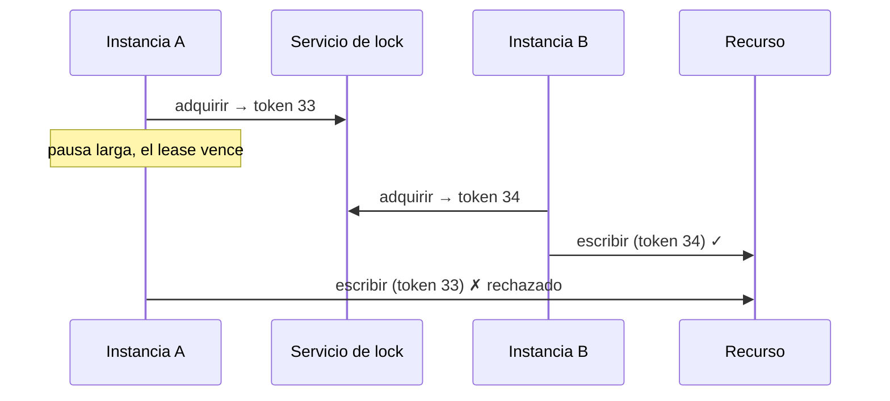

# Locks distribuidos y relojes

Parte de: [[09-Arquitectura-Patrones/05 Diseño de sistemas/_Índice Diseño de sistemas|Diseño de sistemas]]

> [!info] Cómo avanzar
> `progreso`: **pendiente** → **viendo** (estudiando) → **visto** (contestaste la autoevaluación sin abrir las respuestas) → **dominado** (hiciste el laboratorio o lo aplicaste de verdad).

## Contenido

### Qué es
Un **lock distribuido** garantiza que, entre varias instancias de una aplicación, solo una ejecute cierta tarea a la vez: el job nocturno de conciliación, la regeneración de una caché, el procesamiento de un pedido específico. Con una sola instancia bastaría un `lock` o `SemaphoreSlim`; con 5 réplicas del API en Azure Container Apps, la exclusión tiene que vivir en un recurso compartido.

Los **relojes** entran en el tema porque coordinar procesos en máquinas distintas obliga a preguntarse "¿qué pasó primero?", y los relojes físicos no son confiables para responderlo.

### Cómo funciona
Implementaciones comunes:
- **Base de datos**: en SQL Server, `sp_getapplock` toma un lock con nombre ligado a la transacción o a la sesión; o una tabla de *leases* con `PropietarioId` y `ExpiraEn` actualizada de forma atómica.
- **Redis**: `SET clave valor NX PX 30000` (solo si no existe, con expiración). Se libera borrando la clave solo si el valor sigue siendo el tuyo.
- **Blob lease** en Azure Storage: un *lease* exclusivo de 15 a 60 segundos (o infinito) sobre un blob.
- **Sistemas de coordinación** (etcd, ZooKeeper) cuando la corrección es crítica.

Dos ingredientes obligatorios:

1. **Expiración (lease).** Si el dueño muere sin liberar, el lock debe vencer solo; si no, nadie más podría ejecutar la tarea nunca.
2. **Fencing token.** La expiración crea un problema nuevo: un proceso se pausa (GC largo, VM congelada), su lock vence, otro lo toma, y el primero "despierta" creyendo que aún es el dueño. Solución: cada vez que se otorga el lock se entrega un número creciente; el recurso protegido rechaza escrituras con un token menor al último que vio.



**Relojes.** Los relojes de distintas máquinas se desfasan y NTP puede ajustarlos hacia atrás o adelante. Por eso no se ordenan eventos de varias máquinas con `DateTime.UtcNow`:
- **Relojes lógicos de Lamport**: un contador que cada proceso incrementa y que se lleva al máximo visto + 1 al recibir un mensaje; da un orden consistente con la causalidad.
- **Relojes vectoriales**: detectan además eventos concurrentes.
- En la práctica: secuencias de la base, offsets de [[Kafka]] por partición, números de secuencia asignados por un servidor único por conversación o entidad.

### Ejemplo
Job de conciliación en Itzamna.Dionisio con `sp_getapplock`, para que solo una instancia lo ejecute:

```csharp
public sealed class ConciliacionJob(IDbConnectionFactory db, IConciliador conciliador, ILogger<ConciliacionJob> log)
{
    public async Task EjecutarAsync(CancellationToken ct)
    {
        await using var cn = await db.AbrirAsync(ct);
        await using var tx = await cn.BeginTransactionAsync(ct);

        var p = new DynamicParameters();
        p.Add("@Resource", "job-conciliacion");
        p.Add("@LockMode", "Exclusive");
        p.Add("@LockOwner", "Transaction");
        p.Add("@LockTimeout", 0); // no esperar: si otro lo tiene, salir
        p.Add("@Resultado", dbType: DbType.Int32, direction: ParameterDirection.ReturnValue);
        await cn.ExecuteAsync("sp_getapplock", p, tx, commandType: CommandType.StoredProcedure);

        if (p.Get<int>("@Resultado") < 0)
        {
            log.LogInformation("Otra instancia está conciliando");
            return;
        }
        await conciliador.EjecutarAsync(cn, tx, ct);
        await tx.CommitAsync(ct); // libera el lock al terminar la transacción
    }
}
```

Fencing en la propia base: `UPDATE Recursos SET ..., UltimoToken = @Token WHERE Id = @Id AND UltimoToken < @Token`; si afecta 0 filas, tu lock ya no era válido.

### Cuándo usarlo y cuándo no
- **Úsalo** para jobs programados que no deben correr dos veces, migraciones de datos, o para serializar el trabajo sobre una entidad.
- **Evítalo** si puedes diseñar sin él: un consumidor idempotente, una cola con sesiones por entidad (Service Bus sessions), o concurrencia optimista con `rowversion` suelen ser más simples y robustos.
- Si el lock protege **corrección** (dinero, inventario), necesitas fencing; si solo evita trabajo duplicado (eficiencia), una expiración puede bastar.

### Errores comunes
- **Lock sin expiración**: un proceso caído bloquea para siempre.
- **Expiración sin fencing** en operaciones críticas: dos dueños simultáneos tras una pausa.
- **Liberar el lock de otro**: borrar la clave en Redis sin verificar que el valor es el tuyo.
- **Ordenar eventos por la hora de cada servidor** o, peor, del cliente.
- **Mantener el lock durante llamadas lentas a terceros**, alargando el tiempo crítico.

### Para profundizar
- [SQL Server: sp_getapplock](https://learn.microsoft.com/sql/relational-databases/system-stored-procedures/sp-getapplock-transact-sql)
- [Martin Kleppmann: How to do distributed locking](https://martin.kleppmann.com/2016/02/08/how-to-do-distributed-locking.html)
- [Leslie Lamport: Time, Clocks, and the Ordering of Events (PDF)](https://lamport.azurewebsites.net/pubs/time-clocks.pdf)
- [Patrón Leader Election (Azure Architecture Center)](https://learn.microsoft.com/azure/architecture/patterns/leader-election)

## Autoevaluación

Contesta primero en voz alta o en papel; luego despliega la respuesta.

> [!question]- ¿Para qué sirve un lock distribuido?
> Para que solo una instancia ejecute algo a la vez (un job programado, procesar una entidad). Se implementa con Redis, la base (`sp_getapplock`, filas con lease), blob leases o ZooKeeper/etcd.

> [!question]- ¿Por qué un lock necesita expiración y *fencing token*?
> Expiración: si el dueño muere, el lock se libera. Fencing token: si un proceso pausado cree que aún tiene el lock vencido, el recurso rechaza su escritura por tener un token menor al último visto.

> [!question]- ¿Por qué no confiar en relojes de distintas máquinas para ordenar eventos?
> Se desfasan y pueden saltar (NTP). Para orden se usan relojes lógicos (Lamport, vectoriales), secuencias del broker o de la base.

