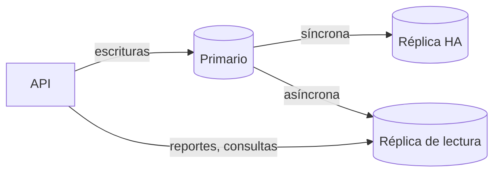

# Replicación y réplicas de lectura

Parte de: [[09-Arquitectura-Patrones/05 Diseño de sistemas/_Índice Diseño de sistemas|Diseño de sistemas]]

> [!info] Cómo avanzar
> `progreso`: **pendiente** → **viendo** (estudiando) → **visto** (contestaste la autoevaluación sin abrir las respuestas) → **dominado** (hiciste el laboratorio o lo aplicaste de verdad).

## Contenido

### Qué es
**Replicar** es mantener copias de los mismos datos en varios nodos. En el esquema más común, **primario-réplica** (antes "maestro-esclavo"), un nodo primario recibe todas las escrituras y las propaga a una o más réplicas. Las réplicas sirven para dos cosas: **disponibilidad** (si cae el primario, una réplica toma su lugar: *failover*) y **escala de lectura** (repartir consultas de solo lectura entre varias copias).

### Cómo funciona
El primario escribe en su log de transacciones y envía esos cambios a las réplicas, que los aplican en el mismo orden. La gran diferencia está en **cuándo confirma** el primario al cliente:

- **Síncrona**: el commit espera a que al menos una réplica confirme que recibió el cambio. No se pierde nada en un failover, pero cada escritura paga la latencia de red a la réplica.
- **Asíncrona**: el commit no espera. Las escrituras son rápidas, pero la réplica va con **retraso** (*replication lag*) y un failover puede perder las últimas transacciones.



**El problema de leer de réplicas asíncronas:** lecturas viejas. El usuario guarda su perfil, la siguiente pantalla consulta la réplica y ve el dato anterior. Soluciones:
- **Read-your-writes**: leer del primario lo que el mismo usuario acaba de escribir (por un tiempo o por marca de sesión).
- Mandar a réplicas solo lo que tolera retraso: reportes, búsquedas, dashboards.
- Ver [[Modelos de consistencia (fuerte, eventual, read-your-writes)]].

**SQL Server**: los grupos de disponibilidad Always On tienen réplicas en modo *synchronous-commit* (para alta disponibilidad con failover automático) o *asynchronous-commit* (típico en otra región), y las secundarias pueden configurarse como legibles.

**Azure SQL Database**: los niveles Premium y Business Critical (y Hyperscale con al menos una réplica secundaria) incluyen **read scale-out**: agregas `ApplicationIntent=ReadOnly` a la cadena de conexión y la conexión va a una réplica de solo lectura. Esa réplica es siempre asíncrona respecto al primario; el retraso típico va de decenas de milisegundos a pocos segundos, sin un máximo garantizado. En niveles General Purpose se usa geo-replicación para tener secundarias legibles.

### Ejemplo
En Wee.Reporteria, los reportes pesados van a la réplica para no competir con las transacciones del API:

```csharp
public sealed class ConexionesSql(IConfiguration cfg) : IConexionesSql
{
    // Misma base, distinta intención: Azure SQL enruta a la réplica de solo lectura
    public SqlConnection Escritura() => new(cfg.GetConnectionString("Principal"));
    public SqlConnection Lectura() => new(new SqlConnectionStringBuilder(cfg.GetConnectionString("Principal"))
    {
        ApplicationIntent = ApplicationIntent.ReadOnly
    }.ConnectionString);
}

public sealed class VentasPorSucursalQuery(IConexionesSql db) : IVentasPorSucursalQuery
{
    public async Task<IReadOnlyList<VentaSucursal>> EjecutarAsync(DateOnly desde, DateOnly hasta, CancellationToken ct)
    {
        await using var cn = db.Lectura(); // tolera segundos de retraso
        var filas = await cn.QueryAsync<VentaSucursal>(new CommandDefinition(
            Sql.VentasPorSucursal, new { desde, hasta }, cancellationToken: ct));
        return filas.AsList();
    }
}
```

Para comprobar a dónde quedaste conectado: `SELECT DATABASEPROPERTYEX(DB_NAME(), 'Updateability');` devuelve `READ_ONLY` en la réplica.

Regla del slice: cada consulta decide explícitamente si usa `Lectura()` o `Escritura()`; las pantallas que muestran lo que el usuario acaba de guardar usan el primario.

### Cuándo usarlo y cuándo no
- **Réplicas para disponibilidad**: casi siempre en producción (en Azure SQL viene incluido según el nivel).
- **Réplicas de lectura**: cuando las lecturas dominan y las consultas pesadas (reportes, exportaciones) afectan al transaccional.
- **No resuelven escrituras**: si el cuello de botella es escribir, necesitas optimizar, colas o [[Sharding y particionamiento]].
- Antes de agregar réplicas, revisa índices y caché: suelen ser más baratos.

### Errores comunes
- **Leer de la réplica justo después de escribir** y reportar "bugs" de datos que "no se guardaron".
- **Asumir que la réplica es un respaldo.** Si borras una tabla, la réplica la borra también; los backups y el point-in-time restore son otra cosa.
- **Mandar todo a réplicas** sin revisar qué consultas toleran retraso.
- **No monitorear el retraso**: una réplica que se queda minutos atrás convierte lecturas "casi actuales" en datos viejos.

### Para profundizar
- [Azure SQL: réplicas de solo lectura (read scale-out)](https://learn.microsoft.com/azure/azure-sql/database/read-scale-out)
- [SQL Server: grupos de disponibilidad Always On](https://learn.microsoft.com/sql/database-engine/availability-groups/windows/overview-of-always-on-availability-groups-sql-server)
- [Azure SQL: geo-replicación activa](https://learn.microsoft.com/azure/azure-sql/database/active-geo-replication-overview)

## Autoevaluación

Contesta primero en voz alta o en papel; luego despliega la respuesta.

> [!question]- ¿Qué es la replicación primario-réplica?
> Un nodo primario recibe las escrituras y las propaga a réplicas que sirven lecturas (y sirven de respaldo para failover).

> [!question]- Síncrona vs asíncrona.
> Síncrona: el commit espera a la réplica (sin pérdida, más latencia). Asíncrona: el commit no espera (rápido; la réplica tiene retraso y un failover puede perder lo último).

> [!question]- ¿Qué problema trae leer de réplicas asíncronas?
> Lecturas viejas; el usuario no ve lo que acaba de escribir. Ver [[Modelos de consistencia (fuerte, eventual, read-your-writes)]].

> [!question]- Ejemplo en SQL Server / Azure SQL.
> Grupos de disponibilidad Always On con réplicas secundarias legibles; en Azure SQL, réplicas de lectura con `ApplicationIntent=ReadOnly` en la cadena de conexión (según el nivel de servicio).

