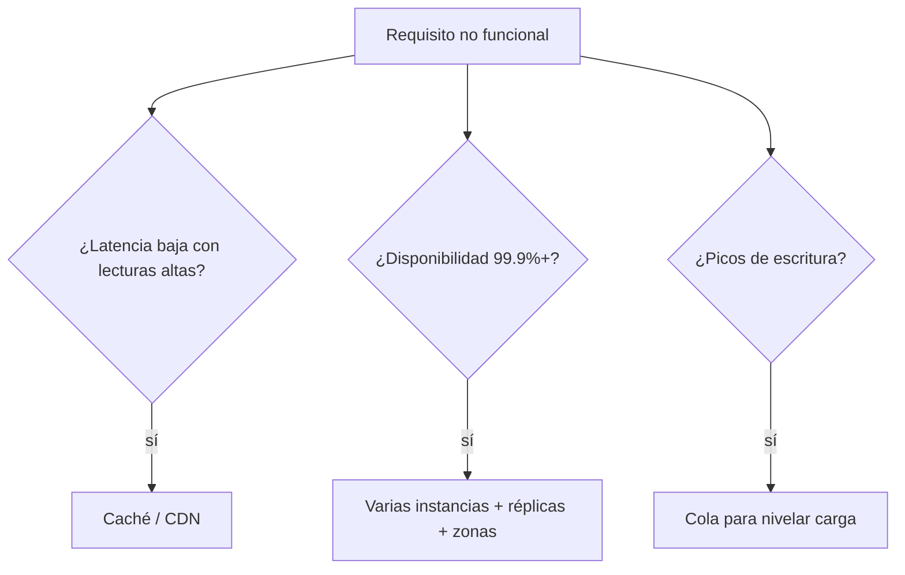

# Requisitos funcionales y no funcionales

Parte de: [[09-Arquitectura-Patrones/05 Diseño de sistemas/_Índice Diseño de sistemas|Diseño de sistemas]]

> [!info] Cómo avanzar
> `progreso`: **pendiente** → **viendo** (estudiando) → **visto** (contestaste la autoevaluación sin abrir las respuestas) → **dominado** (hiciste el laboratorio o lo aplicaste de verdad).

## Contenido

### Qué es
Los **requisitos funcionales** dicen **qué** hace el sistema: "el usuario acorta una URL", "el administrador descarga el reporte en Excel". Los **no funcionales** (atributos de calidad) dicen **qué tan bien** lo hace: latencia, throughput, disponibilidad, durabilidad, consistencia, seguridad, costo, mantenibilidad. Los funcionales definen las piezas; los no funcionales definen la **arquitectura**, porque son los que obligan a meter caché, réplicas, colas o sharding.

### Cómo funciona
**Funcionales**: escríbelos como acciones de un actor, pocos y priorizados. En diseño de sistemas, 3 a 5 bastan; lo demás va a "fuera de alcance".

**No funcionales**: deben ser **medibles**. Un requisito que no se puede probar no sirve para decidir. Transforma frases vagas en números:

| Vago | Medible |
|---|---|
| "Debe aguantar mucho tráfico" | 10,000 lecturas/s en pico, 500 escrituras/s |
| "Debe ser rápido" | p99 < 100 ms en la redirección, p95 < 300 ms en el API |
| "Siempre disponible" | 99.9% mensual (≈ 43 min de caída al mes) |
| "No perder datos" | RPO = 0 para pagos, RPO ≤ 5 min para analítica |
| "Seguro" | Datos aislados por tenant; tokens RS256 de 15 min; secretos en Key Vault |

Usa percentiles (p95, p99) y no promedios: el promedio esconde a los usuarios que esperan 3 segundos.

Algunos atributos chocan entre sí, y elegir es diseñar ([[Atributos de calidad y trade-offs]]):
- Consistencia fuerte vs disponibilidad y latencia ([[Consistencia eventual y teorema CAP]]).
- Costo vs redundancia.
- Simplicidad vs escalabilidad extrema.

**Preguntas que siempre conviene hacer** (en una entrevista o con negocio):
1. ¿Cuántos usuarios y cuánta actividad por usuario? ¿Cómo crece?
2. ¿Proporción lectura/escritura?
3. ¿Qué latencia es aceptable y en qué operación?
4. ¿Qué tan consistente debe ser? ¿Se tolera ver datos de hace unos segundos?
5. ¿Cuánto tiempo se conservan los datos?
6. ¿Una región o varias? ¿Usuarios en qué países?
7. ¿Qué queda explícitamente fuera?



### Ejemplo
Requisitos de Wee.Reporteria (reportes en Excel):

```markdown
### Funcionales
- El usuario solicita un reporte con filtros (fecha, sucursal).
- El sistema genera el Excel y avisa cuando está listo.
- El usuario descarga reportes de los últimos 30 días.

### No funcionales
- Solicitud responde en < 300 ms (p95); la generación puede tardar hasta 2 min.
- Reportes de hasta 500 k filas sin agotar memoria del API.
- 99.5% de disponibilidad mensual en horario laboral (México).
- Archivos privados por tenant; enlace de descarga válido 15 min.

### Fuera de alcance
- Reportes en tiempo real; edición del Excel en línea.
```

Solo con esto ya se deduce la arquitectura: generación asíncrona en un worker (por la latencia y la memoria), Blob Storage con URL firmada (por la privacidad) y notificación al terminar.

En ASP.NET Core, algunos NFR se vuelven código verificable: un `TimeoutPolicy`, un límite de tamaño de petición (`MaxRequestBodySize`), una política de rate limiting o una prueba de carga en el pipeline de Azure DevOps que falle si el p95 supera el umbral.

### Cuándo usarlo y cuándo no
- Siempre al inicio de un diseño, de un design doc o de una funcionalidad grande.
- Para un ajuste menor, basta con confirmar que no cambian los NFR existentes.
- Revisa los NFR cuando cambie el negocio (nuevo país, 10x usuarios): son la razón para cambiar la arquitectura, y ese cambio merece un ADR.

### Errores comunes
- **NFR sin número**: "escalable" o "rápido" no permiten decidir ni probar.
- **Copiar 99.999%** sin saber que son ~26 segundos de caída al mes y cuánto cuesta.
- **Olvidar el costo** como requisito: la solución "correcta" que el cliente no puede pagar no lo es.
- **Mezclar soluciones con requisitos**: "usar Redis" no es un requisito; "p99 < 50 ms" sí.
- **No escribir lo que queda fuera**, y descubrir a mitad del proyecto que todos esperaban algo distinto.

### Para profundizar
- [Azure Well-Architected Framework: pilares](https://learn.microsoft.com/azure/well-architected/pillars)
- [Azure: objetivos de confiabilidad y SLO](https://learn.microsoft.com/azure/well-architected/reliability/metrics)
- [System Design Primer (GitHub)](https://github.com/donnemartin/system-design-primer)

## Autoevaluación

Contesta primero en voz alta o en papel; luego despliega la respuesta.

> [!question]- Diferencia entre ambos.
> Funcionales: qué hace el sistema ("el usuario acorta una URL"). No funcionales: cómo de bien (latencia, disponibilidad, durabilidad, seguridad, costo).

> [!question]- Convierte "debe aguantar mucho tráfico" en algo útil.
> "10 k lecturas/s en pico, p99 < 100 ms, 99.9% de disponibilidad mensual".

> [!question]- ¿Qué preguntas haces siempre en una entrevista?
> Usuarios y volumen, proporción lectura/escritura, latencia aceptable, consistencia requerida, retención de datos, regiones, qué está fuera de alcance.

## Práctica

- [[Lab 4 - Diseño e implementación de un rate limiter]]

