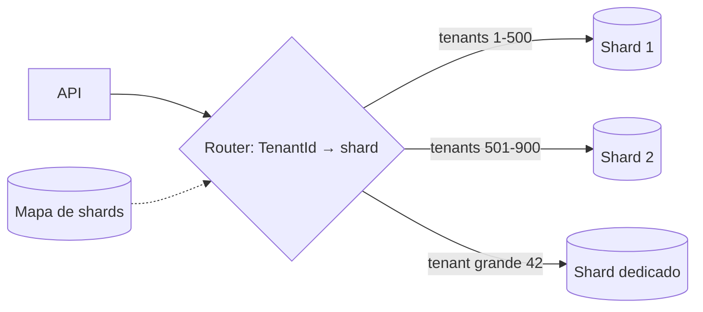

# Sharding y particionamiento

Parte de: [[09-Arquitectura-Patrones/05 Diseño de sistemas/_Índice Diseño de sistemas|Diseño de sistemas]]

> [!info] Cómo avanzar
> `progreso`: **pendiente** → **viendo** (estudiando) → **visto** (contestaste la autoevaluación sin abrir las respuestas) → **dominado** (hiciste el laboratorio o lo aplicaste de verdad).

## Contenido

### Qué es
**Particionar** es dividir un conjunto de datos grande en partes más pequeñas. Cuando esas partes viven en **servidores distintos**, se llama **sharding**: cada shard es una base independiente con un subconjunto de las filas (división horizontal), elegido por una **clave de shard**. Sirve para repartir escrituras, almacenamiento y carga que ya no caben en un solo nodo, incluso después de optimizar y agregar [[Replicación y réplicas de lectura|réplicas de lectura]].

No confundir con el particionamiento de tablas de SQL Server (*partition function / partition scheme*): divide una tabla dentro de **la misma** base para facilitar mantenimiento y eliminar particiones viejas, pero no reparte la carga entre servidores.

### Cómo funciona
**Estrategias de asignación:**
- **Por rango**: `TenantId 1–1000 → shard A`, fechas de 2025 → shard B. Las consultas por rango son eficientes, pero hay riesgo de *hot spot* (todas las escrituras de hoy caen en el último shard).
- **Por hash**: `shard = hash(clave) mod N`. Distribuye de forma uniforme, pero una consulta por rango debe ir a todos los shards. Problema: al cambiar N casi todas las claves cambian de shard.
- **Hashing consistente**: claves y shards en un anillo; al agregar un shard solo se mueve la fracción que le toca (≈ 1/N).
- **Por directorio (lookup)**: una tabla `Tenant → Shard`. Máxima flexibilidad (mover un tenant grande a su propio shard) a cambio de una búsqueda extra y un componente más que debe estar disponible.



**Cómo elegir la clave:**
1. Que la **mayoría de las consultas** la incluyan (si no, cada consulta va a todos los shards: *scatter-gather*).
2. Que reparta la carga de forma **uniforme**.
3. Que no genere **hot spots**: la fecha de creación es mala clave para escrituras; `TenantId` es buena si los tenants son parecidos (y si uno es gigante, va a su propio shard).
4. Que mantenga juntos los datos que se usan juntos (pedido y sus líneas en el mismo shard).

**Lo que se complica:**
- *Joins* y transacciones entre shards (evítalos con buena clave; si no, sagas: [[Patrón Saga]]).
- Reequilibrar al agregar shards.
- Ids únicos globales (GUID, secuencias por rango, o ids tipo Snowflake).
- Operación: migraciones de esquema en N bases, backups, monitoreo.

### Ejemplo
Router por directorio en un SaaS multi-tenant (Pochteca.Nomisma con Postgres, o cualquier API con Dapper):

```csharp
public sealed class ShardRouter(IMemoryCache cache, IMapaShards mapa)
{
    public async Task<string> CadenaParaAsync(int tenantId, CancellationToken ct) =>
        (await cache.GetOrCreateAsync($"shard:{tenantId}", async e =>
        {
            e.AbsoluteExpirationRelativeToNow = TimeSpan.FromMinutes(5);
            return await mapa.BuscarAsync(tenantId, ct); // tabla Tenant → cadena de conexión
        }))!;
}
```

Por qué `hash mod N` es frágil, verificado con Python:

```python
claves = range(1_000_000)
movidas = sum(1 for k in claves if k % 4 != k % 5)
print(movidas / len(claves))   # 0.8 → 80% de las claves cambia de shard al pasar de 4 a 5
```

En Azure: Azure SQL tiene la *Elastic Database client library* para mapas de shards; Azure Cosmos DB particiona automáticamente por la *partition key* que elijas; Azure SQL Hyperscale crece en almacenamiento y lectura sin que la aplicación administre shards, aunque sigue teniendo un solo primario para escrituras.

### Cuándo usarlo y cuándo no
- **Úsalo** cuando las escrituras o el tamaño ya no caben en el nodo más grande razonable, o cuando necesitas aislar tenants grandes.
- **No lo uses** como primera herramienta: antes van índices, consultas, caché, réplicas, archivado de datos viejos y escalar verticalmente. El sharding es caro de operar y difícil de revertir: merece un ADR.
- Si eliges base por tenant desde el inicio ([[Multi-tenancy]]), ya tienes una forma de sharding por directorio.

### Errores comunes
- **Clave que no está en las consultas**: todo se vuelve scatter-gather.
- **Clave monótona** (fecha, id autoincremental) con rango: un shard recibe todas las escrituras.
- **`mod N` sin plan de reequilibrio**: agregar un shard obliga a mover casi todo.
- **Shardear demasiado pronto** y pagar la complejidad sin necesidad.
- **Olvidar las consultas globales** (reportes de todos los tenants): planea un almacén analítico aparte.

### Para profundizar
- [Patrón Sharding (Azure Architecture Center)](https://learn.microsoft.com/azure/architecture/patterns/sharding)
- [Azure Cosmos DB: particionamiento](https://learn.microsoft.com/azure/cosmos-db/partitioning-overview)
- [Azure SQL: escalar horizontalmente con Elastic Database](https://learn.microsoft.com/azure/azure-sql/database/elastic-scale-introduction)

## Ejercicios

Resuélvelos en papel o en la herramienta; la solución está plegada.

> [!question]- Con `shard = hash(k) mod 4`, pasas a 5 shards. ¿Qué fracción de claves cambia de shard?
> Solo se quedan las claves con `k mod 4 == k mod 5` → 4 de cada 20 = **20% se quedan, 80% se mueven**. Con *hashing consistente* se movería ~1/5 (≈20%).

## Autoevaluación

Contesta primero en voz alta o en papel; luego despliega la respuesta.

> [!question]- ¿Qué es sharding?
> Dividir los datos horizontalmente entre varias bases (shards) según una clave, para repartir escrituras y almacenamiento.

> [!question]- ¿Cómo eliges la clave de shard?
> Que reparta la carga de forma uniforme, que la mayoría de consultas incluyan esa clave (evitar consultas a todos los shards) y que no genere *hot spots* (p. ej. `TenantId` si los tenants son parecidos; no la fecha).

> [!question]- Por rango vs por hash.
> Rango: consultas por rango eficientes, riesgo de hot spot. Hash: distribución uniforme, rangos costosos.

> [!question]- ¿Qué se complica con sharding?
> Joins y transacciones entre shards, reequilibrar al agregar nodos, unicidad global de ids y operación.

