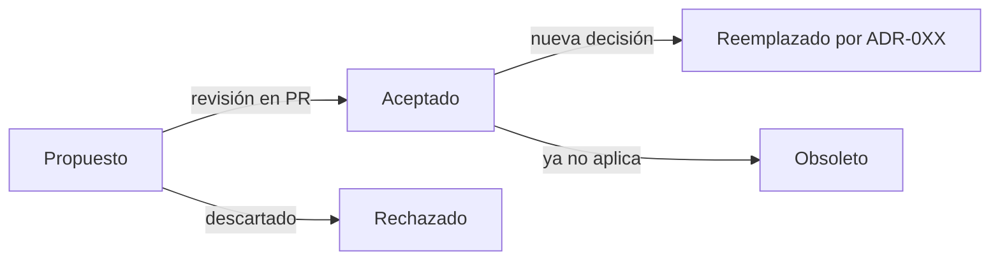

# ADR - registro de decisiones de arquitectura

Parte de: [[09-Arquitectura-Patrones/06 Documentar decisiones/_Índice Documentar decisiones|Documentar decisiones]]

> [!info] Cómo avanzar
> `progreso`: **pendiente** → **viendo** (estudiando) → **visto** (contestaste la autoevaluación sin abrir las respuestas) → **dominado** (hiciste el laboratorio o lo aplicaste de verdad).

## Contenido

### Qué es
Un **ADR** (*Architecture Decision Record*) es un documento corto, de una página o menos, que registra **una** decisión de arquitectura significativa: qué se decidió, en qué contexto, qué alternativas se consideraron y qué consecuencias se aceptan. Lo popularizó Michael Nygard en 2011 con una idea simple: el código dice **qué** hace el sistema, pero no **por qué** se eligió así; sin ese porqué, dentro de un año alguien "arreglará" una decisión deliberada o repetirá una discusión ya resuelta.

En tus repos, los ADRs viven en el `ARQUITECTURA.md` de cada proyecto (Xolotl.Hecate, Itzamna.Dionisio, Itzamna.Clio…), numerados en orden, junto a los diagramas del sistema. Así la decisión viaja con el código, se revisa en el mismo pull request de Azure DevOps y queda en el historial de git.

### Cómo funciona
**Secciones típicas:**
1. **Título** en forma de decisión: "ADR-007: Usar outbox transaccional para publicar eventos".
2. **Fecha y estado**: Propuesto → Aceptado → (más adelante) Reemplazado por ADR-012 u Obsoleto.
3. **Contexto**: las fuerzas en juego. Requisitos, restricciones (equipo de 1–2 personas, presupuesto, plataforma Azure), problemas actuales. Es la sección más importante y la que más se omite.
4. **Decisión**: en voz activa y presente, concreta. "Guardamos cada evento en la tabla `Outbox` dentro de la misma transacción del cambio; un `BackgroundService` los publica a Service Bus".
5. **Consecuencias**: positivas **y negativas**. Lo que ganas, lo que pagas, lo que ahora debes vigilar.
6. **Alternativas consideradas** con el motivo concreto de descarte.

**Ciclo de vida: no se reescriben.** Un ADR aceptado es un registro histórico. Si la decisión cambia, escribes un ADR nuevo que la reemplaza, y al viejo solo le cambias el estado a "Reemplazado por ADR-0XX". Así cualquiera puede reconstruir cómo y por qué evolucionó el sistema.



**¿Qué merece un ADR?** Las decisiones **difíciles de revertir** o que **afectan a muchos**: estilo de arquitectura ([[Vertical Slice Architecture]] vs capas), base de datos, estrategia de [[Multi-tenancy]], mensajería, autenticación (JWT RS256 con PKCE en Xolotl.Hecate), cómo se manejan errores (ProblemDetails con `codigo`), dónde viven los secretos. No merece ADR el nombre de una variable ni la versión de un paquete menor.

### Ejemplo
Un ADR dentro del `ARQUITECTURA.md` de Itzamna.Dionisio:

```markdown
### ADR-004: SQL en archivos .sql con una interfaz por consulta
- Fecha: 2026-11-09
- Estado: Aceptado

#### Contexto
El API usa Dapper con procedimientos en SQL Server. Las consultas en strings de C#
dificultan revisarlas, formatearlas y probarlas; varias features repetían SQL similar.
Equipo pequeño; se prioriza que cada slice sea autocontenido.

#### Decisión
Cada consulta vive en un archivo .sql dentro de su slice (recurso incrustado) y se
expone con una interfaz propia (IObtenerPedidoQuery). Los handlers dependen de la interfaz.

#### Consecuencias
+ SQL legible, con resaltado y revisable en el PR.
+ Cada consulta se prueba y se reemplaza de forma aislada.
- Más archivos e interfaces; requiere un generador o convención para cargarlos.
- Un cambio de esquema obliga a buscar en varios .sql.

#### Alternativas
- EF Core: descartado; el equipo ya domina procedimientos y se necesita control fino del plan.
- Repositorio genérico: descartado; oculta el SQL y crece sin límite.
```

El ADR se agrega en el mismo PR que introduce el cambio; el mensaje del commit lo referencia ("ADR-004: ..."). Lo practicas en [[Lab 5 - Escribir un ADR real en ARQUITECTURA.md]].

### Cuándo usarlo y cuándo no
- Escríbelo **cuando se toma** la decisión, no meses después: el contexto se olvida rápido.
- También vale para decisiones heredadas: un ADR retroactivo "documentamos lo que ya existe y por qué creemos que se hizo así" ayuda a quien llega.
- Si la decisión necesita explorar mucho (varias opciones, riesgos, plan), primero va un [[Design docs y RFCs|design doc]], que luego produce uno o varios ADRs.

### Errores comunes
- **Solo la decisión, sin contexto ni alternativas**: en un año nadie sabrá por qué se descartó lo otro.
- **Editar el ADR viejo** para reflejar la nueva decisión y perder la historia.
- **Consecuencias solo positivas**: si no hay nada negativo, no analizaste lo suficiente.
- **ADRs para todo**: cien registros triviales esconden los diez importantes.
- **ADRs fuera del repo** (en una wiki que nadie actualiza) y desconectados del código.

### Para profundizar
- [Michael Nygard: Documenting Architecture Decisions](https://www.cognitect.com/blog/2011/11/15/documenting-architecture-decisions)
- [ADR GitHub organization: plantillas y herramientas](https://adr.github.io/)
- [Azure Well-Architected: registro de decisiones de arquitectura](https://learn.microsoft.com/azure/well-architected/architect-role/architecture-decision-record)

## Autoevaluación

Contesta primero en voz alta o en papel; luego despliega la respuesta.

> [!question]- ¿Qué es un ADR y qué secciones lleva?
> Un documento corto que registra **una** decisión de arquitectura significativa. Secciones típicas: título, estado (propuesto/aceptado/reemplazado), contexto, decisión, consecuencias (positivas y negativas), alternativas consideradas.

> [!question]- ¿Se edita un ADR aceptado cuando cambia la decisión?
> No se reescribe: se crea uno nuevo que lo reemplaza y se marca el viejo como "Reemplazado por ADR-00X". Así queda la historia del porqué.

> [!question]- ¿Qué decisiones merecen ADR?
> Las difíciles de revertir o que afectan a muchos: estilo de arquitectura, base de datos, estrategia multi-tenant, mensajería, autenticación. No el nombre de una variable.

> [!question]- Error común.
> Escribir solo la decisión sin el contexto ni las alternativas: dentro de un año nadie sabrá por qué se descartó lo otro.

## Práctica

- [[Lab 5 - Escribir un ADR real en ARQUITECTURA.md]]

